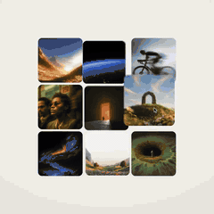
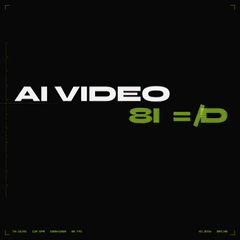
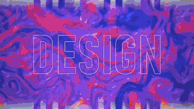
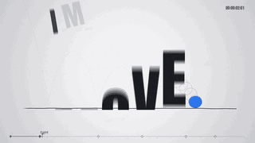
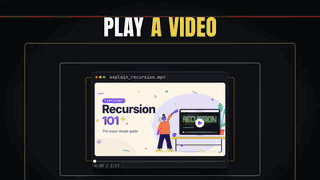

# Awesome AI Motion Prompts

Motion worth watching. Prompts worth trying. Any model, any platform.

Featured: [@shneural](https://x.com/shneural/status/2103151003272962130) · [Prompt](examples/bold-type.md)

**[▶ Play online](https://www.open-prompts.com/motion-prompts)** · **[Full list](docs/FULL_LIST.md)** · **[Submit a PR](CONTRIBUTING.md)**

**Submissions welcome!** Add your motion under its category below and open a PR. [How to contribute](CONTRIBUTING.md).

## Contents

- [Product & Brand](#product-brand)
- [Typography & Motion Studies](#motion-studies)
- [Explainers & Data](#explainers-data)
- [Characters & Stories](#characters-stories)
- [3D & Simulations](#3d-simulations)
- [Music & Audiovisual](#music-audiovisual)
- [Interactive Experiences](#interactive)
- [Full list](docs/FULL_LIST.md)
- [Contributing](CONTRIBUTING.md)

## Product & Brand

[＋ Submit to this category](https://github.com/rudy2steiner/awesome-ai-motion-prompts/edit/main/README.md#L29) · [Full list](docs/FULL_LIST.md#product-brand)

<table>
<tr>
<td width="33%" valign="top"> <a href="examples/ui-morph.md"><b>UI morph showreel</b></a> <a href="https://x.com/twoclipping/status/2103273003555402193">@twoclipping</a> · <a href="examples/ui-morph.md#prompt">Prompt</a> Opus 5.5</td>
<td width="33%" valign="top"> <a href="examples/photo-print.md"><b>Photo print app launch film</b></a> <a href="https://x.com/twoclipping/status/2103835273813496100">@twoclipping</a> · <a href="examples/photo-print.md#prompt">Prompt</a> Opus 5.5</td>
<td width="33%" valign="top"> <a href="examples/cinetic.md"><b>Cinetic skill launch film</b></a> <a href="https://x.com/LexnLin/status/2106891315371737480">@LexnLin</a> · <a href="examples/cinetic.md#prompt">Prompt</a> Opus 5.5</td>
</tr>
<tr>
<td width="33%" valign="top"> <a href="examples/typingmind.md"><b>TypingMind logo reveal</b></a> <a href="https://x.com/tdinh_me/status/2103704250329301409">@tdinh_me</a> · <a href="examples/typingmind.md#prompt">Prompt</a> Opus 5.5</td>
<td width="33%" valign="top"> <a href="examples/enxovaly.md"><b>Enxovaly baby app promo</b></a> <a href="https://x.com/gabrielbuzziv/status/2103589440258187408">@gabrielbuzziv</a> · <a href="examples/enxovaly.md#prompt">Prompt</a> Opus 5.5</td>
<td width="33%" valign="top"> <a href="examples/changelog-highlights.md"><b>Changelog highlight video (no skill installed)</b></a> <a href="https://x.com/leon7hao/status/2096844989900914865">@leon7hao</a> · <a href="examples/changelog-highlights.md#prompt">Prompt</a> GPT-6 Astra</td>
</tr>
</table>

<!-- Add new Product & Brand motions above this line. -->

## Typography & Motion Studies

[＋ Submit to this category](https://github.com/rudy2steiner/awesome-ai-motion-prompts/edit/main/README.md#L50) · [Full list](docs/FULL_LIST.md#motion-studies)

<table>
<tr>
<td width="33%" valign="top"> <a href="examples/kinetic-type.md"><b>Kinetic type</b></a> <a href="https://x.com/techhalla/status/2103411244468498547">@techhalla</a> · <a href="examples/kinetic-type.md#prompt">Prompt</a> Opus 5.5</td>
<td width="33%" valign="top"> <a href="examples/motion-showreel.md"><b>Motion showreel</b></a> <a href="https://x.com/prasenx/status/2103538744695693512">@prasenx</a> · <a href="examples/motion-showreel.md#prompt">Prompt</a> Opus 5.5</td>
<td width="33%" valign="top"> <a href="examples/bold-type.md"><b>Bold kinetic type showreel</b></a> <a href="https://x.com/shneural/status/2103151003272962130">@shneural</a> · <a href="examples/bold-type.md#prompt">Prompt</a> Claude Opus 5.5 / GPT-6 Astra</td>
</tr>
<tr>
<td width="33%" valign="top"> <a href="examples/particle-showreel.md"><b>Motion designer showreel</b></a> <a href="https://x.com/himanshutwtxs/status/2103495232637882858">@himanshutwtxs</a> · <a href="examples/particle-showreel.md#prompt">Prompt</a> Opus 5.5</td>
<td width="33%" valign="top"> <a href="examples/ajith-showreel.md"><b>15-second flat-color motion showreel</b></a> <a href="https://x.com/ajith_io/status/2103449416325890146">@ajith_io</a> · <a href="examples/ajith-showreel.md#prompt">Prompt</a> Claude Opus 5.5</td>
</tr>
</table>

<!-- Add new Typography & Motion Studies motions above this line. -->

## Explainers & Data

[＋ Submit to this category](https://github.com/rudy2steiner/awesome-ai-motion-prompts/edit/main/README.md#L70) · [Full list](docs/FULL_LIST.md#explainers-data)

<table>
<tr>
<td width="33%" valign="top"> <a href="examples/mathematics.md"><b>Mathematics motion showreel</b></a> <a href="https://x.com/Math_files/status/2104486181853610052">@Math_files</a> · <a href="examples/mathematics.md#prompt">Prompt</a> Opus 5.5</td>
<td width="33%" valign="top"> <a href="examples/recursion.md"><b>Recursion explained in genres</b></a> <a href="https://x.com/emollick/status/2103688362960019567">@emollick</a> · <a href="examples/recursion.md#prompt">Prompt</a> Opus 5.5</td>
</tr>
</table>

<!-- Add new Explainers & Data motions above this line. -->

## Characters & Stories

[＋ Submit to this category](https://github.com/rudy2steiner/awesome-ai-motion-prompts/edit/main/README.md#L85) · [Full list](docs/FULL_LIST.md#characters-stories)

<table>
<tr>
<td width="33%" valign="top"> <a href="examples/overthinking.md"><b>Overthinking showreel</b></a> <a href="https://x.com/gizakdag/status/2103566030916239768">@gizakdag</a> · <a href="examples/overthinking.md#prompt">Prompt</a> Opus 5.5</td>
</tr>
</table>

<!-- Add new Characters & Stories motions above this line. -->

## 3D & Simulations

[＋ Submit to this category](https://github.com/rudy2steiner/awesome-ai-motion-prompts/edit/main/README.md#L99) · [Full list](docs/FULL_LIST.md#3d-simulations)

<table>
<tr>
<td width="33%" valign="top"> <a href="examples/infinite-zoom.md"><b>Infinite zoom</b></a> <a href="https://x.com/koldo2k/status/2103129343253778767">@koldo2k</a> · <a href="examples/infinite-zoom.md#prompt">Prompt</a> Opus 5.5</td>
</tr>
</table>

<!-- Add new 3D & Simulations motions above this line. -->

## Music & Audiovisual

[＋ Submit to this category](https://github.com/rudy2steiner/awesome-ai-motion-prompts/edit/main/README.md#L113) · [Full list](docs/FULL_LIST.md#music-audiovisual)

Be the first to share a motion in this category.

<!-- Add new Music & Audiovisual motions above this line. -->

## Interactive Experiences

[＋ Submit to this category](https://github.com/rudy2steiner/awesome-ai-motion-prompts/edit/main/README.md#L123) · [Full list](docs/FULL_LIST.md#interactive)

<table>
<tr>
<td width="33%" valign="top"> <a href="examples/starry-night.md"><b>Starry Night cat-spotting game</b></a> <a href="https://x.com/MandelDuck/status/2103802923465768972">@MandelDuck</a> · <a href="examples/starry-night.md#prompt">Prompt</a> Opus 5.5</td>
</tr>
</table>

<!-- Add new Interactive Experiences motions above this line. -->

## Credits

Maintained by [open-prompts.com](https://www.open-prompts.com/motion-prompts). Inspired by [awesome-opus5-5-videos](https://github.com/yihui-dev/awesome-opus5-5-videos), [guanmo-ai/awesome-ai-motion](https://github.com/guanmo-ai/awesome-ai-motion) and [gongnyang/awesome-ai-motion](https://github.com/gongnyang/awesome-ai-motion).

Works and prompts belong to their creators. [Attribution & removals](THIRD_PARTY.md) · [Sources & verification](docs/SOURCING.md) · [Data format](docs/DATA_FORMAT.md).
