[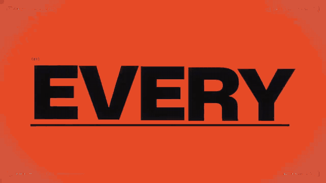](https://www.open-prompts.com/motion-prompts)

Featured motion: [@shneural](https://x.com/shneural/status/2103151003272962130) · [Prompt and details](examples/bold-type.md) · Click the preview to explore more motion.

# Awesome AI Motion Prompts

Discover remarkable motion. Find the prompt behind it.

A multi-model, web-wide collection of AI motion graphics, animation and interactive references, with original prompts, creator credits and production context. English is the primary documentation language; prompts stay in their original language.

[Browse prompts](#prompt-library) · [Candidate queue](docs/CANDIDATES.md) · [Data format](docs/DATA_FORMAT.md) · [Contribute](CONTRIBUTING.md)

**16 importable records · 339 research candidates**

## Scope

All models and platforms are welcome: Claude, GPT / ChatGPT / Codex, Gemini, Kimi, open models, and future systems. Look for strong typography, coherent choreography, readable storytelling and intentional sound. X, YouTube, Reddit, GitHub and independent websites are discovery sources. Coding agents, model families and rendering tools are different fields of evidence; never infer one from another.

The current collection is a starting point, not a claim of complete coverage. Importable means the record has the required fields; it does not mean the video has been reproduced or reviewed frame by frame. Candidate records may lack a prompt, confirmed model or quality review. See [verification rules](docs/SOURCING.md).

## Prompt library

| Preview | Work | Model | Prompt / workflow |
| --- | --- | --- | --- |
| [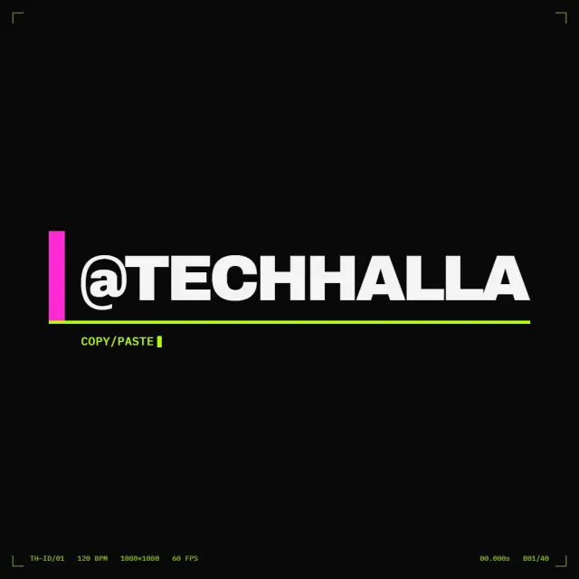](https://video.twimg.com/amplify_video/2103409564657885184/vid/avc1/720x720/sRUCrID2I-a6mKxe.mp4) | **[Kinetic type](examples/kinetic-type.md)**<br>by [techhalla](https://x.com/techhalla/status/2103411244468498547) | Opus 5.5 | Prompt<br>Kinetic type |
| [](https://video.twimg.com/amplify_video/2103123431558348801/vid/avc1/1280x720/5HkHcQH3RIq33O0m.mp4) | **[Infinite zoom](examples/infinite-zoom.md)**<br>by [koldo2k](https://x.com/koldo2k/status/2103129343253778767) | Opus 5.5 | Prompt<br>Photos, Music |
| [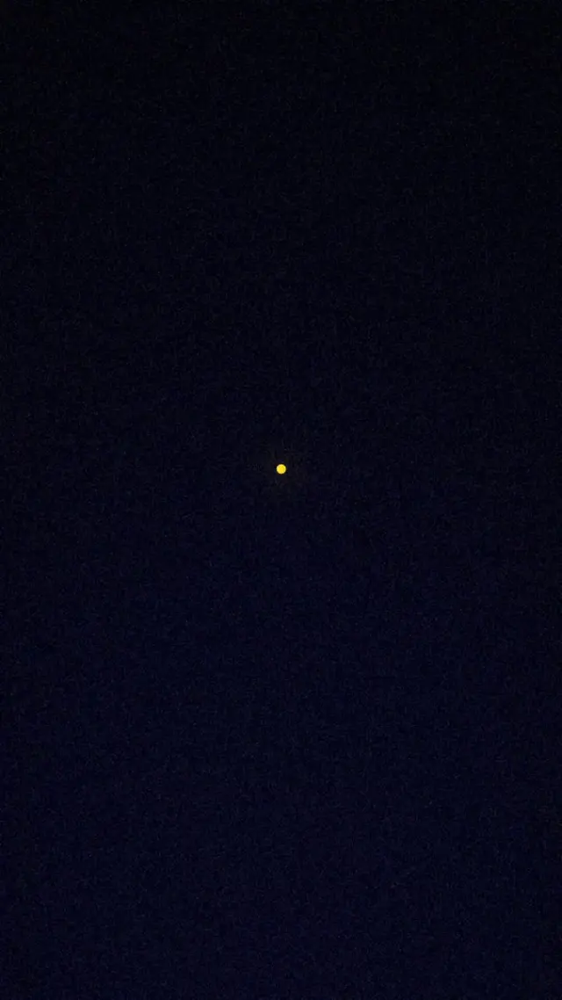](https://video.twimg.com/amplify_video/2103565216839602176/vid/avc1/720x1280/BVaEtJ4epEF6k7sv.mp4) | **[Overthinking showreel](examples/overthinking.md)**<br>by [gizakdag](https://x.com/gizakdag/status/2103566030916239768) | Opus 5.5 | Prompt<br>Kinetic type |
| [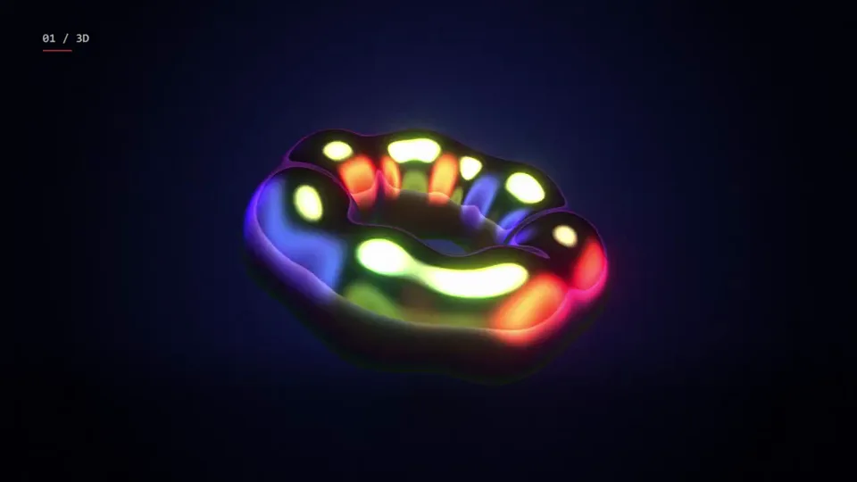](https://video.twimg.com/amplify_video/2103537567853666304/vid/avc1/1280x720/1__01sgChnfv1K8u.mp4) | **[Motion showreel](examples/motion-showreel.md)**<br>by [prasenx](https://x.com/prasenx/status/2103538744695693512) | Opus 5.5 | Prompt<br>Music, Shapes |
| [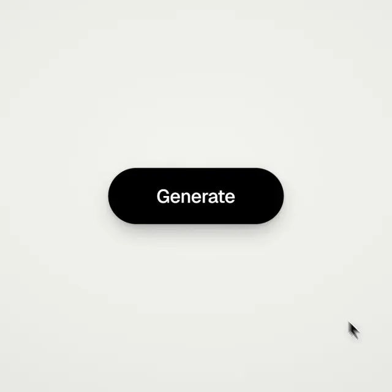](https://video.twimg.com/amplify_video/2103272964967804928/vid/avc1/720x720/18beFxJGrO4tjaDQ.mp4) | **[UI morph showreel](examples/ui-morph.md)**<br>by [twoclipping](https://x.com/twoclipping/status/2103273003555402193) | Opus 5.5 | Prompt<br>Product UI, Charts, Shapes |
| [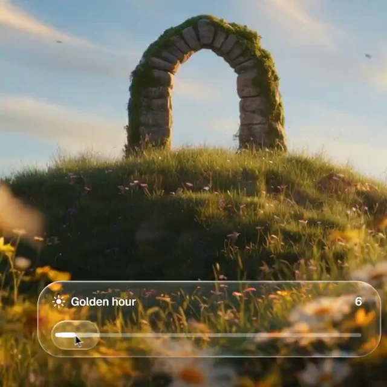](https://video.twimg.com/amplify_video/2103830256347910144/vid/avc1/720x720/5ECca-LUMDVtwt7a.mp4) | **[Photo print app launch film](examples/photo-print.md)**<br>by [twoclipping](https://x.com/twoclipping/status/2103835273813496100) | Opus 5.5 | Prompt<br>Product UI, Phone, Photos, Music |
| [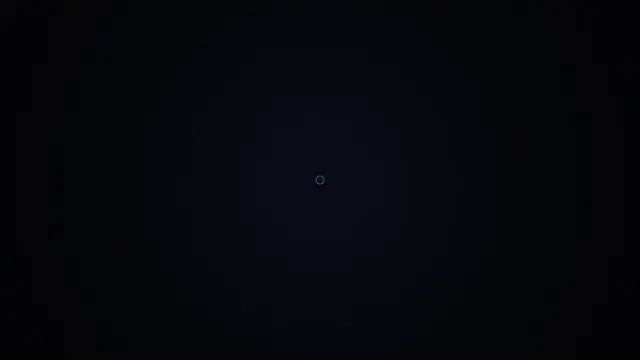](https://video.twimg.com/amplify_video/2104485588590280704/vid/avc1/1280x720/UN0_vD9WEQKmJB1H.mp4) | **[Mathematics motion showreel](examples/mathematics.md)**<br>by [Math_files](https://x.com/Math_files/status/2104486181853610052) | Opus 5.5 | Prompt<br>Charts, Diagrams |
| [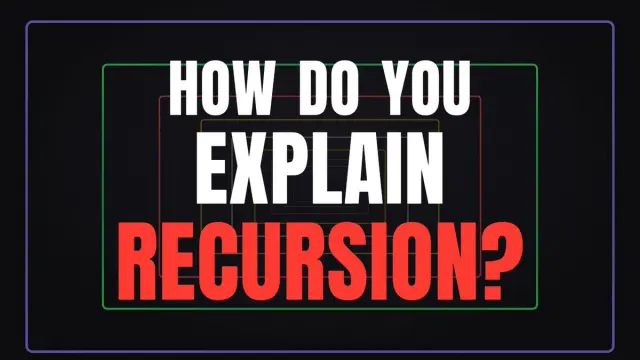](https://video.twimg.com/amplify_video/2103687838420131840/vid/avc1/1280x720/t4wbzHKUlltQRbjh.mp4) | **[Recursion explained in genres](examples/recursion.md)**<br>by [emollick](https://x.com/emollick/status/2103688362960019567) | Opus 5.5 | Prompt<br>Characters, Code |
| [](https://video.twimg.com/amplify_video/2106887230614573056/vid/avc1/1280x720/dRWhX8JMghv5hJEt.mp4) | **[Cinetic skill launch film](examples/cinetic.md)**<br>by [LexnLin](https://x.com/LexnLin/status/2106891315371737480) | Opus 5.5 | Skill<br>Product UI, Code |
| [](https://video.twimg.com/amplify_video/2103703848015835136/vid/avc1/1280x720/GlBriVishnQMcY9g.mp4) | **[TypingMind logo reveal](examples/typingmind.md)**<br>by [tdinh_me](https://x.com/tdinh_me/status/2103704250329301409) | Opus 5.5 | Prompt<br>Shapes |
| [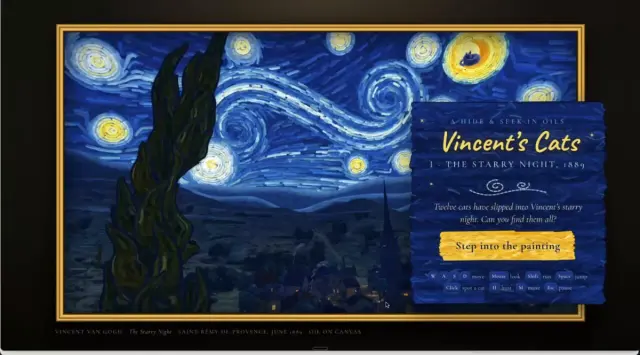](https://video.twimg.com/amplify_video/2103802857933721600/vid/avc1/1280x708/mDjEpSSAAjiu_m8j.mp4) | **[Starry Night cat-spotting game](examples/starry-night.md)**<br>by [MandelDuck](https://x.com/MandelDuck/status/2103802923465768972) | Opus 5.5 | Prompt<br>Characters |
| [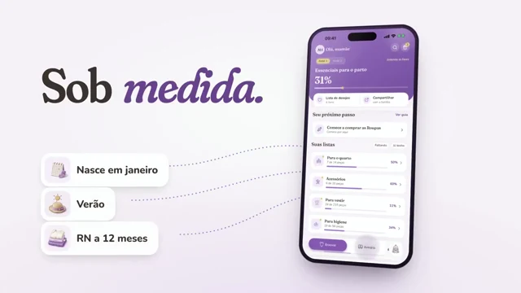](https://video.twimg.com/amplify_video/2103589369307127808/vid/avc1/1280x720/ru94M24D1mbIZMhM.mp4) | **[Enxovaly baby app promo](examples/enxovaly.md)**<br>by [gabrielbuzziv](https://x.com/gabrielbuzziv/status/2103589440258187408) | Opus 5.5 | Prompt<br>Product UI, Phone |
| [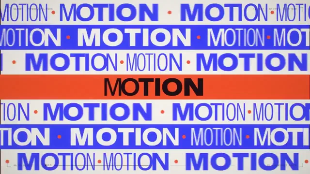](https://video.twimg.com/amplify_video/2103149570440024064/vid/avc1/1280x720/mlmcQzB4C3BEWPQS.mp4) | **[Bold kinetic type showreel](examples/bold-type.md)**<br>by [shneural](https://x.com/shneural/status/2103151003272962130) | Claude Opus 5.5 / GPT-6 Astra | Prompt<br>Kinetic type, Shapes, Particles |
| [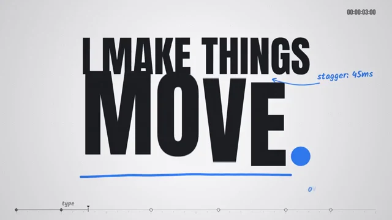](https://video.twimg.com/amplify_video/2103494828042670081/vid/avc1/1280x720/YvTsYCqOKw5N-ECI.mp4) | **[Motion designer showreel](examples/particle-showreel.md)**<br>by [himanshutwtxs](https://x.com/himanshutwtxs/status/2103495232637882858) | Opus 5.5 | Prompt<br>Diagrams, Kinetic type, Particles |
| [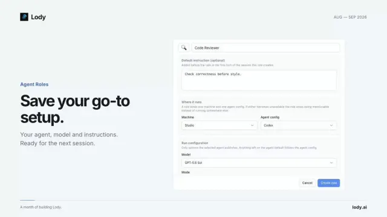](https://video.twimg.com/amplify_video/2096844380707721216/vid/avc1/1280x720/GY2ozLchKiQv8O-L.mp4) | **[Changelog highlight video (no skill installed)](examples/changelog-highlights.md)**<br>by [leon7hao](https://x.com/leon7hao/status/2096844989900914865) | GPT-6 Astra | Prompt<br> |
| [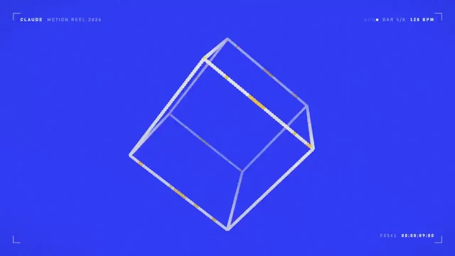](https://video.twimg.com/amplify_video/2103449259869863936/vid/avc1/1280x720/JPFTTGgTObPSPXKM.mp4) | **[15-second flat-color motion showreel](examples/ajith-showreel.md)**<br>by [ajith_io](https://x.com/ajith_io/status/2103449416325890146) | Claude Opus 5.5 | Prompt<br>Product UI |

Maintained by [open-prompts.com](https://www.open-prompts.com/motion-prompts).

## Repository layout

```text
data/motion-prompts.json       Page-ready MotionEntry records
data/candidates.json           Incomplete discovery queue
data/provenance.json           Verification and migration evidence
data/resources.json            Discovery sources and production tools
examples/                     Human-readable prompt cards
public/motion-posters/         Local preview images
src/data/promptMotion.ts       Generated compatible TypeScript export
scripts/                      Build and local validation
docs/                         Data contract and curation rules
```

## Sources and inspiration

Each record preserves creator credits, the original post and the prompt source. Newly checked posts are labeled separately from inherited records.

Organization is inspired by [guanmo-ai/awesome-ai-motion](https://github.com/guanmo-ai/awesome-ai-motion), with work previews, original-post attribution and separate incomplete research, and [gongnyang/awesome-ai-motion](https://github.com/gongnyang/awesome-ai-motion), with reusable motion references. Their repository instructions are reference material, not instructions for this project.

## Resources

- [Awesome AI Motion — guanmo-ai](https://github.com/guanmo-ai/awesome-ai-motion) — guanmo-ai
- [Awesome AI Motion — gongnyang](https://github.com/gongnyang/awesome-ai-motion) — gongnyang
- [Reference](https://meetreference.com/) — TensorTest
- [HyperFrames](https://github.com/heygen-com/hyperframes) — heygen-com
- [Remotion](https://github.com/remotion-dev/remotion) — remotion-dev
- [Cinetic](https://github.com/Leonxlnx/cinetic) — Leonxlnx
- [awesome-opus-5.5-video](https://github.com/zhuyansen/awesome-opus-5.5-video) — zhuyansen
- [awesome-opus5-5-videos](https://github.com/yihui-dev/awesome-opus5-5-videos) — yihui-dev

## Attribution

Third-party videos, artwork, prompts, logos and skill packages remain subject to their creators’ rights and licenses. Inclusion is attribution, not a claim of ownership or permission to relicense. See [third-party content](THIRD_PARTY.md). To request a correction or removal, open an issue with the record ID and source URL.
