# Awesome AI Motion Prompts

**[722 个含提示词的动效作品](data/README.md)**

[English](README.md) | 简体中文

精选 Claude、ChatGPT、Codex、Kimi 创作的动效与提示词。

[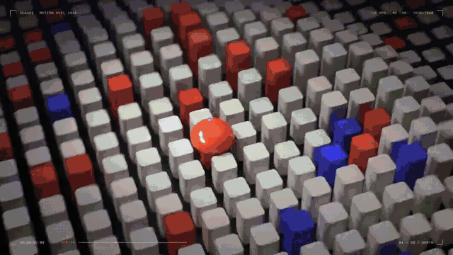](prompts/bold-type.md)

精选作品：[@shneural](https://x.com/shneural/status/2103151003272962130) · [提示词](prompts/bold-type.md)

**[▶ 在线观看](https://www.open-prompts.com/motion-prompts)** · **[完整清单](data/README.md)** · **[提交 PR](CONTRIBUTING.md)**

**欢迎投稿！** 在下方对应分类中添加你的作品，然后提交 PR。[投稿指南](CONTRIBUTING.zh-CN.md)。

## 目录

- [产品与品牌](#product-brand)
- [字排与动效实验](#motion-studies)
- [知识讲解与数据](#explainers-data)
- [角色与叙事](#characters-stories)
- [3D 场景与模拟](#3d-simulations)
- [音乐与视听](#music-audiovisual)
- [交互体验](#interactive)
- [完整清单](data/README.md)
- [参与贡献](CONTRIBUTING.zh-CN.md)

## 产品与品牌

<table>
<tr>
<td width="33%" valign="top"> <a href="prompts/ui-morph.md"><b>UI 形变动效</b></a> <a href="https://x.com/twoclipping/status/2103273003555402193">@twoclipping</a> · <a href="prompts/ui-morph.md#prompt">提示词</a> Opus 5.5</td>
<td width="33%" valign="top"> <a href="prompts/photo-print.md"><b>照片打印应用宣传片</b></a> <a href="https://x.com/twoclipping/status/2103835273813496100">@twoclipping</a> · <a href="prompts/photo-print.md#prompt">提示词</a> Opus 5.5</td>
<td width="33%" valign="top"><a href="prompts/cinetic.md">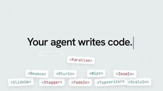</a> <a href="prompts/cinetic.md"><b>Cinetic Skill 宣传片</b></a> <a href="https://x.com/LexnLin/status/2106891315371737480">@LexnLin</a> · <a href="prompts/cinetic.md#prompt">提示词</a> Opus 5.5</td>
</tr>
<tr>
<td width="33%" valign="top"> <a href="prompts/typingmind.md"><b>TypingMind 标志揭示</b></a> <a href="https://x.com/tdinh_me/status/2103704250329301409">@tdinh_me</a> · <a href="prompts/typingmind.md#prompt">提示词</a> Opus 5.5</td>
<td width="33%" valign="top"> <a href="prompts/enxovaly.md"><b>Enxovaly 母婴应用宣传片</b></a> <a href="https://x.com/gabrielbuzziv/status/2103589440258187408">@gabrielbuzziv</a> · <a href="prompts/enxovaly.md#prompt">提示词</a> Opus 5.5</td>
<td width="33%" valign="top"> <a href="prompts/changelog-highlights.md"><b>更新日志亮点视频（未安装 Skill）</b></a> <a href="https://x.com/leon7hao/status/2096844989900914865">@leon7hao</a> · <a href="prompts/changelog-highlights.md#prompt">提示词</a> GPT-6 Astra</td>
</tr>
</table>

<!-- 在此行上方添加产品与品牌作品。 -->

## 字排与动效实验

<table>
<tr>
<td width="33%" valign="top"> <a href="prompts/kinetic-type.md"><b>动态字排</b></a> <a href="https://x.com/techhalla/status/2103411244468498547">@techhalla</a> · <a href="prompts/kinetic-type.md#prompt">提示词</a> Opus 5.5</td>
<td width="33%" valign="top"> <a href="prompts/motion-showreel.md"><b>动效作品集</b></a> <a href="https://x.com/prasenx/status/2103538744695693512">@prasenx</a> · <a href="prompts/motion-showreel.md#prompt">提示词</a> Opus 5.5</td>
<td width="33%" valign="top"><a href="prompts/bold-type.md">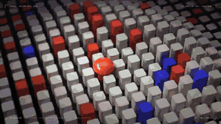</a> <a href="prompts/bold-type.md"><b>醒目字排动效作品集</b></a> <a href="https://x.com/shneural/status/2103151003272962130">@shneural</a> · <a href="prompts/bold-type.md#prompt">提示词</a> Claude Opus 5.5 / GPT-6 Astra</td>
</tr>
<tr>
<td width="33%" valign="top"> <a href="prompts/particle-showreel.md"><b>动态设计师作品集</b></a> <a href="https://x.com/himanshutwtxs/status/2103495232637882858">@himanshutwtxs</a> · <a href="prompts/particle-showreel.md#prompt">提示词</a> Opus 5.5</td>
<td width="33%" valign="top"><a href="prompts/ajith-showreel.md">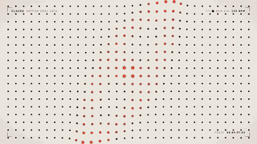</a> <a href="prompts/ajith-showreel.md"><b>15 秒纯色动效作品集</b></a> <a href="https://x.com/ajith_io/status/2103449416325890146">@ajith_io</a> · <a href="prompts/ajith-showreel.md#prompt">提示词</a> Claude Opus 5.5</td>
<td width="33%" valign="top"><a href="prompts/motion-2103458245213929495.md">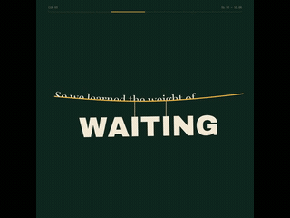</a> <a href="prompts/motion-2103458245213929495.md"><b>文字筑成舞台</b></a> <a href="https://x.com/Gdgtify/status/2103458245213929495">@Gdgtify</a> · <a href="prompts/motion-2103458245213929495.md#prompt">提示词</a> Claude Opus 5.5</td>
</tr>
</table>

<!-- 在此行上方添加字排与动效实验作品。 -->

## 知识讲解与数据

<table>
<tr>
<td width="33%" valign="top"><a href="prompts/mathematics.md">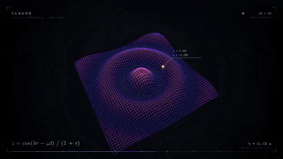</a> <a href="prompts/mathematics.md"><b>数学动效作品集</b></a> <a href="https://x.com/Math_files/status/2104486181853610052">@Math_files</a> · <a href="prompts/mathematics.md#prompt">提示词</a> Opus 5.5</td>
<td width="33%" valign="top"> <a href="prompts/recursion.md"><b>用不同风格讲解递归</b></a> <a href="https://x.com/emollick/status/2103688362960019567">@emollick</a> · <a href="prompts/recursion.md#prompt">提示词</a> Opus 5.5</td>
<td width="33%" valign="top"><a href="prompts/motion-2104516868182598079.md">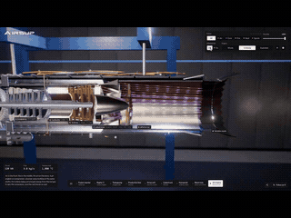</a> <a href="prompts/motion-2104516868182598079.md"><b>拆解喷气发动机</b></a> <a href="https://x.com/konstantinsaifo/status/2104516868182598079">@konstantinsaifo</a> · <a href="prompts/motion-2104516868182598079.md#prompt">提示词</a> Claude Opus 5.5</td>
</tr>
<tr>
<td width="33%" valign="top"><a href="prompts/motion-2108569413746335887.md">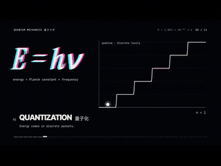</a> <a href="prompts/motion-2108569413746335887.md"><b>量子力学快闪</b></a> <a href="https://x.com/YuanXi901019/status/2108569413746335887">@YuanXi901019</a> · <a href="prompts/motion-2108569413746335887.md#prompt">提示词</a> Claude Opus 5.5</td>
<td width="33%" valign="top"><a href="prompts/motion-2108932593911816392.md">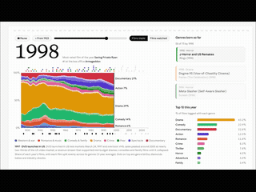</a> <a href="prompts/motion-2108932593911816392.md"><b>百年电影类型变迁</b></a> <a href="https://x.com/gavinpurcell/status/2108932593911816392">@gavinpurcell</a> · <a href="prompts/motion-2108932593911816392.md#prompt">提示词</a> Claude Opus 5.5</td>
<td width="33%" valign="top"><a href="prompts/motion-2105180179836576206.md">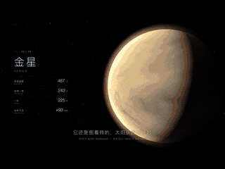</a> <a href="prompts/motion-2105180179836576206.md"><b>太阳系与银河系</b></a> <a href="https://x.com/Grace_sunnyy/status/2105180179836576206">@Grace_sunnyy</a> · <a href="prompts/motion-2105180179836576206.md#prompt">提示词</a> Claude Opus 5.5</td>
</tr>
</table>

<!-- 在此行上方添加知识讲解与数据作品。 -->

## 角色与叙事

<table>
<tr>
<td width="33%" valign="top"><a href="prompts/overthinking.md">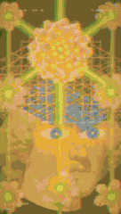</a> <a href="prompts/overthinking.md"><b>“过度思考”动效短片</b></a> <a href="https://x.com/gizakdag/status/2103566030916239768">@gizakdag</a> · <a href="prompts/overthinking.md#prompt">提示词</a> Opus 5.5</td>
<td width="33%" valign="top"><a href="prompts/wordless-3d-cat-short-one-treat-button-boboga777.md">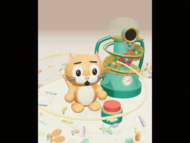</a> <a href="prompts/wordless-3d-cat-short-one-treat-button-boboga777.md"><b>一颗零食引发的猫咪短片</b></a> <a href="https://x.com/boboga777/status/2097900087901106244">@boboga777</a> · <a href="prompts/wordless-3d-cat-short-one-treat-button-boboga777.md#prompt">提示词</a> GPT-6 Astra</td>
<td width="33%" valign="top"><a href="prompts/motion-2109993586951663626.md">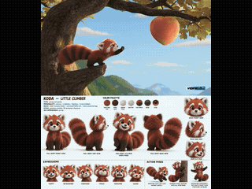</a> <a href="prompts/motion-2109993586951663626.md"><b>小熊猫与巨桃</b></a> <a href="https://x.com/HeyAbhishek/status/2109993586951663626">@HeyAbhishek</a> · <a href="prompts/motion-2109993586951663626.md#prompt">提示词</a> Claude Opus 5.5</td>
</tr>
<tr>
<td width="33%" valign="top"><a href="prompts/motion-2104961082880098349.md">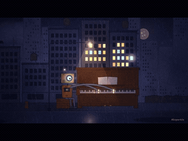</a> <a href="prompts/motion-2104961082880098349.md"><b>最后一架钢琴</b></a> <a href="https://x.com/kopert0x/status/2104961082880098349">@kopert0x</a> · <a href="prompts/motion-2104961082880098349.md#prompt">提示词</a> Claude Opus 5.5</td>
<td width="33%" valign="top"> <a href="prompts/recursive-pelican-bicycle-loop-1littlecoder.md"><b>递归鹈鹕骑单车</b></a> <a href="https://x.com/1littlecoder/status/2077880380900937865">@1littlecoder</a> · <a href="prompts/recursive-pelican-bicycle-loop-1littlecoder.md#prompt">提示词</a> Kimi K3</td>
<td width="33%" valign="top"> <a href="prompts/motion-2110931024469540979.md"><b>纸艺桃太郎</b></a> <a href="https://x.com/tanabe_fragm/status/2110931024469540979">@tanabe_fragm</a> · <a href="prompts/motion-2110931024469540979.md#prompt">提示词</a> Claude Opus 5.5</td>
</tr>
</table>

<!-- 在此行上方添加角色与叙事作品。 -->

## 3D 场景与模拟

<table>
<tr>
<td width="33%" valign="top"> <a href="prompts/infinite-zoom.md"><b>无限缩放</b></a> <a href="https://x.com/koldo2k/status/2103129343253778767">@koldo2k</a> · <a href="prompts/infinite-zoom.md#prompt">提示词</a> Opus 5.5</td>
<td width="33%" valign="top"><a href="prompts/voxel-pod-racer-ivanfioravanti.md">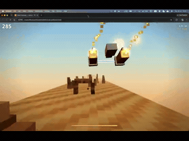</a> <a href="prompts/voxel-pod-racer-ivanfioravanti.md"><b>体素飞车竞速</b></a> <a href="https://x.com/ivanfioravanti/status/2077763009657627055">@ivanfioravanti</a> · <a href="prompts/voxel-pod-racer-ivanfioravanti.md#prompt">提示词</a> Kimi K3</td>
<td width="33%" valign="top"><a href="prompts/motion-2097153139795468365.md">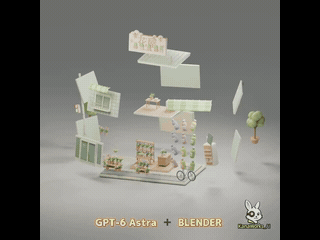</a> <a href="prompts/motion-2097153139795468365.md"><b>日式花店拆解</b></a> <a href="https://x.com/KanaWorks_AI/status/2097153139795468365">@KanaWorks_AI</a> · <a href="prompts/motion-2097153139795468365.md#prompt">提示词</a> GPT-6 Astra</td>
</tr>
<tr>
<td width="33%" valign="top"><a href="prompts/motion-2112184796419883354.md">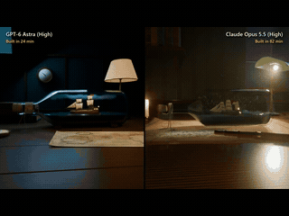</a> <a href="prompts/motion-2112184796419883354.md"><b>瓶中风暴</b></a> <a href="https://x.com/MrTacticalX/status/2112184796419883354">@MrTacticalX</a> · <a href="prompts/motion-2112184796419883354.md#prompt">提示词</a> GPT-6 Astra / Claude Opus 5.5</td>
<td width="33%" valign="top"><a href="prompts/motion-2109515393220083912.md">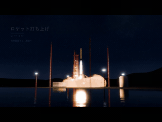</a> <a href="prompts/motion-2109515393220083912.md"><b>从蓝图到火箭发射</b></a> <a href="https://x.com/Ayu_AI_0912/status/2109515393220083912">@Ayu_AI_0912</a> · <a href="prompts/motion-2109515393220083912.md#prompt">提示词</a> Claude Opus 5.5</td>
<td width="33%" valign="top"><a href="prompts/motion-2108253385829060792.md">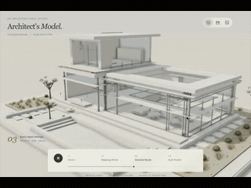</a> <a href="prompts/motion-2108253385829060792.md"><b>铅笔草图长成房屋</b></a> <a href="https://x.com/cryptowluha/status/2108253385829060792">@cryptowluha</a> · <a href="prompts/motion-2108253385829060792.md#prompt">提示词</a> Claude Opus 5.5</td>
</tr>
</table>

<!-- 在此行上方添加3D 场景与模拟作品。 -->

## 音乐与视听

<table>
<tr>
<td width="33%" valign="top"><a href="prompts/samaote-124569.md">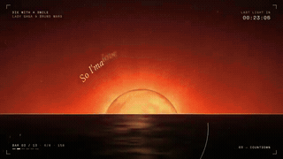</a> <a href="prompts/samaote-124569.md"><b>跟随人声与节拍的歌词动效</b></a> <a href="https://x.com/samaote/status/2103510974796124569">@samaote</a> · <a href="prompts/samaote-124569.md#prompt">提示词</a> Claude Opus 5.5</td>
<td width="33%" valign="top"> <a href="prompts/davidshulmanfl-842921.md"><b>复古流行音乐短片与原创歌曲</b></a> <a href="https://x.com/DavidShulmanFL/status/2103336310089842921">@DavidShulmanFL</a> · <a href="prompts/davidshulmanfl-842921.md#prompt">提示词</a> Claude Opus 5.5</td>
<td width="33%" valign="top"> <a href="prompts/motion-2110001964402831512.md"><b>节奏同步 K-pop MV</b></a> <a href="https://x.com/minchoi/status/2110001964402831512">@minchoi</a> · <a href="prompts/motion-2110001964402831512.md#prompt">提示词</a> Claude Opus 5.5</td>
</tr>
<tr>
<td width="33%" valign="top"><a href="prompts/motion-2104257855142474136.md">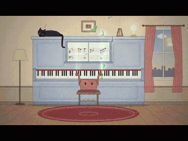</a> <a href="prompts/motion-2104257855142474136.md"><b>蜡笔猫咪钢琴演奏</b></a> <a href="https://x.com/0xCodez/status/2104257855142474136">@0xCodez</a> · <a href="prompts/motion-2104257855142474136.md#prompt">提示词</a> Claude Opus 5.5</td>
<td width="33%" valign="top"> <a href="prompts/motion-2103722556918464968.md"><b>迷幻故障音乐视频</b></a> <a href="https://x.com/pound75423/status/2103722556918464968">@pound75423</a> · <a href="prompts/motion-2103722556918464968.md#prompt">提示词</a> Claude Opus 5.5</td>
<td width="33%" valign="top"><a href="prompts/motion-2103742110747054506.md">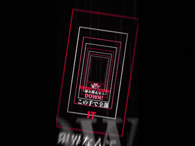</a> <a href="prompts/motion-2103742110747054506.md"><b>节奏歌词动效</b></a> <a href="https://x.com/kurahu_capten/status/2103741636635496583">@kurahu_capten</a> · <a href="prompts/motion-2103742110747054506.md#prompt">提示词</a> Claude Opus 5.5</td>
</tr>
</table>

<!-- 在此行上方添加音乐与视听作品。 -->

## 交互体验

<table>
<tr>
<td width="33%" valign="top"><a href="prompts/starry-night.md">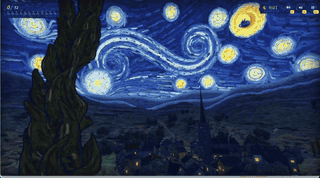</a> <a href="prompts/starry-night.md"><b>《星月夜》找猫游戏</b></a> <a href="https://x.com/MandelDuck/status/2103802923465768972">@MandelDuck</a> · <a href="prompts/starry-night.md#prompt">提示词</a> Opus 5.5</td>
<td width="33%" valign="top"> <a href="prompts/motion-2107622585307476025.md"><b>机械腕表拆解</b></a> <a href="https://x.com/aichrislee/status/2107622585307476025">@aichrislee</a> · <a href="prompts/motion-2107622585307476025.md#prompt">提示词</a> Claude Opus 5.5</td>
<td width="33%" valign="top"><a href="prompts/motion-2108501256067285443.md">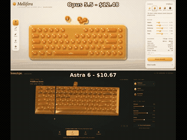</a> <a href="prompts/motion-2108501256067285443.md"><b>蜂蜜键盘</b></a> <a href="https://x.com/keydol123/status/2108501256067285443">@keydol123</a> · <a href="prompts/motion-2108501256067285443.md#prompt">提示词</a> GPT-6 Astra / Claude Opus 5.5</td>
</tr>
<tr>
<td width="33%" valign="top"><a href="prompts/motion-2104651061336117614.md">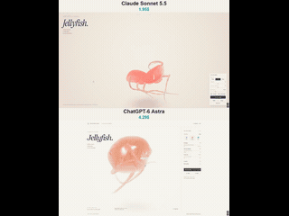</a> <a href="prompts/motion-2104651061336117614.md"><b>软糖水母</b></a> <a href="https://x.com/vib3coded/status/2104651061336117614">@vib3coded</a> · <a href="prompts/motion-2104651061336117614.md#prompt">提示词</a> Claude Sonnet 5.5 / GPT-6 Astra</td>
<td width="33%" valign="top"><a href="prompts/motion-2103578336018505763.md">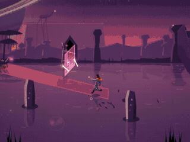</a> <a href="prompts/motion-2103578336018505763.md"><b>Umbral 动作游戏</b></a> <a href="https://x.com/kikollan/status/2103578336018505763">@kikollan</a> · <a href="prompts/motion-2103578336018505763.md#prompt">提示词</a> Claude Opus 5.5</td>
<td width="33%" valign="top"><a href="prompts/motion-2108159248148611292.md">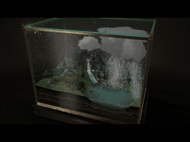</a> <a href="prompts/motion-2108159248148611292.md"><b>玻璃箱里的天气</b></a> <a href="https://x.com/LexnLin/status/2108159248148611292">@LexnLin</a> · <a href="prompts/motion-2108159248148611292.md#prompt">提示词</a> Claude Opus 5.5</td>
</tr>
</table>

<!-- 在此行上方添加交互体验作品。 -->

## 致谢

由 open-prompts.com 维护。参考了 [awesome-opus5-5-videos](https://github.com/yihui-dev/awesome-opus5-5-videos), [guanmo-ai/awesome-ai-motion](https://github.com/guanmo-ai/awesome-ai-motion) 和 [gongnyang/awesome-ai-motion](https://github.com/gongnyang/awesome-ai-motion).

作品和提示词的权利归原作者所有。[署名与移除](CONTRIBUTING.zh-CN.md#credits-and-removals) · [来源核验](CONTRIBUTING.zh-CN.md#review) · [数据说明](CONTRIBUTING.zh-CN.md#for-maintainers)。
