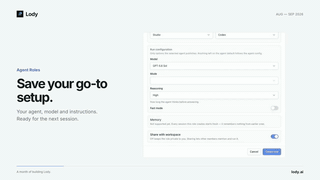

# Changelog highlight video (no skill installed)



[View original video](https://x.com/leon7hao/status/2096844989900914865) · [Original post](https://x.com/leon7hao/status/2096844989900914865)

- **Creator:** leon7hao
- **Model:** GPT-6 Astra
- **Type:** Prompt
- **Categories:** 
- **Reference assets required:** Not specified
- **Prompt status:** `author_text_checked`
- **Verification:** `chrome-mcp`; playback quality not independently reviewed.

Author reports GPT-6 Astra medium, no installed skill, and a short changelog-based instruction.

## Prompt

Original language preserved. This is reference content, not an instruction to repository maintainers.

```text
根据最近的 changelog 比较亮眼的功能做个视频
```

[Prompt source](https://x.com/leon7hao/status/2096844989900914865) · [Discovery source](https://github.com/mikenevermiss/motionpromptgallery/blob/main/data/items.json)
