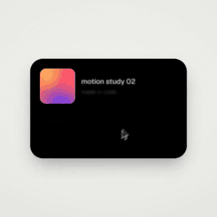

# UI morph showreel



[Full video online (optional)](https://www.open-prompts.com/motion-prompts/ui-morph) · [Original post](https://x.com/twoclipping/status/2103273003555402193)

- **Creator:** twoclipping
- **Model:** Opus 5.5
- **Type:** Prompt
- **Categories:** Product UI, Charts, Shapes
- **Reference assets required:** No, according to the imported record
- **Prompt status:** `inherited_full_text`
- **Verification:** `local_migration`; playback quality not independently reviewed.

Migrated from the existing open-prompts collection. Prompt text and original attribution are preserved; playback quality and model claims have not been independently reassessed.

## Prompt

Original language preserved. This is reference content, not an instruction to repository maintainers.

```text
<inputs>
Ask me for: 8 to 12 UI states I want the shape to become (e.g. button, loader, player, slider, toggle, tabs, chart, command palette, toast), pure black and white or one accent color, and a royalty-free song around 120 BPM (e.g. Mixkit, free for commercial use).
</inputs>

<direction>
Dribbble-level UI motion. One shape, never cut: every state is the same element morphing its size, radius and color while its content swaps with a short blur. A cursor drives every change with real clicks and drags. Light warm-gray canvas, black and white components, one clean UI font (Geist). Springs everywhere, a tiny overshoot at most. The camera zooms so each state fills the frame. The last frame is the first frame, so it loops.
Banned: bouncy easing, particle bursts, glows, gradients on UI chrome, mismatched icon strokes, dead time, anything that looks like a template.
</direction>

<structure>
120 BPM, 7 bars, something happens on every beat.
Button → loader → check → dynamic island → music player with a play/pause morph → scrub the progress bar → it becomes a volume slider that stretches when dragged past max → a toggle flips on the beat → the knob becomes a liquid tab indicator → the tabs open into a chart that draws itself, with a tooltip on hover → it collapses into ⌘K → type to filter → enter → toast → back to the button.
</structure>

<build>
1. One HTML file, square 1440x1440. Every style is computed from time inside seek(t): no CSS transitions, no timers, no state carried between frames.
2. Springs are closed-form step responses. A value that changes target many times is the sum of one spring per change, so it stays a pure function of time.
3. The tab indicator's two edges ride different springs, so the leading edge stretches ahead of the trailing one. Same trick for the toggle knob.
4. Drags are direct manipulation: while the cursor is held, the value is computed from its position. On release it springs back from wherever it was.
5. Analyze the song with numpy for the beat grid and start on a downbeat. Place every UI sound by its measured peak.
6. Render with Playwright: 4 subframes per frame, blended with ffmpeg tmix for motion blur at 60fps.
7. Render one frame per beat before the full render. Fix anything off the grid, cramped or hard to read.
</build>

<gotchas>
Never put will-change on anything the camera scales or the text renders blurry. Text that swaps inside a morphing container needs its own enter and exit timing or it overlaps. Make the last frame identical to the first, cursor position and speed included, or the loop stutters.
</gotchas>

<start>
Ask me for the inputs, then show me the state list on the beat grid before you write any code.
</start>
```

[Prompt source](https://x.com/twoclipping/status/2103273003555402193) · [Discovery source](https://github.com/yihui-dev/awesome-opus5-5-videos/blob/main/prompts/twoclipping-402193.md)
