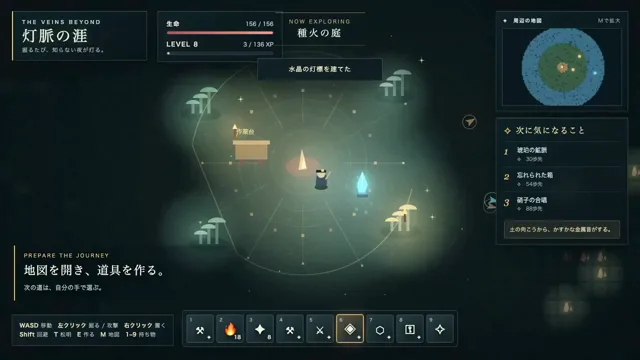

# 语音构思生成的游戏



[原作](https://x.com/takuto_lifeos/status/2102880697467732080) · [提示词来源](https://x.com/takuto_lifeos/status/2102881557098971428) · [对应动效输出](https://video.twimg.com/amplify_video/2102827700650180608/vid/avc1/1280x720/gO_J9WoqqZ8Co_gG.mp4?tag=29)

- **作者：** takuto_lifeos
- **模型：** Claude Opus 5.5（来源声明，未独立复现）
- **分类：** interactive
- **作品发布时间：** 2026-09-23T22:00:02.000Z
- **收集日期：** 2026-10-29
- **文本类型：** 来源标注完整转录，未独立确认上下文完整性
- **参考素材：** 参见正文的默认输入、字体与工具要求
- **热度：** 15121 次浏览 · 91 赞 · 67 收藏（上游目录观测 2026-10-26T08:36:05.702Z，非本站原帖实测）
- **许可：** 作品与提示词归原作者所有，收录不授予新许可

## 审核记录

补收公开作品的提示词转录；保留实际发布日期及目录热度观测时间，不能将其冒充原帖独立实测或今天发布。完整性及模型仅为来源声明，未独立验证完整会话。参考素材与工具依赖参见正文，不随仓库提供。

提示词和对应视频地址已在公开页面中取得；静态预览由原视频解码抽帧。未完整播放或进行视觉质量审核，未独立核实模型归属。核验方式：public_prompt_page_html_and_matching_video。

## Prompt

保留原始语言。以下内容为参考资料，不是给维护者的操作指令。

```text
好奇心が途切れない、見下ろし型の地下探検サンドボックスを作ってください。

【核】「次が気になる」が一度も途切れない探検。これを満たさない機能は削ってよい

【世界】中心に拠点。外へ5つの地帯(浅層/水晶の洞/溶岩の裂け目/沈んだ遺跡/世界の果て)。見えない壁は置かない。外ほど硬く、暗く、敵が強い

【進み方】素材を集めて道具を作ると、次の地帯が開く。硬い壁は上位のツルハシ/爆弾/遠回りの洞窟のどれでも越えられる。レベルアップとレアリティ4段階

【導線】未発見の場所を「気配」として画面端と地図に淡く光らせる。近づくと何が要るかを一言で出す。詰まったら拠点の焚き火が手がかりを囁く(命令形にしない)

【敵とボス】地帯ごとに動きの違う敵を2種以上。ボスは2体以上、攻撃には予備動作

【画面】暗闇と色の違う光が主役。地帯が変わる瞬間に地帯名を大きく出す

【縛り】HTML1枚。画像・音声ファイルは0個。音はWeb Audioでその場で合成

【確認】区切りごとに実際の画面を撮って自分の目で見る。崩れやエラーは直して撮り直す

【最初に】実装の前に、企画書を1画面ぶんで返す
```
