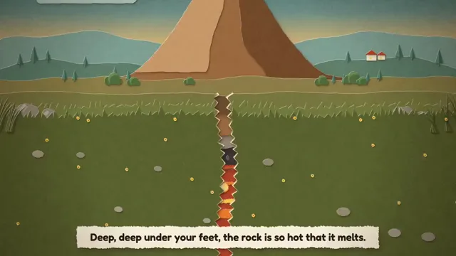

# 面向儿童的火山原理讲解视频



[原作](https://x.com/nishanthps/status/2103272493658353765) · [提示词来源](https://x.com/nishanthps/status/2103272493658353765) · [对应动效输出](https://video.twimg.com/amplify_video/2103272088333402112/vid/avc1/1280x720/R_gwYRiPW0Ukz1Nl.mp4?tag=29)

- **作者：** nishanthps
- **模型：** Claude Opus 5.5（来源声明，未独立复现）
- **分类：** explainers-data
- **作品发布时间：** 2026-09-24T23:56:54.000Z
- **收集日期：** 2026-10-28
- **文本类型：** 作者公开简短要求，不等同完整工作流
- **参考素材：** 参见正文的默认输入、字体与工具要求
- **热度：** 35990 次浏览 · 585 赞 · 546 收藏（上游目录观测 2026-10-26T08:36:05.702Z，非本站原帖实测）
- **许可：** 作品与提示词归原作者所有，收录不授予新许可

## 审核记录

补收公开作品的提示词转录；保留实际发布日期及目录热度观测时间，不能将其冒充原帖独立实测或今天发布。完整性及模型仅为来源声明，未独立验证完整会话。参考素材与工具依赖参见正文，不随仓库提供。

提示词和对应视频地址已在公开页面中取得；静态预览由原视频解码抽帧。未完整播放或进行视觉质量审核，未独立核实模型归属。核验方式：public_prompt_page_html_and_matching_video。

## Prompt

保留原始语言。以下内容为参考资料，不是给维护者的操作指令。

```text
make a video to teach kids about how volcanos work
```
