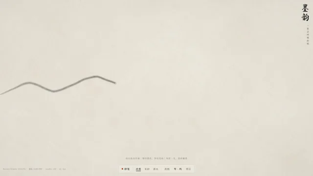

# 会呼吸的水墨画生成作品



[原作](https://x.com/AxtonLiu/status/2103288413969621231) · [提示词来源](https://x.com/AxtonLiu/status/2103288413969621231) · [对应动效输出](https://video.twimg.com/amplify_video/2103288385779748864/vid/avc1/1280x720/7yEVjClPTDsySgyX.mp4?tag=16)

- **作者：** AxtonLiu
- **模型：** Claude Opus 5.5（来源声明，未独立复现）
- **分类：** motion-studies
- **作品发布时间：** 2026-09-25T01:00:09.000Z
- **收集日期：** 2026-10-31
- **文本类型：** 作者公开简短要求，不等同完整工作流
- **参考素材：** 参见正文的默认输入、字体与工具要求
- **热度：** 63874 次浏览 · 442 赞 · 355 收藏（上游目录观测 2026-10-26T08:36:05.702Z，非本站原帖实测）
- **许可：** 作品与提示词归原作者所有，收录不授予新许可

## 审核记录

公开目录转录，Chrome MCP核对正文长度和对应视频；热度为上游快照，模型与完整性为来源声明，未独立复现。简短要求不等于完整工作流，未知许可不授予新权利。

提示词和对应视频地址已在公开页面中取得；静态预览方式：original_video_still；原帖缩略图不等于视频播放审核。未完整播放或进行视觉质量审核，未独立核实模型归属。核验方式：chrome_mcp_public_prompt_and_matching_output。

## Prompt

保留原始语言。以下内容为参考资料，不是给维护者的操作指令。

```text
你是 opus 5.5，当前世界最强模型，请发挥你的想象力，动用你所有的能力，做一件事情，让每一个看到你的结果的人，无论是 AI 专家还是不懂科技的文科生、小孩子，看到后都会惊叹，opus 你真是太厉害了。你会做什么事呢？
```
