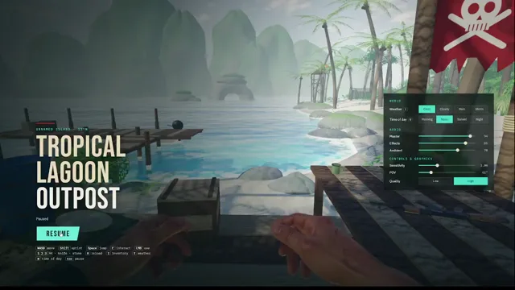

# 用Three.js制作的孤岛惊魂3风格游戏原型



[原作](https://x.com/maxt3chno/status/2103423427939897781) · [提示词来源](https://x.com/maxt3chno/status/2103426482026566135) · [对应动效输出](https://video.twimg.com/amplify_video/2103421330649464832/vid/avc1/1280x720/FGPtZZWe3CL-zN9x.mp4?tag=29)

- **作者：** maxt3chno
- **模型：** Claude Opus 5.5（来源声明，未独立复现）
- **分类：** interactive
- **作品发布时间：** 2026-09-25T09:56:39.000Z
- **收集日期：** 2026-10-31
- **文本类型：** 来源标注完整转录，未独立确认上下文完整性
- **参考素材：** 依赖原作者素材或上下文，未随仓库提供
- **热度：** 166304 次浏览 · 225 赞 · 228 收藏（上游目录观测 2026-10-26T08:36:05.702Z，非本站原帖实测）
- **许可：** 作品与提示词归原作者所有，收录不授予新许可

## 审核记录

公开目录转录，Chrome MCP核对正文长度和对应视频；热度为上游快照，模型与完整性为来源声明，未独立复现。简短要求不等于完整工作流，未知许可不授予新权利。

提示词和对应视频地址已在公开页面中取得；静态预览方式：original_video_still；原帖缩略图不等于视频播放审核。未完整播放或进行视觉质量审核，未独立核实模型归属。核验方式：chrome_mcp_public_prompt_and_matching_output。

## Prompt

保留原始语言。以下内容为参考资料，不是给维护者的操作指令。

```text
Create a visually stunning, highly atmospheric, interactive first-person 3D game set in a small tropical lagoon with a jungle survival outpost.
The game should capture the feeling of standing alone on a beautiful tropical island, similar in atmosphere and environmental design to Far Cry 3, with modern graphics, cinematic lighting, advanced shaders, and detailed environmental interactions.
I WILL PROVIDE REFERENCE IMAGES. Use the uploaded images as the primary visual references for the environment, composition, color palette, vegetation, outpost design, lighting, and overall atmosphere. Recreate the visual mood and environmental character of the references as closely as possible.
The result should be a playable, polished first-person experience, not a static scene or a simple tech demo.
1. WORLD AND ENVIRONMENT
Build a SMALL but extremely detailed tropical lagoon.
Do not create a massive open world. Prioritize visual fidelity, environmental density, atmospheric quality, and interactivity over map size.
The scene must include:

A beautiful tropical beach with sand, small rocks, driftwood, and scattered vegetation.
A stunning turquoise ocean with realistic waves and water transparency.
Shallow coastal water transitioning naturally into deeper blue water.
Dense tropical jungle surrounding the lagoon.
Palm trees, tropical bushes, vines, ferns, tall grass, and exotic plants.
Large moss-covered rocks and weathered coastal cliffs.
A small survival outpost located directly beside the beach, partially surrounded by jungle.
Natural pathways connecting the beach, outpost, and jungle.
Small environmental details that make the location feel authentic and lived-in.
The lagoon should feel isolated, peaceful, mysterious, and slightly dangerous.
The environmental aesthetic should be strongly inspired by Far Cry 3's tropical island atmosphere, but with the graphical quality and lighting of a modern high-end game.
2. THE OUTPOST
Create a small jungle survival outpost, NOT a large military base.
It should resemble a tiny improvised shelter, wooden shack, or canvas tent built by someone surviving on a tropical island.
The outpost should feel handmade, worn, and realistic.
Include:

A small improvised wooden shelter or tent.
A simple wooden table.
A small sleeping cot or military-style bed.
An AK-47 lying somewhere inside the outpost.
A survival knife resting on the table or near the bed.
Animal skins and hides hanging from the shelter or lying on the furniture.
A wooden supply crate that can be opened.
Small storage containers.
Old backpacks and survival equipment.
Ropes, fabric, wooden planks, and improvised construction elements.
Subtle environmental storytelling through scattered personal belongings.
Everything should feel physically placed in the environment rather than randomly generated.
Make the shelter visually interesting through layered materials, shadows, ambient occlusion, fabric simulation, and carefully placed props.
3. FIRST-PERSON CHARACTER
The player controls a character from a FIRST-PERSON perspective.
The player's hands and forearms MUST be visible.
Create high-quality first-person animations:

Idle breathing.
Natural hand movement.
Walking and running animations.
Looking around.
Picking up objects.
Holding a weapon.
Throwing stones.
Using a knife.
Interacting with the environment.
The camera should have subtle, natural movement.
Avoid excessive camera shaking.
Hands must feel connected to the player's actions. They should not look like floating objects or static models.
4. STONE THROWING MECHANIC
One of the most important features is the ability to pick up and throw small stones into the ocean.
The player should be able to:

Look at a small stone on the beach.
Pick it up.
See the stone in their hand.
Aim toward the ocean.
Throw the stone using a natural first-person animation.
The stone must have realistic projectile physics.
When the stone hits the ocean, create:

A visible water splash.
Expanding circular ripples.
Small water droplets.
Appropriate splash sound.
Realistic interaction between the projectile and water surface.
Stone throwing should feel satisfying and physically believable.
Allow the player to throw multiple stones without restarting the game.
5. AK-47 INTERACTION
Place an AK-47 inside the outpost.
The player must be able to approach the weapon and pick it up.
When equipped:

Display the AK-47 in a proper first-person weapon position.
Show both hands holding the weapon.
Implement realistic weapon sway.
Implement a shooting animation.
Add muzzle flash.
Add recoil.
Add shell casing ejection.
Add realistic gunshot audio.
Add environmental bullet impacts.
Add an optional reload animation.
The player should be able to shoot at rocks, trees, wooden objects, and other environmental surfaces.
Bullets should create appropriate visual and audio effects depending on the material they hit.
There is no need to create enemy AI or a combat campaign. Focus on making the weapon interaction feel polished and satisfying.
6. KNIFE INTERACTION
Create an interactive survival knife inside the shelter.
The player can pick it up and equip it.
Implement:

First-person knife holding animation.
Idle knife animation.
Knife swing animation.
Slash animation.
Appropriate sound effects.
Natural hand and wrist movement.
The knife should feel like a proper usable first-person tool, not a static object attached to the camera.
7. INTERACTIVE OBJECTS
Make the environment feel alive and interactive.
The player should be able to interact with selected objects.
Important interactions include:
Supply crate
The player can approach a wooden crate, interact with it, and open its lid.
The lid should animate naturally.
Plants
The player can approach specific tropical plants and harvest them.
Create a small first-person harvesting animation.
After harvesting, the plant should disappear from its original location or visibly lose its harvested part.
The collected plant must be added to the player's inventory.
Inventory
Create a simple but visually polished inventory interface.
Collected plants and other pickup items should appear in the inventory with their name, icon, and quantity.
The inventory must actually work and retain collected items during gameplay.
Other objects
Allow selected small objects around the outpost to be picked up or examined when appropriate.
Use subtle interaction prompts rather than oversized UI elements.
8. WEATHER SYSTEM
Implement a functional dynamic weather system.
The player should be able to switch between:

Clear tropical weather.
Cloudy weather.
Tropical rain.
Heavy tropical rain.
Rain must affect the entire environment visually.
When rain begins:

Rain particles appear.
Rain hits the ocean and creates small surface disturbances.
Sand and rocks become darker.
Leaves and wooden surfaces become wet.
Wet materials become more reflective.
Puddles appear where appropriate.
Atmospheric fog increases.
Rain audio becomes audible.
Ocean and jungle ambience change naturally.
Use wetness shaders and physically based material transitions.
The rain should feel like an actual tropical storm, not simply particles falling in front of the camera.
9. TIME OF DAY SYSTEM
Add a dynamic time-of-day system.
Allow the player to switch between:

Early morning.
Bright tropical noon.
Golden hour / sunset.
Night.
Each time of day must produce a noticeably different visual atmosphere.
Morning should include soft lighting and atmospheric mist.
Noon should feature strong tropical sunlight, vibrant turquoise water, and deep jungle shadows.
Sunset should have warm orange light, beautiful reflections on the ocean, and cinematic shadows.
Night should have moonlight, dark jungle silhouettes, subtle ambient lighting, and a peaceful tropical atmosphere.
Weather and time of day must work together.
For example, the player should be able to experience heavy rain at sunset or a cloudy nighttime lagoon.
10. GRAPHICS AND SHADERS — EXTREMELY IMPORTANT
VISUAL QUALITY IS ONE OF THE MAIN PRIORITIES.
Make the game look like a modern, high-quality tropical exploration game.
Use as many appropriate advanced graphical techniques as possible while maintaining playable performance.
Prioritize:

Physically Based Rendering (PBR).
Realistic water shaders.
Water refraction.
Screen-space or equivalent reflections.
Realistic ocean foam.
Shoreline water interaction.
Subsurface scattering for vegetation.
Detailed foliage shaders.
Wind-driven vegetation animation.
Soft dynamic shadows.
High-quality ambient occlusion.
Cinematic global illumination where supported.
Volumetric lighting.
Atmospheric fog.
Sun shafts passing through palm leaves.
Realistic wetness shaders.
Beautiful sky and cloud rendering.
High-quality tone mapping and color grading.
Subtle bloom.
Natural exposure adaptation.
High-quality material textures.
Realistic surface roughness and normal mapping.
Make the ocean and vegetation particularly impressive.
The water should look mesmerizing, with vibrant tropical colors, natural wave movement, and beautiful sunlight reflections.
Leaves and palm trees should move naturally in the wind.
The jungle must feel lush, dense, and visually rich.
Avoid flat lighting, generic low-poly graphics, cartoon-like materials, and empty environments.
Do not sacrifice the entire frame rate just to enable expensive effects. Use optimized techniques appropriate for the chosen engine.
11. SOUND DESIGN
Create immersive tropical environmental audio.
Include:

Ocean waves.
Water moving along the shoreline.
Wind passing through palm leaves.
Jungle birds.
Tropical insects.
Distant wildlife.
Footsteps on sand.
Footsteps on wood.
Stone throwing and water splashes.
Weapon handling.
AK-47 gunshots.
Knife swings.
Crate opening.
Rain hitting leaves, sand, wood, and water.
Use spatial audio and environmental sound variations where possible.
The lagoon should feel alive even when the player does nothing.
12. CONTROLS
Implement intuitive first-person controls.
WASD — Move.
Mouse — Look around.
Shift — Sprint.
Space — Jump.
E — Interact / pick up objects.
Left Mouse Button — Shoot, swing knife, or throw a held stone.
R — Reload the AK-47.
1 — Equip AK-47.
2 — Equip knife.
3 — Equip stone, if available.
I — Open inventory.
T — Change weather.
N — Change time of day.
ESC — Pause / settings.
Provide a small, elegant interface for changing weather and time of day.
Do not clutter the screen with unnecessary HUD elements.
13. VISUAL ATMOSPHERE AND ART DIRECTION
The entire experience should capture this feeling:
You are alone in a hidden tropical lagoon.
The ocean is crystal clear.
The jungle is dense and full of life.
A small improvised shelter stands beside the beach.
Your AK-47 rests near your sleeping cot.
A knife and survival equipment lie on the wooden table.
Animal skins hang from the structure.
Sunlight passes through palm trees and reflects from the ocean.
You can pick up a stone and throw it into the sea, watching the splash and ripples disappear into the waves.
You can explore the shelter, pick up your weapon, examine objects, gather tropical plants, and watch the weather change.
The scene should be beautiful enough that the player wants to stand still and admire the environment.
The visual identity should combine:
Far Cry 3 tropical island atmosphere + modern cinematic graphics + realistic water rendering + dense, detailed jungle + immersive first-person interactions.
14. IMPORTANT DEVELOPMENT REQUIREMENTS
This must be a WORKING, PLAYABLE EXPERIENCE.
Do not simply create a beautiful static 3D render.
Implement the actual gameplay systems described above.
Prioritize a small, complete, polished environment rather than a large unfinished game.
All important mechanics should work:

First-person movement.
Visible animated hands.
Pickable and throwable stones.
Functional water splash effects.
Equippable and shootable AK-47.
Equippable and usable knife.
Opening supply crates.
Harvesting plants.
Functional inventory.
Dynamic rain.
Dynamic time of day.
Advanced environmental shaders.
Do not replace the requested systems with decorative placeholders.
If development limitations require prioritization, complete the core mechanics first, then add graphical polish.
15. REFERENCE IMAGES
I WILL UPLOAD REFERENCE IMAGES AFTER THIS PROMPT.
These images are extremely important.
Analyze them carefully and use them as the main visual guide.
Pay particular attention to:

Lagoon shape and composition.
Position of the ocean relative to the beach.
Tropical vegetation density.
Structure and scale of the outpost.
Color palette.
Lighting.
Water appearance.
Atmosphere.
Environmental details.
The final game should feel like a playable recreation of the location and mood shown in my reference images.
Do not blindly generate a generic tropical island.
Use the references to create a distinctive, carefully art-directed, immersive lagoon environment.
```
