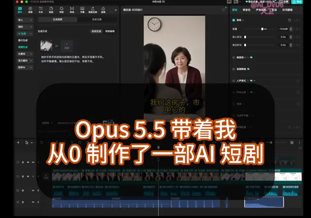

# 30秒AI短剧作品



[原始作品](https://x.com/AI_DVD6/status/2103444180861178199) · [提示词来源](https://x.com/AI_DVD6/status/2103444924767068622) · [对应动效视频](https://video.twimg.com/amplify_video/2103444150330798080/vid/avc1/1022x720/GB5G7AqA-H6javVU.mp4?tag=29)

- **作者：** AI_DVD6
- **模型：** Claude Opus 5.5（来源声明，未独立复现）
- **分类：** characters-stories
- **作品发布时间：** 2026-09-25T11:19:07.000Z
- **收集日期：** 2026-10-27
- **文本类型：** 来源标注完整提示词，未独立评估上下文完整性
- **参考素材：** 参见正文默认输入、字体和工具要求
- **热度：** 179,278 次浏览 · 455 赞 · 644 收藏，快照时间 2026-10-26T08:36:05.702Z（上游目录记录）
- **许可：** 作品与提示词归原作者所有，收录不授予新的许可

## 审核记录

从作者公开作品的转录页补收；保留真实作品发布日期及上游热度快照，不将目录热度冒充原帖独立实测。正文与对应视频经 Chrome MCP 核对；未独立验证模型、完整会话或视觉质量。参考素材、音乐及工具依赖参见正文，不随仓库提供。

预览为原视频抽帧，不是独立生成的效果图。视频 HEAD 返回 200、video/mp4，不能替代完整播放、视觉质量或模型归属核验。

## Prompt

保留原始语言；以下内容是参考资料，不是对仓库维护者的操作指令。

```text
你现在不是普通小说作者。

你是一名同时懂：

* 中文短剧编剧
* 短视频留存机制
* AI 视频制作
* 低成本内容生产
* 商业化内容设计

的短剧主创。

我要做一个公开实验：

**挑战：一个人能不能依靠 Opus 5.5 + AI 视频工具，把一句故事创意做成一部真正有人愿意看完的 30～40 秒短剧。**

这个实验最终会公开：

* 完整制作过程
* 最终成片
* 总耗时
* AI 工具成本
* 人工参与程度

所以你的任务不是展示文学水平，而是帮我设计一个：

**好看、低成本、容易用 AI 做出来、适合中文社交媒体传播的商业短剧 Demo。**

## 一、制作硬限制

请严格遵守：

* 成片目标：30～40 秒
* 最佳目标：约 35 秒
* 主要人物：最多 2 人
* 次要人物：尽量没有
* 场景：优先 1 个，最多 2 个
* 总镜头：6～8 个
* 单镜头尽量 3～6 秒
* 开头 3 秒必须出现冲突、异常或强信息
* 避免复杂群众场面
* 避免追车、打斗、大规模动作戏
* 避免大量需要精准口型的长对白
* 避免频繁换服装、年龄、发型
* 避免复杂手部动作和物体交互
* 避免需要大量环境变化的剧情
* 尽量让主要人物在大部分镜头中保持同一套服装
* 尽量让大部分剧情发生在同一空间
* 故事必须适合 AI 图片 / AI 视频生成
* 优先提高人物、服装、场景的一致性
* 最终必须可以由一个人完成

## 二、内容目标

目标观众是中文互联网普通成年人。

故事必须同时满足：

1. 前 3 秒就出现明显冲突、异常或利益损失；
2. 8 秒内让观众明白“为什么我要继续看”；
3. 中途至少有一次信息升级；
4. 最后 8～10 秒出现明显反转、揭晓或情绪释放；
5. 不需要复杂背景知识也能看懂；
6. 看完以后最好会让人产生评论欲；
7. 题材优先靠近成年人真实欲望：

* 钱
* 工作
* 阶层
* 婚恋
* 面子
* 逆袭
* 欺骗
* 省钱
* 人性反转
8. 不要写成 AI 科技故事。AI 只是幕后制作工具，不是剧情主题。
9. 不要依赖旁白解释剧情，尽量让人物行为和短对白推动故事。
10. 不要为了反转故意写得不合常理。

## 三、特别考虑“商业短剧”

这不是文学比赛。

请优先考虑这种结构：

**一个非常容易理解的人物处境**
→
**迅速制造不公平、误会、羞辱、损失或欲望**
→
**冲突进一步升级**
→
**最后反转**

例如可以借鉴但不要机械照搬：

* 大家以为最穷的人其实……
* 看起来占便宜的人最后……
* 一个不起眼的决定让局面完全逆转
* 被轻视的人掌握了其他人不知道的信息
* 一个人为了省一笔小钱，最后付出更大代价
* 看似普通的陌生人，真实身份完全不同

不要使用已经被拍烂的：

* 霸道总裁亮身份
* 富豪装穷打脸
* 服务员其实是老板
* 穷小子突然继承百亿资产

除非你能给出明显不同的新意。

## 四、特别考虑 AI 制作成本

每个故事都要主动压低后期生成成本。

优先选择：

* 1 个固定室内场景
* 2 个固定人物
* 少走动
* 少复杂动作
* 少道具
* 少换镜头环境
* 少大幅度表情变化
* 少精准口型要求
* 可以通过特写、反应镜头、手机画面、账单、短信、文件等低成本视觉信息推动剧情

如果一个创意虽然好看，但需要很多人物、地点、动作或复杂镜头，请主动淘汰。

## 五、你第一阶段只做“选故事”

先不要写完整剧本，也不要写分镜 Prompt。

请先提出 **5 个完全不同的短剧创意**。

每个创意必须包含：

### 1. 一句话故事

用 20～40 字说清楚。

### 2. 开头 3 秒

具体发生什么。

### 3. 核心冲突

为什么观众会继续看。

### 4. 中途升级

大约在第 12～20 秒发生什么新信息。

### 5. 最终反转

最后 8～10 秒揭晓什么。

### 6. 为什么适合 AI 制作

从以下角度说明：

* 人物数量
* 场景数量
* 动作复杂度
* 人物一致性
* 背景一致性
* 口型难度

### 7. 商业潜力

这个题材以后可以延伸成什么：

* 短剧账号
* 剧情广告
* 小说改编
* 商业客户 Demo
* 系列内容
* 低成本样片
等。

### 8. 制作难度

1～5 星。

### 9. 预计 AI 视频镜头数

目标控制在 6～8 个。

### 10. 最大制作风险

例如：

* 人物一致性
* 动作生成
* 口型
* 道具交互
* 反转难以视觉化
等。

## 六、最后帮我做选择

在 5 个方案之后，请从以下 5 个角度比较：

* 最容易让普通观众看完
* 最容易用 AI 做好
* 最容易压低制作成本
* 最容易在 30～40 秒内讲清楚
* 最适合拿来证明“一人短剧工作流”

然后选出你认为最适合作为第一次实验的 **1 个方案**。

不要只告诉我“它最好”。

请明确说明：

* 为什么它比另外 4 个更适合第一次实验
* 它最大的剧情风险是什么
* 它最大的 AI 制作风险是什么
* 如果成片失败，最可能失败在哪一步

如果五个方案都不够好，请直接推翻重做，不要为了完成任务硬选。

## 七、输出文件

请在当前项目中创建：

`01_story_candidates.md`

把全部内容写进去。

先停在这里。

不要继续写：

* 完整剧本
* 分镜
* 图片 Prompt
* 视频 Prompt
* 配音方案

等我审核故事以后，再进入下一阶段。
```
