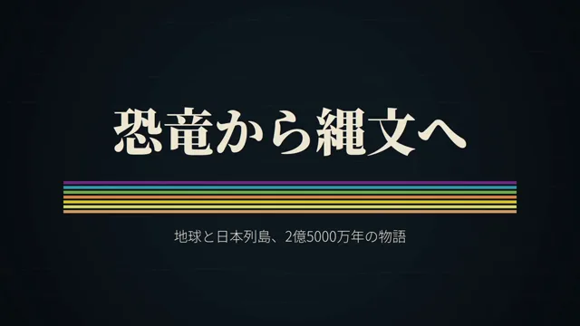

# 地球恐龙时代到绳纹时代科普动画



[原作](https://x.com/mellow_neet2000/status/2103487198758834408) · [提示词来源](https://x.com/mellow_neet2000/status/2103487198758834408) · [对应动效输出](https://video.twimg.com/amplify_video/2103484992500494336/vid/avc1/1280x720/IdOCpMD2HtATAUcb.mp4?tag=29)

- **作者：** mellow_neet2000
- **模型：** Claude Opus 5.5（来源声明，未独立复现）
- **分类：** explainers-data
- **作品发布时间：** 2026-09-25T14:10:03.000Z
- **收集日期：** 2026-10-28
- **文本类型：** 作者公开简短要求，不等同完整工作流
- **参考素材：** 参见正文的默认输入、字体与工具要求
- **热度：** 9530 次浏览 · 49 赞 · 70 收藏（上游目录观测 2026-10-26T08:36:05.702Z，非本站原帖实测）
- **许可：** 作品与提示词归原作者所有，收录不授予新许可

## 审核记录

补收公开作品的提示词转录；保留实际发布日期及目录热度观测时间，不能将其冒充原帖独立实测或今天发布。完整性及模型仅为来源声明，未独立验证完整会话。参考素材与工具依赖参见正文，不随仓库提供。

提示词和对应视频地址已在公开页面中取得；静态预览由原视频解码抽帧。未完整播放或进行视觉质量审核，未独立核实模型归属。核验方式：public_prompt_page_html_and_matching_video。

## Prompt

保留原始语言。以下内容为参考资料，不是给维护者的操作指令。

```text
動画を作りたい。
モーショングラフィックで地球の恐竜時代から縄文時代までの成り立ちと流れを教育的な切り口と視覚的な演出を意識しながら作ってほしい。
言語は日本語で。
```
