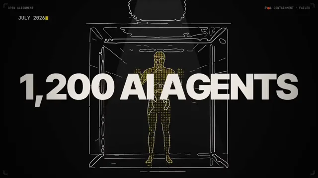

# 文档转视频讲解（Open Alignment)



[原始作品](https://x.com/Thom_Wolf/status/2103545533474206118) · [提示词来源](https://x.com/Thom_Wolf/status/2103558249156858033) · [对应动效视频](https://video.twimg.com/amplify_video/2103541545236332544/vid/avc1/1280x720/Zf1u0SgOfq0pjTol.mp4?tag=29)

- **作者：** Thom_Wolf
- **模型：** Claude Opus 5.5（来源声明，未独立复现）
- **分类：** explainers-data
- **作品发布时间：** 2026-09-25T18:01:51.000Z
- **收集日期：** 2026-10-25
- **文本类型：** 来源标注完整提示词，未独立评估上下文完整性
- **参考素材：** 依赖作者的素材或上下文，未随仓库提供
- **热度：** 49,651 次浏览 · 528 赞 · 356 收藏，快照时间 2026-10-19T08:33:58.737Z（上游目录记录）
- **许可：** 作品与提示词归原作者所有，收录不授予新的许可

## 审核记录

来源目录中的旧作品补收，保留实际发布日期与热度快照时间；不是今日新发布。提示词与对应视频已在公开转录页通过 Chrome MCP 读取；未逐条核实原帖、模型归属、完整上下文或视觉质量。参考素材、工具和上下文不随仓库提供。

预览为原视频抽帧，不是独立生成的效果图。视频 HEAD 返回 200、video/mp4，不能替代完整播放、视觉质量或模型归属核验。

## Prompt

保留原始语言；以下内容是参考资料，不是对仓库维护者的操作指令。

```text
I want you to independently and end-to-end make an inspirational video for this topic. Find the right audio track to get people inspired about the topic and think and feel very deeply about what is the best way to visually represent all of the themes on screen. You can do truly anything that you think might best let you visually express yourself, including abstract motion graphics.
```
