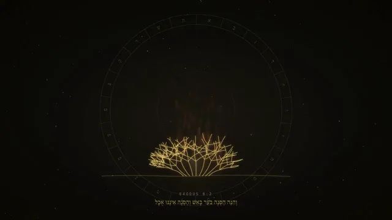

# 犹太历史纪录片一次生成



[原始作品](https://x.com/eranshir/status/2103564391170089429) · [提示词来源](https://x.com/eranshir/status/2103794993764904974) · [对应动效视频](https://video.twimg.com/amplify_video/2103563244606558208/vid/avc1/1280x720/_VtAbOu_EoojgbCz.mp4?tag=29)

- **作者：** eranshir
- **模型：** Claude Opus 5.5（来源声明，未独立复现）
- **分类：** explainers-data
- **作品发布时间：** 2026-09-25T19:16:47.000Z
- **收集日期：** 2026-10-27
- **文本类型：** 来源标注完整提示词，未独立评估上下文完整性
- **参考素材：** 依赖作者的素材或上下文，未随仓库提供
- **热度：** 53,786 次浏览 · 279 赞 · 152 收藏，快照时间 2026-10-26T08:36:05.702Z（上游目录记录）
- **许可：** 作品与提示词归原作者所有，收录不授予新的许可

## 审核记录

从作者公开作品的转录页补收；保留真实作品发布日期及上游热度快照，不将目录热度冒充原帖独立实测。正文与对应视频经 Chrome MCP 核对；未独立验证模型、完整会话或视觉质量。参考素材、音乐及工具依赖参见正文，不随仓库提供。

预览为原视频抽帧，不是独立生成的效果图。视频 HEAD 返回 200、video/mp4，不能替代完整播放、视觉质量或模型归属核验。

## Prompt

保留原始语言；以下内容是参考资料，不是对仓库维护者的操作指令。

```text
I want you to create a video inspired by the video in this folder but covering all of jewish history. You can use whatever tool or process you need, iterate as many time as you need, create something that will be illuminating, have a strong hook, be interesting, entertaining, and provide some profound angles. You want to leverage imagery, messages and hints that are sitting rent free in people's mind to build a powerful narrative.

Iterate as much as you want, take artistic freedom, but I want when i watch it to be drawn in, get immersed, be moved.
```
