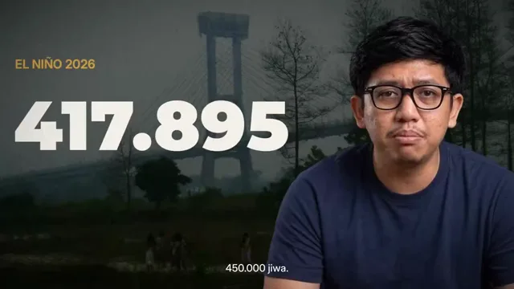

# 讲解厄尔尼诺现象的纪录片风格短片



[原始作品](https://x.com/hanifproduktif/status/2103656501579862155) · [提示词来源](https://x.com/hanifproduktif/status/2103656501579862155) · [对应动效视频](https://video.twimg.com/amplify_video/2103656279856275456/vid/avc1/1280x720/8QAkH0HXjSa8X_5f.mp4?tag=29)

- **作者：** hanifproduktif
- **模型：** Claude Opus 5.5（来源声明，未独立复现）
- **分类：** explainers-data
- **作品发布时间：** 2026-09-26T01:22:48.000Z
- **收集日期：** 2026-10-25
- **文本类型：** 作者公开的简短要求，不等同完整工作流
- **参考素材：** 参见正文默认输入、字体和工具要求
- **热度：** 32,552 次浏览 · 519 赞 · 387 收藏，快照时间 2026-10-19T08:33:58.737Z（上游目录记录）
- **许可：** 作品与提示词归原作者所有，收录不授予新的许可

## 审核记录

来源目录中的旧作品补收，保留实际发布日期与热度快照时间；不是今日新发布。提示词与对应视频已在公开转录页通过 Chrome MCP 读取；未逐条核实原帖、模型归属、完整上下文或视觉质量。参考素材、工具和上下文不随仓库提供。

预览为原视频抽帧，不是独立生成的效果图。视频 HEAD 返回 200、video/mp4，不能替代完整播放、视觉质量或模型归属核验。

## Prompt

保留原始语言；以下内容是参考资料，不是对仓库维护者的操作指令。

```text
bikin video reels ala dokumenter Netflix but jelasin El Niño pake bahasa bayi (durasi 2:30)
```
