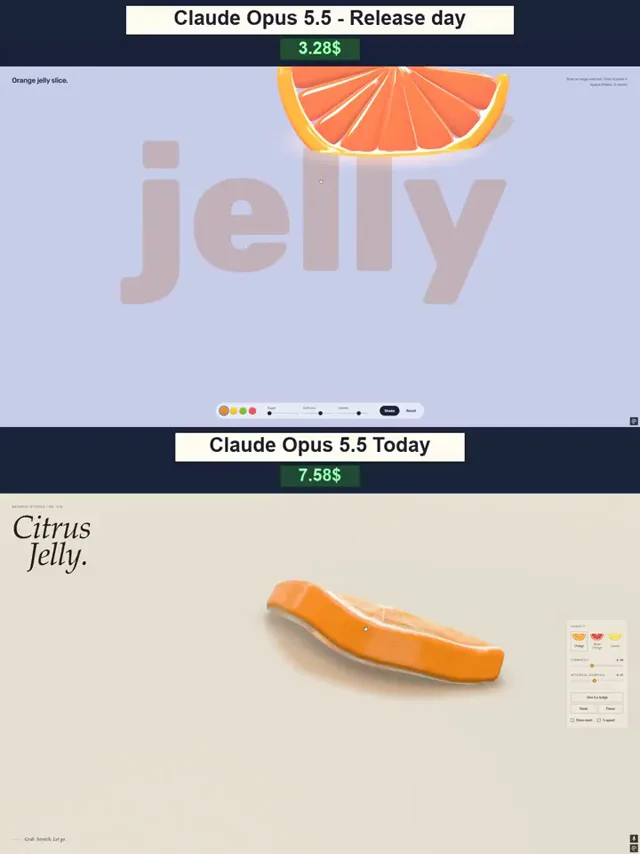

# 果冻物理效果迭代对比



[原作](https://x.com/vib3coded/status/2103822857155313953) · [提示词来源](https://x.com/vib3coded/status/2103823351248535667) · [对应动效输出](https://video.twimg.com/amplify_video/2103822641941426176/vid/avc1/720x960/6G2jScIE__WPqiSr.mp4?tag=29)

- **作者：** vib3coded
- **模型：** Claude Opus 5.5（来源声明，未独立复现）
- **分类：** 3d-simulations
- **作品发布时间：** 2026-09-26T12:23:50.000Z
- **收集日期：** 2026-10-31
- **文本类型：** 来源标注完整转录，未独立确认上下文完整性
- **参考素材：** 参见正文的默认输入、字体与工具要求
- **热度：** 78866 次浏览 · 360 赞 · 165 收藏（上游目录观测 2026-10-26T08:36:05.702Z，非本站原帖实测）
- **许可：** 作品与提示词归原作者所有，收录不授予新许可

## 审核记录

公开目录转录，Chrome MCP核对正文长度和对应视频；热度为上游快照，模型与完整性为来源声明，未独立复现。简短要求不等于完整工作流，未知许可不授予新权利。

提示词和对应视频地址已在公开页面中取得；静态预览方式：original_video_still；原帖缩略图不等于视频播放审核。未完整播放或进行视觉质量审核，未独立核实模型归属。核验方式：chrome_mcp_public_prompt_and_matching_output。

## Prompt

保留原始语言。以下内容为参考资料，不是给维护者的操作指令。

```text
Create Citrus Jelly — an interactive 3D scene featuring a gummy orange slice. Everything must run directly in the browser in a single HTML file using WebGPU and WGSL shaders. Build genuine volumetric 3D geometry, not an image or a prerecorded animation.
APPEARANCE
A thick semicircular orange slice with vibrant orange flesh, a pale pith layer, and a firmer outer rind.

Visible radial segments, thin internal membranes, and tiny bubbles.
A juicy, translucent gummy material with soft highlights, light refraction, and depth-dependent color.
Avoid making it look like rigid plastic or glass.
Use a light cream background, soft studio lighting, and a contact shadow. Avoid overexposure.
PHYSICS AND INTERACTION

Let users grab any visible point with a mouse or finger and pull it.

Deformation must originate at the grab point and propagate naturally through neighboring areas.
The flesh should stretch and narrow under tension, while the rind offers more resistance.
On release, the slice should spring back gently, with oscillations gradually settling.
Use a stable soft-body simulation: a spring mesh or volumetric elastic constraints with volume preservation.
Segments, membranes, and bubbles must deform with the flesh rather than separating or floating independently.
Include ground collisions: the slice should squash slightly on impact and wobble afterward.
Prevent instant snapping back, endless oscillation, and exploding geometry.
INTERFACE

A minimal editorial layout with generous whitespace.

A large italic serif heading, “Citrus Jelly.”, on the left.
A compact control panel on the right with Firmness and Internal damping sliders.
Give it a nudge, Reset, and Pause buttons.
Show mesh and ¼ speed toggles.
Three color presets: Orange, Blood Orange, and Lemon.
A small interaction hint: “Grab. Stretch. Let go.”
All labels in English, with comfortable desktop and mobile controls.
TECHNICAL REQUIREMENTS

Genuine WebGPU rendering, not a Canvas 2D substitute.

Generate geometry and materials in code without premade models.
Use a fixed simulation timestep and constraints that prevent excessive stretching.
Maintain smooth performance during grabbing, dragging, and release.
Display a clear fallback message when WebGPU is unavailable.
Test different grab locations, strong stretching, oscillation decay, collisions, and reset.
The main priority is a convincing gummy feel. The slice should look soft, juicy, and so satisfying in motion that people want to keep stretching it.
```
