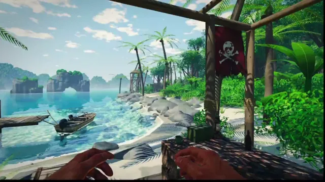

# 孤岛惊魂3克隆游戏（优化版）



[原作](https://x.com/maxt3chno/status/2103960867327115462) · [提示词来源](https://x.com/maxt3chno/status/2103961551031996532) · [对应动效输出](https://video.twimg.com/amplify_video/2103958262580154369/vid/avc1/1280x720/QU__8LmwPuy3UfnD.mp4?tag=29)

- **作者：** maxt3chno
- **模型：** Claude Opus 5.5（来源声明，未独立复现）
- **分类：** interactive
- **作品发布时间：** 2026-09-26T21:32:15.000Z
- **收集日期：** 2026-10-29
- **文本类型：** 来源标注完整转录，未独立确认上下文完整性
- **参考素材：** 依赖原作者素材或上下文，未随仓库提供
- **热度：** 219688 次浏览 · 1694 赞 · 903 收藏（上游目录观测 2026-10-26T08:36:05.702Z，非本站原帖实测）
- **许可：** 作品与提示词归原作者所有，收录不授予新许可

## 审核记录

补收公开作品的提示词转录；保留实际发布日期及目录热度观测时间，不能将其冒充原帖独立实测或今天发布。完整性及模型仅为来源声明，未独立验证完整会话。参考素材与工具依赖参见正文，不随仓库提供。

提示词和对应视频地址已在公开页面中取得；静态预览由原视频解码抽帧。未完整播放或进行视觉质量审核，未独立核实模型归属。核验方式：public_prompt_page_html_and_matching_video。

## Prompt

保留原始语言。以下内容为参考资料，不是给维护者的操作指令。

```text
CLOSING THE GAP TO THE REFERENCE (Stages 6–11)

Stages 1–5 are done: the world, controller, outpost, water, sky, vegetation, hands, weapons, inventory, weather, time of day, audio and menus all work, and the layout already matches the reference. What's missing is image quality. Right now the frame looks like clean low-poly under a milky haze. The reference looks like a saturated, high-contrast, gritty, lived-in photograph. Stages 6–11 close that gap.

Global rules for Stages 6–11:
- Every new effect sits behind a quality flag. Low must stay fast.
- Don't break earlier stages: time of day, weather, rain, wetness and lightning must all still combine correctly. At the end of each stage, check Noon/Clear and Sunset/Storm once.
- Keep existing APIs compatible: getWaterHeight(x,z), addRipple(x,z,strength), setSkyState({...}), shared globals (wind, wetness, rain, time) and the effects event bus.
- Rebuild the standalone bundle after every change and do one console-error check. No test loops.
- Run each stage in a fresh session. Do only that stage.

────────────────────────
STAGE 6 — Light, atmosphere, color grading, dappled shadows (reasoning: High)
Goal: remove the milky haze and get a punchy tropical-noon frame with lace-like leaf shadows. This stage is the cheapest and has the biggest impact.

1. Haze/fog: cut daytime fog density and height sharply. Fog only lies low at the foot of the mountains and far out over the water. Aerial perspective is blue (#9cc3dc → #cfe6f5), never white. Mountains read in 3 depth layers, with more blue on each layer further back.
2. Sky: zenith ~#4f9fe0 fading to a #cfe6f5 horizon. Cumulus clouds get crisp, sunlit white tops, blue-grey undersides and a silver lining near the sun. Denser clouds, less smeared vapor.
3. Sun and ambient: stronger sun; darker, cooler ambient/hemisphere light so shadows go deep (shadowed areas at ~15–20% of lit brightness); warm bounce light from the sand.
4. Grading: an S-curve for contrast, saturation ~×1.25, slightly lower exposure, warm highlights and cool turquoise shadows. Add a contrast-adaptive sharpening pass after FXAA. Raise the bloom threshold so it never washes the frame out. God rays only through foliage, not across the whole screen. Make sure eye adaptation doesn't brighten the image back up.
5. Dappled shadows: add 1–2 palms over the shelter, with one trunk and its fronds framing the top-left of the starting view like the reference. Leaves cast alpha-tested shadows (custom depth/distance materials using the leaf mask). Also add an animated light cookie that projects leaf dapples inside the shelter and sways with the wind. Tighten the shadow frustum/cascade near the player so shadows on the table stay crisp.
6. Ambient occlusion: stronger SSAO where surfaces meet (table/deck, crates, legs, props on the table), plus small contact-shadow decals under objects.
7. First-person hands: warmer skin, a bit more fill light from the sand, and scale/position closer to the reference (large, low in frame).
Acceptance: the starting frame next to the reference has comparable contrast and saturation, a deep blue sky, and visible leaf dapples on the deck and table.

────────────────────────
STAGE 7 — FLAGSHIP WATER (reasoning: Max)
Goal: water is the star of the game, at modern AAA quality — something you'd watch for minutes. Rewrite the water module in depth, not as patches, while keeping the CPU height query (getWaterHeight) exactly in sync with the GPU surface.

7.1 Wave model
- Large swell: 6–8 Gerstner harmonics using the correct deep-water dispersion relation. The CPU height query evaluates the same harmonics (iterative inverse displacement).
- Fine surface: GPU FFT ocean spectrum (Phillips/JONSWAP) with ping-pong render targets, 128²–256², in 2–3 cascades at different scales. Output displacement, normals and a Jacobian map for foam. Low quality: 1 cascade at 64² or baked tileable normals.
- No visible tiling: non-multiple cascade sizes plus rotation. In the distance, filter normals (Toksvig/LEAN-style) instead of letting them shimmer.
- Shallow water: waves shoal (grow steeper and shorter as depth drops) and refract toward the shore along the seabed gradient. Inside the lagoon it's calm and almost mirror-like; beyond the reef it's livelier.

7.2 Optics
- Per-channel RGB Beer–Lambert absorption over the real underwater ray length (from the scene depth buffer), plus in-scattering (#1fb0b8 / #16739e). Result: 0–0.5 m of water is nearly colorless, 1–3 m is vivid turquoise (#46d6c8), 6 m and deeper is deep blue, with a sharp turquoise-to-blue edge at the reef drop-off like the reference.
- Screen-space refraction offset by the normal and scaled by depth. Use a depth test so objects above the surface don't leak into the refraction. Add subtle chromatic dispersion.
- Reflections: screen-space reflections (High) with a sky/PMREM fallback, plus a half-resolution planar reflection over the near lagoon (High) so the pier, boat and palms reflect properly. Schlick Fresnel with F0 = 0.02: clear up close, mirror-like at grazing angles.
- Sun: a tight GGX highlight plus stochastic micro-facet glitter sparkling on wave crests. A proper sun glitter path at sunset, a moon path at night.
- Subsurface scattering: backlit wave crests glow turquoise.
- The sky and clouds in reflections come from the same sky function, and clouds move in the reflection too.

7.3 Seabed, caustics, reef
- Animated caustics (layered Voronoi or a baked caustic texture with perspective warp), RGB chromatic split, intensity by depth. Project them onto everything underwater: sand, rocks, pier piles, boat hull, the player's legs. Caustics fade in shadow (sample the shadow map).
- Reef: 40–80 instanced coral/rock clusters on the lagoon floor (the dark patches in the reference), swaying seagrass, sand ripples on the bottom (normal map), scattered shells. The seabed gets its own darker wet material.
- Underwater light shafts when looking up from below the surface.

7.4 Shore and foam
- Swash: a thin sheet of water runs up the sand and drains back. It leaves a dark wet band that dries with a delay, and a bubbly foam line rides on its leading edge.
- Foam: a real procedural bubble/foam texture, not raw noise. It spawns on crests (from the FFT Jacobian), along the shoreline, and around rocks, piles and the boat (from depth difference). It persists and decays over time (an accumulation buffer on High).
- Rings of foam and small ripples around piles and rocks standing in the water.

7.5 Interactivity
- addRipple feeds a real height-field wave simulation: a 256² ping-pong grid centered on the player that scrolls with them. Stone splashes, bullet impacts, raindrops and the player's footsteps in water create rings that reflect and interfere physically.
- Wake/Kelvin-style bow waves from the player wading.
- Buoyancy: the boat, fallen crates, shells and stones bob using the height query plus the surface normal. The boat tugs at its mooring lines. Fix the boat: hull above the waterline, clearly visible next to the pier in the starting frame.
- Underwater mode (camera below the surface): water-colored underwater fog, distortion, caustic light shafts, muffled audio (emit an 'underwater' event for the audio system), and a correct half-in/half-out waterline split across the screen.

7.6 Weather and time hooks
- Expose every new parameter through water.setParams({...}), driven by the weather/time compositor: wind drives the spectrum (flat calm when clear → whitecaps in a storm), rain adds droplet rings to the height field plus surface roughness, night gives a moon path, sunset a golden path.

7.7 Performance
- High: FFT with 2 cascades at 256², planar reflection + SSR, height field at 256². Low: 1 cascade at 64² (or baked normals), no planar reflection/SSR, height field at 128². Target: water under ~4 ms per frame on a mid-range GPU at High.
Acceptance: the starting frame shows crystal-clear turquoise shallows with a visible reef and caustics, a crisp drop-off into deep blue, a living swash line on the beach, and the pier and boat reflected. A thrown stone produces physically believable interfering rings.

────────────────────────
STAGE 8 — Terrain: karst mountains, rocks, beach, jungle (reasoning: High)
1. Karst mountains: ridged-multifractal displacement on top of the current shapes, sheer vertical walls, ledges and erosion gullies. A slope-based shader: steep areas are grey limestone with vertical streaks; ledges and gentle slopes are green canopy (a crown-shaped noise with occlusion between crowns). Thousands of cheap instanced canopy billboards on the slopes (one draw call). The sea arch and rock islet use the same materials.
2. Boulders: noise-deformed rocks with sharp ridged facets, grouped in clusters of 3–7, half-buried in sand or water, moss on top, and a dark wet band at the waterline. Triplanar texturing.
3. Jungle: broadleaf trees with clumped card-based crowns; palms of different ages and leans; dense undergrowth on the right-hand slope (ferns, bushes, banana/monstera) at 3–4× the current density with LODs; vines between trees; grass along the beach edge. No more "lawn": dark soil and leaf litter under the trees.
4. Beach: wind ripples (normal map), a wet band synced with the Stage 7 swash, pebbles, driftwood, fallen palm fronds, coconuts; a gradual transition from sand to soil to jungle, with grass.
5. Move the hut and the watchtower 20–30% closer into the starting frame if it doesn't break collisions or paths.

────────────────────────
STAGE 9 — Next-level procedural materials (reasoning: High)
All generators produce albedo/normal/roughness(/AO) maps at 1024² (512² on Low), cached.
1. Old weathered wood: stretched-noise grain, knots, cracks, a different tone and UV offset per plank, dark seams, grime in the corners, sun bleaching, worn light edges (from curvature). No striped "zebra" look. Used for the deck, table, pier, crates and posts.
2. Metal: paint → chipping → rust, driven by curvature/noise masks, plus rust streaks and scratches (barrel, ammo can, lantern). The mug gets chipped enamel.
3. Fabric: canvas with visible weave, stains and faded folds. Flags in faded rust-brown (#a8352a → rust), with torn alpha edges and a dirty skull.
4. Leopard pelt: correct rosette pattern plus fur shells (4–6 layers, High only) or a dense normal map, with a jagged hide edge.
5. Rope: twisted-fiber normals, thicker, frayed ends.
6. Rock and sand: triplanar mapping, moss by normal direction; grainy sand with tiny crystal glints in the sun.
If hand-made tileable PBR texture sets exist locally, use them instead of the matching generator (and embed them in the standalone bundle).

────────────────────────
STAGE 10 — Foreground props + custom models (reasoning: Medium)
1. Load any local .glb models from the models folder through the existing loader, keeping the procedural fallback. For each model: real-world scale in meters, grounding on its surface, colliders, shadows, wetness injection, and the Stage 3 interactions (inspecting the lantern/mug/map; the crate lid opens if the model has a separate lid part, otherwise keep the procedural lid).
2. Table: make the props larger and lay them out like the reference — the AK diagonally across the whole table, the knife on the front edge, the map under the knife, the mug, the ammo can, the lantern on the right, the bottle.
3. Left side: the cot (tube frame, sagging canvas, a plump pillow), the pelt hanging over its edge, a backpack and a crate next to the cot, a rusty barrel.
4. A torn flag hanging from the canopy at the top right, like the reference; rope lashings on the posts.
5. The boat moored at the pier (buoyancy from Stage 7), a crate on the pier, mooring ropes to the piles.
6. Hut and watchtower: corrugated tin roof, canvas awning, barrels, crates.

────────────────────────
STAGE 11 — Performance + final match against the reference (reasoning: Medium)
1. An FPS/frame-time overlay (F3) with a per-pass breakdown. Budget: ≥60 FPS on High on a mid-range discrete GPU, ≥30 FPS on Low on a modern iGPU.
2. Optimize: instancing, LODs, distance culling, half-resolution for the expensive passes, cached and compressed textures, proper disposal.
3. Take one screenshot from the starting view next to the reference and do a final palette tune. Check every time-of-day × weather combination.
4. Rebuild the bundle, do one console check, update the status log.
```
