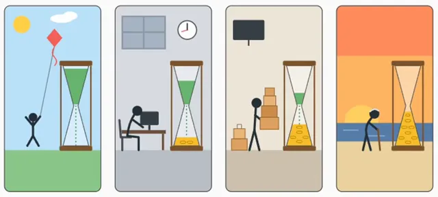

# 无文字呈现人类史上最大骗局的画面



[原作](https://x.com/Kadiner_ir/status/2105910487015674058) · [提示词来源](https://x.com/Kadiner_ir/status/2105910487015674058) · [对应动效输出](https://video.twimg.com/amplify_video/2105910025298247681/vid/avc1/1282x576/ti0j4QKB14lArHsN.mp4?tag=29)

- **作者：** Kadiner_ir
- **模型：** Claude Opus 5.5（来源声明，未独立复现）
- **分类：** characters-stories
- **作品发布时间：** 2026-10-02T06:39:20.000Z
- **收集日期：** 2026-10-31
- **文本类型：** 作者公开简短要求，不等同完整工作流
- **参考素材：** 参见正文的默认输入、字体与工具要求
- **热度：** 20838 次浏览 · 165 赞 · 72 收藏（上游目录观测 2026-10-26T08:36:05.702Z，非本站原帖实测）
- **许可：** 作品与提示词归原作者所有，收录不授予新许可

## 审核记录

公开目录转录，Chrome MCP核对正文长度和对应视频；热度为上游快照，模型与完整性为来源声明，未独立复现。简短要求不等于完整工作流，未知许可不授予新权利。

提示词和对应视频地址已在公开页面中取得；静态预览方式：original_video_still；原帖缩略图不等于视频播放审核。未完整播放或进行视觉质量审核，未独立核实模型归属。核验方式：chrome_mcp_public_prompt_and_matching_output。

## Prompt

保留原始语言。以下内容为参考资料，不是给维护者的操作指令。

```text
«بزرگ‌ترین کلاهبرداری تاریخ بشر» رو فقط با تصویر نشون بده؛ بدون حتی یک کلمه؛
```
