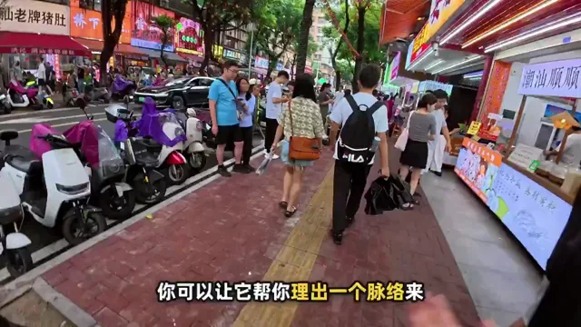

# AI剪辑旅行视频日志



[原作](https://x.com/dashiAIxz/status/2106091485125091695) · [提示词来源](https://x.com/dashiAIxz/status/2106091485125091695) · [对应动效输出](https://video.twimg.com/amplify_video/2106087186143891456/vid/avc1/1280x720/Xrk2d2j9blTm_-M8.mp4?tag=29)

- **作者：** dashiAIxz
- **模型：** Claude Opus 5.5（来源声明，未独立复现）
- **分类：** characters-stories
- **作品发布时间：** 2026-10-02T18:38:33.000Z
- **收集日期：** 2026-10-31
- **文本类型：** 来源标注完整转录，未独立确认上下文完整性
- **参考素材：** 依赖原作者素材或上下文，未随仓库提供
- **热度：** 24434 次浏览 · 182 赞 · 199 收藏（上游目录观测 2026-10-26T08:36:05.702Z，非本站原帖实测）
- **许可：** 作品与提示词归原作者所有，收录不授予新许可

## 审核记录

公开目录转录，Chrome MCP核对正文长度和对应视频；热度为上游快照，模型与完整性为来源声明，未独立复现。简短要求不等于完整工作流，未知许可不授予新权利。

提示词和对应视频地址已在公开页面中取得；静态预览方式：original_video_still；原帖缩略图不等于视频播放审核。未完整播放或进行视觉质量审核，未独立核实模型归属。核验方式：chrome_mcp_public_prompt_and_matching_output。

## Prompt

保留原始语言。以下内容为参考资料，不是给维护者的操作指令。

```text
文件目录：自媒体项目-vlog/vlog02-汕头day1
1.帮我把这些录制的内容剪辑成一段vlog。
2.你需要根据我们聊天的内容，梳理出一个或者几个合理的主题（相当于有一个脉络）
3.配上BGM（先不用管版权问题，可以去抖音上搜索相关BGM）
4.剩下的自由发挥，我是一个AI博主，我希望这个能够剪辑出一条爆款视频。
```
