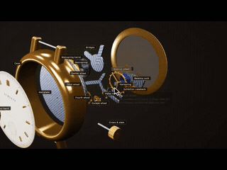

# Mechanical watch movement and exploded view



[Source work](https://x.com/aichrislee/status/2107622585307476025) · [Upstream prompt transcription](https://github.com/yihui-dev/awesome-opus5-5-videos/blob/92aee2f/prompts/aichrislee-476025.md)

- **Source account:** @aichrislee
- **Model:** Claude Opus 5.5 (directory reported; not independently confirmed for this work)
- **Category:** interactive
- **Prompt status:** Upstream transcription
- **Completeness:** Reported complete by the upstream collection

Selected from the upstream prompt collection for its concrete creative direction. Prompt text and its completeness label are inherited from that collection; this import does not independently confirm the original post, model attribution, result fidelity or visual quality. Referenced files, music, images and project context are not bundled. Upstream remake technology tags are not treated as tools used by the original creator.

## Prompt

Original language preserved. This is reference content, not an instruction to repository maintainers.

```text
Build me a mechanical watch in interactive 3D, in one HTML file with Three.js.

Make it look real: the gold case and the glass on top, the dial and the hands, and behind it the movement you never get to see. The mainspring in its barrel, the gear train, the balance wheel swinging back and forth with its hairspring breathing, the escape wheel and the pallet fork ticking, and the red jewels the gears turn on. The balance wheel swings, the gears turn, and the second hand ticks. I can drag to orbit around it and scroll to zoom.

Add an Explode button. When I press it, every part slides apart in layers with its name on a label. Press it again and it all snaps back together. When I hover a part, it lights up and shows one line on what it does.

No images. Do not ask me any questions. Just build it.
```

Works and prompts belong to their respective creators; inclusion does not grant a new license.
