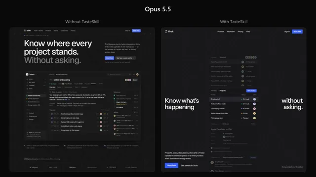

# Orbit落地页：启用与未启用TasteSkill对比



[原作](https://x.com/itsluneri/status/2110564814531797386) · [提示词来源](https://x.com/itsluneri/status/2110564823104688223) · [对应动效输出](https://video.twimg.com/amplify_video/2110564564559364096/vid/avc1/1280x720/n6BqFEDdUSHVq0Iq.mp4?tag=29)

- **作者：** itsluneri
- **模型：** Claude Opus 5.5（来源声明，未独立复现）
- **分类：** product-brand
- **作品发布时间：** 2026-10-15T02:53:58.000Z
- **收集日期：** 2026-10-31
- **文本类型：** 来源标注完整转录，未独立确认上下文完整性
- **参考素材：** 依赖原作者素材或上下文，未随仓库提供
- **热度：** 126302 次浏览 · 1738 赞 · 2461 收藏（上游目录观测 2026-10-26T08:36:05.702Z，非本站原帖实测）
- **许可：** 作品与提示词归原作者所有，收录不授予新许可

## 审核记录

公开目录转录，Chrome MCP核对正文长度和对应视频；热度为上游快照，模型与完整性为来源声明，未独立复现。简短要求不等于完整工作流，未知许可不授予新权利。

提示词和对应视频地址已在公开页面中取得；静态预览方式：original_video_still；原帖缩略图不等于视频播放审核。未完整播放或进行视觉质量审核，未独立核实模型归属。核验方式：chrome_mcp_public_prompt_and_matching_output。

## Prompt

保留原始语言。以下内容为参考资料，不是给维护者的操作指令。

```text
Build a complete, production-quality landing page for Orbit, a project management platform for small product teams.
Orbit combines projects, tasks, discussions, documents, and weekly progress updates in one workspace. Its core purpose is to let teams understand what is happening without constantly asking for updates or scheduling status meetings.
Technical requirements
Build the website using Next.js, React, and TypeScript.
Use TSX components and a proper Next.js project structure. Do not create a plain HTML/CSS website.
The implementation should be clean, componentized, responsive, and production-quality. Use modern CSS or Tailwind CSS for styling where appropriate.
Do not merely describe the implementation. Build the complete working page.
Visual reference
Use the provided reference image as the primary art-direction reference.
Match its overall visual character very closely: typography treatment, density, spacing philosophy, texture, contrast, borders, surface treatment, visual weight, image treatment, and general design atmosphere.
However, do not copy the reference website or recreate its content.
Do not copy its:
branding
text or copy
logos
illustrations
exact layout
individual components
imagery
proprietary visual assets
Instead, understand the design language behind the reference and reinterpret it for Orbit.
For example, if the reference uses grain, paper texture, sharp borders, muted surfaces, unusual typography, dense layouts, editorial spacing, or a particular treatment of imagery, use those qualities as inspiration while creating an original design.
The finished page should clearly belong to the same visual world as the reference while still being an original website.
Page
The hero should immediately explain Orbit and show a convincing view of the actual product.
Throughout the page, create realistic Orbit UI showing projects, tasks, assignees, discussions, documents, statuses, deadlines, and weekly updates.
Include the sections that genuinely help sell the product, such as:
Hero
Product demonstration

Core workflow
Features
Team use cases
Integrations
Customer proof
Pricing
FAQ
Final CTA
You may change, combine, reorder, or remove sections when doing so produces a stronger page.
Design quality
Avoid the stereotypical AI-generated SaaS aesthetic.
No purple gradient hero.
No glowing blobs.
No glassmorphism.
No giant collection of rounded cards.
No endless 3-column feature grids.
No random floating icons.
No meaningless charts.
No fake AI functionality.
No excessive pills.
No generic startup illustrations.
No repetitive centered sections.
Do not make every element a card or container.
Use typography, composition, whitespace, texture, product UI, imagery, and hierarchy to create visual interest.
The product UI itself should be detailed and believable. Keep names, projects, dates, statuses, and other information consistent across different product previews.
Copy should be concise and specific. Avoid phrases such as “supercharge your workflow,” “unlock your potential,” and other generic SaaS language.
Add subtle, intentional interactions and motion where they improve the experience. Avoid animation for animation's sake.
Make the page excellent on desktop and mobile.
The final result should feel designed, not generated.
Take the reference image seriously. Analyze its design system first, then translate that design language into an original Orbit website.
Do not ask me to choose colors, fonts, layouts, libraries, or design direction. Make those decisions yourself and implement the complete site.
```
