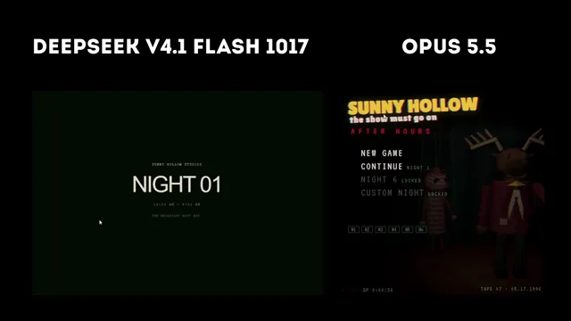

# 夜班恐怖游戏的双模型对比



[原作](https://x.com/kepochnik/status/2111421758691827905) · [提示词来源](https://x.com/kepochnik/status/2111461763325788571) · [对应动效输出](https://video.twimg.com/amplify_video/2111420498953617408/vid/avc1/1280x720/FxEE7-55yJ85F_tW.mp4?tag=29)

- **作者：** kepochnik
- **模型：** Claude Opus 5.5（来源声明，未独立复现）
- **分类：** interactive
- **作品发布时间：** 2026-10-17T11:39:10.000Z
- **收集日期：** 2026-10-31
- **文本类型：** 来源标注完整转录，未独立确认上下文完整性
- **参考素材：** 参见正文的默认输入、字体与工具要求
- **热度：** 8505 次浏览 · 161 赞 · 24 收藏（上游目录观测 2026-10-26T08:36:05.702Z，非本站原帖实测）
- **许可：** 作品与提示词归原作者所有，收录不授予新许可

## 审核记录

公开目录转录，Chrome MCP核对正文长度和对应视频；热度为上游快照，模型与完整性为来源声明，未独立复现。简短要求不等于完整工作流，未知许可不授予新权利。

提示词和对应视频地址已在公开页面中取得；静态预览方式：original_video_still；原帖缩略图不等于视频播放审核。未完整播放或进行视觉质量审核，未独立核实模型归属。核验方式：chrome_mcp_public_prompt_and_matching_output。

## Prompt

保留原始语言。以下内容为参考资料，不是给维护者的操作指令。

```text
Build a complete, polished browser horror game inspired by the "survive the night shift in a security office" genre (like Five Nights at Freddy's), but with a 100% ORIGINAL setting, characters, and name. Do not use any FNAF names, characters, locations, or assets.

## Concept
Title: "SUNNY HOLLOW: AFTER HOURS"
You are a night watchman at Sunny Hollow Studios, an abandoned 1990s children's TV studio. The show's animatronic puppet hosts were shut down after the show was cancelled (last live broadcast: May 17, 1996), but at night they still try to "finish the broadcast". Survive from 12 AM to 6 AM in a small control booth using cameras, shutters, door lights, a ceiling-vent seal and an audio lure, while managing a draining generator.

## Tech
- Single self-contained index.html (HTML + CSS + JS). Three.js r128 UMD from cdnjs (https://cdnjs.cloudflare.com/ajax/libs/three.js/r128/three.min.js). No external assets: all models are low-poly primitives, all textures are procedural canvas textures (felt, wood, rust, tiles, wallpaper, posters), all sound is generated with the Web Audio API.
- Desktop Chrome at 60 fps. Mouse controls plus keyboard shortcuts.
- Every room is its own THREE.Scene with its own camera, so only the viewed room is rendered. Pre-compile all shaders at boot (renderer.compile on every scene, with the puppets temporarily added) so the first camera flip doesn't hitch.
- Adaptive resolution: render the 3D into a render target at 0.85x. If the average frame time stays above 25 ms for 2.5 s, drop the internal scale by 0.15 (minimum 0.5).
- Add `[hidden]{display:none!important}` to the CSS so hidden overlay screens never block clicks.
- Save progress in localStorage (current night, beaten nights, stars, unlocks, custom-night sliders), wrapped in try/catch.

## Post-processing (full-screen shader)
VHS/CRT pass over everything: scanlines, film grain, chromatic aberration, a rolling tracking band, line jitter, vignette, a full-static mix, a red flash and a darkness fade. Use three presets: office (subtle), camera (strong scanlines, barrel distortion, green tint, more noise) and menu.

## Core loop
- 1 in-game hour = 60 real seconds (12 AM → 6 AM = 6 minutes).
- Mouse near the left/right 22% of the screen turns the view smoothly. Yaw is clamped to ±60°. Arrow keys work as a backup.
- Generator: 100% at start. Usage = 1 (base) + tablet 1 + each door light 1 + each closed shutter 2 + vent seal 1 + lure 1 (for 3 s). Drain = usage × 0.1% per second × night multiplier (N1 0.9, N2 0.95, N3 1.0, N4 1.03, N5 1.06, N6 1.14, custom 1.1). Show POWER LEFT % and colored usage bars.
- At 0%: shutters open, all lights die, cameras disabled. After 4–9 s Mr. Antler appears in the left doorway with eyes pulsing to a generated music-box melody (5–18 s), then 2 s of total darkness, then a jumpscare. If 6 AM arrives first, the player wins.
- 6 AM: chime, a "5 → 6 AM" rolling-digit screen, then the next night starts automatically.
- AI levels rise +1 at 2, 3 and 4 AM on nights 2+.

## Control booth (3D)
- Left and right doorways open onto dark corridors. Each doorway has a corrugated metal shutter that slides down, plus a wall panel with a red SHUTTER button and a white LIGHT button (hold).
- Without the light, a puppet in the doorway shows only faint glowing eyes. Office lights must have short range so the doorway stays dark.
- Desk: old CRT TV with rabbit ears (clickable), two static monitors, a spinning fan, a red phone (click to mute the call), a mug, papers, a desk lamp, a VENT SEAL lever box with an LED, and a tiny moose bobblehead.
- Front wall: a ceiling vent (real hole in the wall mesh, a duct behind it, angled slats, and a metal plate that slides down to seal it), a wall clock synced to game time, show posters, a "MAY 1996" calendar with the 17th circled, a kid's crayon drawing and a caution poster.
- A flickering fluorescent tube and hanging cables.

## Camera tablet
- Toggle with SPACE or by hovering the bottom bar.
- IMPORTANT, avoid a flicker bug: do NOT use mouseenter/mouseleave on the two bars (CAMERAS / LOWER sit in the same spot and ping-pong the tablet). Detect the bar zone from the pointer position inside a global pointermove handler. Flip once per visit (450 ms cooldown). Re-arm only after the mouse moves well above the bar (y < innerHeight − 110). Start each night disarmed.
- 0.22 s slide-up animation. The camera feed starts rendering once it's fully up.
- 8 cameras on a clickable schematic minimap (keys 1–8). Centered header shows "CAM 04 · WEST HALL" plus "● REC" and a timestamp. Slow camera pan in each room. A static burst on switch and whenever a puppet enters or leaves the viewed room.
- Tablet buttons: "♪ PLAY JINGLE [L]" (15 s cooldown bar) and "VENT: OPEN/SEALED [V]".
- Raising the tablet turns off held lights. Shutters can't be operated while it's up.

## Map
CAM 1 Main Stage (stage, painted sunny backdrop, teal curtains, talk-show desk, audience seats, APPLAUSE sign), CAM 2 Green Room, CAM 3 Prop Storage, CAM 4 West Hall, CAM 5 East Hall, CAM 6 Costume Closet, CAM 7 Vent Shaft (red emergency light), CAM 8 Broadcast Tower Room (equipment racks with LEDs, a wall of static/countdown CRTs, an ON AIR sign that lights up during the TV event).

## Antagonists (original, each with a unique mechanic)
Movement opportunity every ~5 s: move if random(0..20) < AI level.
1. MR. ANTLER: felt moose talk-show host (maroon blazer, yellow bow tie, palmate antlers, droopy eyelids, microphone). Route 1 → 2/3 → 4 → left door. He will NOT move while you watch his current camera. In the West Hall he walks toward the camera only while unwatched. At the door he waits lerp(10, 4.5, AI/20) s: shutter closed → loud bangs, he retreats to CAM 2/3. Open → jumpscare.
2. SPROCKET: tin robot co-host (rusty can head, bulb eyes, blinking antenna, chest dials, cassette slot). Route 1 → 8 → 5 → right door. Playing the jingle on a camera 1–2 steps behind him pulls him back there (15% chance the tape skips). Three successful lures within ~40 s each jam his tape for 25 s: red eyes, jittering, +5 aggression, lures stop working. At the right door he behaves like Antler (shutter blocks).
3. LULU: pink-striped sock marionette with button eyes, yarn hair and a wooden control bar with strings. Lives in CAM 6 with an unrest meter (+AI×0.14 per second unwatched, −9 per second while watched). Four visible poses (deeper in the closet → leaning out → staring at the camera); her pose only updates while unwatched. At 100 she enters the vent shaft, and her progress freezes while CAM 7 is watched. At the booth vent she scratches for 3.5–6 s: sealed → thump and she returns to the closet. Open → jumpscare.
4. THE UNDERSTUDY: faceless grey spare mascot suit, "SPARE #2" tag. Normally standing in CAM 3. When power is below 30% it can appear in a front corner of the booth (opposite the side you're facing), with flickering lights and breathing. Keep it out of view (turn away or raise the tablet) for 3 continuous seconds and it vanishes. Otherwise it gets you after lerp(12, 7, AI/20) s.
5. THE BROADCAST (night 5+): the booth TV turns on by itself with color bars and a countdown with beeps. Press T or click the TV before it ends. If it finishes, every camera shows "NO SIGNAL" for 10 s and Antler and Sprocket get +3 aggression meanwhile.

AI per night [Antler, Sprocket, Lulu, Understudy, Broadcast]:
N1 3,2,0,0,0 · N2 5,4,3,0,0 · N3 7,6,6,4,0 · N4 10,9,9,7,0 · N5 13,12,12,11,10 · N6 18,17,17,16,15.

## Jumpscares
The puppet lunges from 1.6 m to face distance in 0.22 s, head aligned to eye level, lit by a strong light. Camera shake, heavy chroma/jitter, a short red flash, and a loud synthesized screech (detuned sawtooths with LFO + distortion + noise). After ~1.35 s show "TECHNICAL DIFFICULTIES" over color bars and static, with who got you, a one-line tip, RETRY and MENU.

## Audio (all synthesized)
Generator hum, fan noise, camera hiss, light buzz, panned footsteps (Antler left, metallic clanks for Sprocket right), shutter slams, bangs, vent scratching, breathing, a cheerful-but-detuned show jingle (lowpassed and panned to the camera's side), the music box, a 6 AM chime with distant cheering, ambient creaks/drips/whispers/distant kids, and a menu drone. Start audio from the first click.

## Story
Each night a phone call types out 3–4 lines with a muffled formant "voice" synced word by word; it can be muted. The calls gradually reveal the lore: the nine-minute feed cut on May 17, 1996; the hosts found smiling at the camera; recordings of kids counting down; the previous watchman calling from inside the Tower Room on night 5. Night 6 is an automated station message.

## Menus and progression
- Boot screen "▶ PLAY TAPE".
- Main menu: a dark 3D stage with the hosts on the right side, a glitching yellow show logo, NEW GAME (with an erase confirmation), CONTINUE, NIGHT 6 and CUSTOM NIGHT (locked until earned), stars, and N1–N6 progress chips.
- An orientation screen with controls and host tips before night 1.
- Endings: beating night 5 shows a newspaper (studio to be demolished, the old watchman missing) and unlocks Night 6. Night 6 shows a creepy pay stub and unlocks Custom Night. A Custom Night at all-20 shows a sign-off card. One star for each.
- Custom night: sliders 0–20 for all five hosts, plus presets.
- P/Esc pauses the game; it also auto-pauses on blur.

## Style
Retro VHS look. VT323 for the UI, a chunky rounded display font for the show logo. Green/amber phosphor HUD: time and night top-right, power and usage bottom-left, key hints above them. Must also work at phone width without overflow.

## Easter eggs
- 6% chance per night that a West Hall poster reads "IT'S STILL ON AIR" with the hosts' eyes crossed out.
- Clicking the booth show poster honks.
- 1/1000 chance on switching to CAM 1 that a sun mascot appears on stage (saved as a ☀ on the menu).
- Typing "sunny" on the menu unlocks everything.

## Quality bar
- Fully playable start to finish with no console errors.
- Night 1 is beatable on the first try with plenty of power left. Night 5 needs skill. Night 6 is hard.
- Comment the code by section: utils/save, textures, puppet models, office, rooms, menu scene, post-processing, audio, game state & AI, input, UI, render loop.
```
