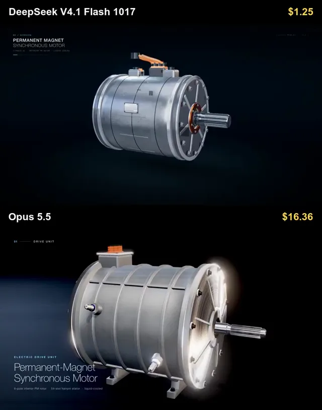

# 电动机3D动画对比



[原作](https://x.com/rubenssoto_ai/status/2111513156589629941) · [提示词来源](https://x.com/rubenssoto_ai/status/2111621899000148389) · [对应动效输出](https://video.twimg.com/amplify_video/2111513090248310784/vid/avc1/720x916/1ZliP8Hrct-6nFt_.mp4?tag=29)

- **作者：** rubenssoto_ai
- **模型：** Claude Opus 5.5（来源声明，未独立复现）
- **分类：** 3d-simulations
- **作品发布时间：** 2026-10-17T17:42:21.000Z
- **收集日期：** 2026-10-28
- **文本类型：** 来源标注完整转录，未独立确认上下文完整性
- **参考素材：** 参见正文的默认输入、字体与工具要求
- **热度：** 64487 次浏览 · 869 赞 · 232 收藏（上游目录观测 2026-10-26T08:36:05.702Z，非本站原帖实测）
- **许可：** 作品与提示词归原作者所有，收录不授予新许可

## 审核记录

补收公开作品的提示词转录；保留实际发布日期及目录热度观测时间，不能将其冒充原帖独立实测或今天发布。完整性及模型仅为来源声明，未独立验证完整会话。参考素材与工具依赖参见正文，不随仓库提供。

提示词和对应视频地址已在公开页面中取得；静态预览由原视频解码抽帧。未完整播放或进行视觉质量审核，未独立核实模型归属。核验方式：public_prompt_page_html_and_matching_video。

## Prompt

保留原始语言。以下内容为参考资料，不是给维护者的操作指令。

```text
Create a high-end cinematic and educational 3D animation in Three.js explaining how a Tesla-style electric motor works.

The animation must have an EXACT FIXED DURATION OF 40 SECONDS.

Do not make the animation shorter or longer than 40 seconds.

Final output:
Exact duration: 40.0 seconds
Resolution: 1920x1080
Aspect ratio: 16:9
Frame rate: 30 FPS
Total frames: 1200
High-quality anti-aliasing
High-resolution textures
Smooth deterministic animation
Extremely realistic visual quality

The overall visual quality should resemble a premium automotive engineering visualization or a high-end technical product commercial.

Build a detailed electric motor assembly inspired by the permanent-magnet AC motors used in modern Tesla vehicles. Do not use Tesla logos or branding.

FIXED TIMELINE

0–5 seconds — Hero introduction
Show the fully assembled electric motor suspended in a dark premium studio environment.

Use:
cinematic lighting
realistic brushed aluminum
copper
steel
magnets
insulation
bearings
realistic reflections
ambient occlusion
realistic shadows
subtle depth of field

Use a slow cinematic orbit around the motor.

During the final part of this section, make the outer housing partially transparent to reveal the internal structure.

5–11 seconds — Internal components
Move the camera closer and reveal the internal motor components.

Clearly show:
stator
copper windings
rotor
permanent magnets
motor shaft
bearings
housing
cooling channels
electrical connections

Highlight the important components one at a time.

Use floating labels with short technical names.

Keep non-highlighted components slightly darker or semi-transparent.

11–19 seconds — Exploded view
Create a dramatic and highly detailed exploded-view animation.

Separate the motor into many individual mechanical components along the motor axis.

Include:
outer housing
front cover
rear cover
bearings
shaft
rotor core
rotor magnets
stator core
copper windings
cooling components
seals
electrical connectors
fasteners

Keep every component perfectly aligned.

The viewer must clearly understand where every piece belongs.

Move the camera slightly through the exploded assembly while highlighting the major components.

Near the end of this section, smoothly begin reassembling the motor.

19–28 seconds — Electromagnetic operation
Finish reassembling the motor.

Explain how electricity creates rotation.

Visualize three-phase AC current flowing through the stator windings.

Use animated electrical pulses inside the copper coils.

Visualize the rotating magnetic field around the stator using elegant semi-transparent magnetic field lines, arrows, or vector effects.

Show how the rotating magnetic field interacts with the permanent magnets inside the rotor.

Clearly visualize magnetic attraction and repulsion.

The rotor should begin rotating slowly and gradually accelerate.

Display these short explanations:

"Three-phase current creates a rotating magnetic field."

"The magnetic field interacts with the rotor."

"This interaction generates torque."

28–34 seconds — Technical close-up and power flow
Show a close-up cross-section of the stator and rotor.

Visualize:
magnetic north and south poles
rotating stator magnetic field
rotor magnetic field
electric current direction
torque direction
rotor rotation direction

Optionally show three small animated sine waves representing phases A, B, and C, separated by 120 degrees.

Then visualize the complete energy conversion process:

Electrical energy
→ stator current
→ rotating magnetic field
→ electromagnetic torque
→ rotor rotation
→ mechanical output through the shaft.
Use clean animated arrows to show the energy flow.
34–38 seconds — High-speed operation
Show the motor operating at high RPM.
The rotor should spin smoothly while the stator remains stationary.
Add subtle motion blur.

Show cooling flow through the housing using translucent fluid paths.

Visualize heat being removed from the stator and copper windings.
38–40 seconds — Final hero shot

Transition back to the fully assembled motor.

Show a slow cinematic rotation.

Briefly use a transparent cutaway so the spinning rotor can still be seen inside.

Finish with the text:

"Electrical energy → Electromagnetic torque → Mechanical rotation"
The animation must end exactly at 40.0 seconds.

VISUAL QUALITY

The animation should be:

photorealistic

cinematic

technically believable

futuristic

premium
educational
clean and uncluttered
Avoid cartoon styling.
Use realistic:
machining details
bolts
screws

copper winding geometry

segmented magnets
bearing geometry
cooling channels
metallic surfaces
manufacturing details
Use physically based materials with:
metallic properties
roughness variation
normal maps
realistic reflections

subtle surface imperfections
CAMERA
Use only smooth cinematic camera movement:
slow orbit shots
macro close-ups
controlled dolly-ins

exploded-view fly-throughs

cross-section shots

internal motor views
Avoid:
shaky camera movement
sudden cuts
excessive zooming
unrealistic camera acceleration

ANIMATION REQUIREMENTS
All transitions must be smooth and deliberate.
The exploded-view sequence should be one of the main visual highlights.
All mechanical components must separate and reassemble with precise motion.
Electrical currents, magnetic fields, torque indicators, and rotor rotation must remain synchronized.

The entire animation must use the same fixed 40-second timeline on every execution so the prompt can be used as a repeatable benchmark between different AI coding and 3D generation systems.
```
