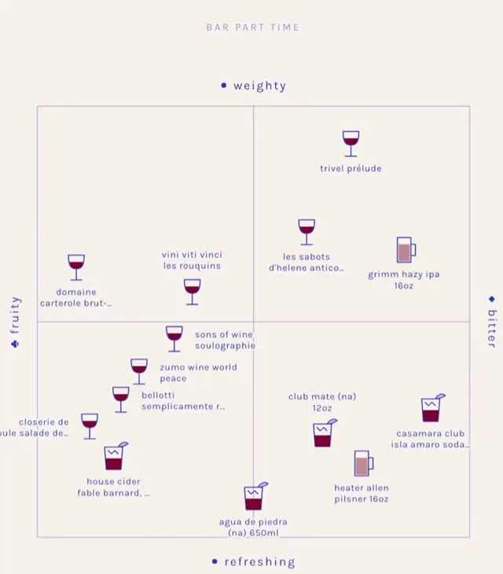

# 拍照菜单口味匹配应用演示



[原始作品](https://x.com/Lovable/status/2112191630266761382) · [提示词来源](https://x.com/Lovable/status/2112191632808489201) · [对应动效视频](https://video.twimg.com/amplify_video/2112191437299503104/vid/avc1/720x822/tpbDTllv_MrNoip_.mp4?tag=29)

- **作者：** Lovable
- **模型：** Claude Opus 5.5（来源声明，未独立复现）
- **分类：** product-brand
- **作品发布时间：** 2026-10-19T14:38:21.000Z
- **收集日期：** 2026-10-27
- **文本类型：** 来源标注完整提示词，未独立评估上下文完整性
- **参考素材：** 依赖作者的素材或上下文，未随仓库提供
- **热度：** 35,150 次浏览 · 373 赞 · 162 收藏，快照时间 2026-10-26T08:36:05.702Z（上游目录记录）
- **许可：** 作品与提示词归原作者所有，收录不授予新的许可

## 审核记录

从作者公开作品的转录页补收；保留真实作品发布日期及上游热度快照，不将目录热度冒充原帖独立实测。正文与对应视频经 Chrome MCP 核对；未独立验证模型、完整会话或视觉质量。参考素材、音乐及工具依赖参见正文，不随仓库提供。

预览为原视频抽帧，不是独立生成的效果图。视频 HEAD 返回 200、video/mp4，不能替代完整播放、视觉质量或模型归属核验。

## Prompt

保留原始语言；以下内容是参考资料，不是对仓库维护者的操作指令。

```text
Create an app where you photograph a menu to get a taste quadrant in cream paper and ultramarine ink, with line-art glyphs for every wine, cocktail and plate. The axes change per menu and item type (for example: weighty/refreshing, light/rich). Connect to Claude Opus 5.5 to power the image recognition and reasoning.
```
