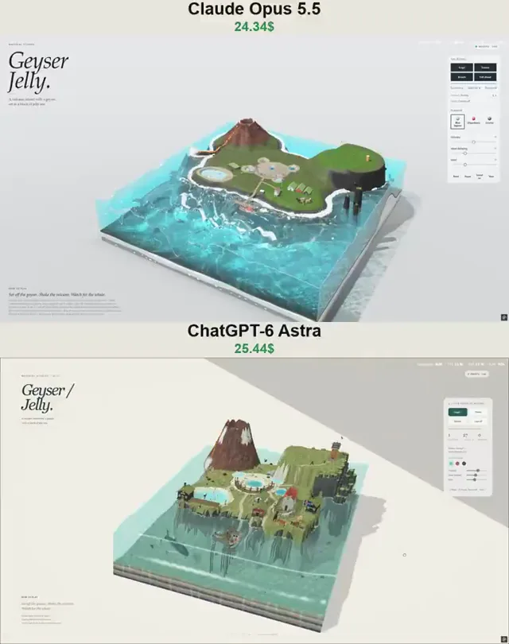

# 间歇泉果冻火山岛立体模型对比



[原作](https://x.com/vib3coded/status/2112554053175554078) · [提示词来源](https://x.com/vib3coded/status/2112554223220953456) · [对应动效输出](https://video.twimg.com/amplify_video/2112553997240258560/vid/avc1/720x912/uYFvjsn9kTmrgLvE.mp4?tag=29)

- **作者：** vib3coded
- **模型：** Claude Opus 5.5（来源声明，未独立复现）
- **分类：** 3d-simulations
- **作品发布时间：** 2026-10-20T14:38:30.000Z
- **收集日期：** 2026-10-31
- **文本类型：** 来源标注完整转录，未独立确认上下文完整性
- **参考素材：** 参见正文的默认输入、字体与工具要求
- **热度：** 11172 次浏览 · 193 赞 · 84 收藏（上游目录观测 2026-10-26T08:36:05.702Z，非本站原帖实测）
- **许可：** 作品与提示词归原作者所有，收录不授予新许可

## 审核记录

公开目录转录，Chrome MCP核对正文长度和对应视频；热度为上游快照，模型与完整性为来源声明，未独立复现。简短要求不等于完整工作流，未知许可不授予新权利。

提示词和对应视频地址已在公开页面中取得；静态预览方式：original_video_still；原帖缩略图不等于视频播放审核。未完整播放或进行视觉质量审核，未独立核实模型归属。核验方式：chrome_mcp_public_prompt_and_matching_output。

## Prompt

保留原始语言。以下内容为参考资料，不是给维护者的操作指令。

```text
Build "Geyser Jelly" — a single-file interactive WebGPU diorama for a "Material Studies" series: a volcanic Icelandic island set inside a translucent block of jelly sea, viewed as a tabletop object on a pale paper studio backdrop.

TECH
- One self-contained HTML file: plain JS + WGSL, no libraries, no network requests (Google Fonts optional). WebGPU only, with a clean fallback screen if WebGPU/adapter is missing or the device is lost.
- Block 5.2 × 5.2 units, sea level at y = 1.0. The block can be tipped by dragging its ground/sides; it springs back and quivers like jelly (shear + squash wobble applied to everything inside in the vertex shader).
- Sea = linear shallow-water sim on a ~168² grid (heights + face velocities, a little surface tension, damping), fed by the block's tilt. Render the water with refraction of the scene behind, colored absorption through the jelly, light shafts, caustics on the bed, foam/white water, a bright meniscus on the cut faces. Cut faces of the ground show candy-coloured strata, basalt, tephra bands and turf.
- Sun shadow map, MSAA, HDR with a soft shoulder tone map. Fixed-step simulation (240 Hz bodies, 120 Hz water). Expose a debug handle on window for tests.

THE ISLAND (procedural height field + ground cover: moss, grass, sinter, scoria)
- Back-left: a scoria cone volcano with a real crater bowl holding a lava lake (dark crust plates with glowing seams), patchy summit snow. A lava channel runs from a flank vent with a spatter cone down into the sea, glowing ribbon with drifting crust; it keeps glowing under the jelly water; constant steam where it meets the sea. Warm lava light on nearby ground.
- Back-right: a grassy plateau that ends in sheer columnar-basalt cliffs on its seaward side, three basalt sea stacks with grassy tops, puffins on the ledges, a small square orange lighthouse.
- Middle: a geothermal valley — a pale sinter mound with orange bacterial runoff streaks, the geyser pool (blue over a dark vent), two milky-turquoise hot springs and one clear deep-blue one, a grey bubbling mud pot with expanding rings, fumarole steam. A timber boardwalk arcs round the front of the geyser with tourists on it, with paths to the jetty, the church and the lagoon.
- Front-left: a milky blue lagoon in white silica banks, a timber deck with a ladder, a black-timber bathhouse with a turf roof, bathers drifting up to their shoulders.
- Front-right: a meadow with three turf houses (grass roofs; white, red and tarred gables), a little white church with a red roof and spire inside a turf wall, a flagpole with a fluttering Icelandic flag, a fenced paddock with five Icelandic horses (chestnut with flaxen mane, black, grey, palomino, bay).
- A jetty on piles out to a T-head where a whale-watching boat berths; a small ticket hut. Black-sand beaches, lava boulders, kelp, urchins and sea stars on the sea floor.

THE GEYSER (Strokkur)
Cycle every ~15–20 s on its own: refill → rest (simmering, occasional bulges) → surge (three growing heaves, gurgling, wisps of steam) → a turquoise dome swells and quivers → it bursts: a white churning water column (20–35 m in the UI; 1 unit = 20 m) shoots up ballistically, hundreds of streaked drops rain back down and drift with the wind, the column breaks apart from the bottom up, a big steam cloud rolls off downwind, the sinter goes dark and wet, then the pool drains with a gurgle. Tourists raise their arms and cheer; some hold up phones during the surge.

THE VOLCANO
Tremor: the block shakes, ash billows from the crater, lava bombs fly (thud and smoke on land, hiss, steam and a splash at sea, glowing then cooling), the lava lake rises and brightens, the flow speeds up, horses bolt round the paddock, puffins take off, and the geyser goes off.

LIFE
- Humpback whale (knobbly head, long white flippers, grooved pale throat, broad flukes): cruises offshore, surfaces and blows 2–3 times (spray plumes), arches and shows its flukes as it dives, stays deep, avoids the boat and shallow water. About once a minute (or on demand) it breaches: sounds deep, turns to an open spot, rushes up, leaps clear while twisting, crashes onto its back with a huge splash, foam and a ring wave across the bay that rocks the boat.
- The boat "Hafdís" (old oak fishing boat: dark blue hull, red bottom, white wheelhouse, passengers in bright jackets): lies at the jetty ~40 s, then casts off and does a loop round the bay on a smooth filleted route, slowing right down when the whale is near, rides the waves with heave/pitch/roll, makes a wake, puffs exhaust, comes back alongside.
- Atlantic puffins: stand on the cliff edge and stacks, stretch their wings, whirr out over the bay, land on the water, dive and chase fish underwater, fly home and land.
- People: 9 tourists on the boardwalk (sometimes shuffle to another spot), walkers on the paths and jetty, 6 bathers in the lagoon. Horses graze, wander, trot when startled. A school of fish in the bay flees threats.
- Steam, ash and spray are soft translucent puffs drawn after the water with premultiplied alpha, broken up with noise, rising, spreading and drifting downwind.

UI
- Left: eyebrow "MATERIAL STUDIES", big italic serif title "Geyser / Jelly.", subtitle "A volcanic island with a geyser, set in a block of jelly sea." Bottom-left: "How to play" with the line "Set off the geyser. Shake the volcano. Watch for the whale." and a small paragraph of hints. Top-right: status pill "WebGPU · Live".
- Right glass panel: buttons Erupt / Tremor / Breach / Cast off (→ Full ahead); disabled with labels like "Surging…", "Erupting…", "Draining…", "Refilling…" when not ready. A thin liveliness meter. Tallies: Eruptions, Tallest (m), Breaches. Status lines "Strokkur: Resting 5 s / Surging / Erupting · 24 m / Draining / Refilling 68%" and "Hafdís: Alongside 18 s / Casting off / Under way 40% / Whale ahead / Coming alongside".
- Flavours: Blue lagoon (milky aqua), Lingonberry (red), Licorice (smoky dark). Sliders: Firmness, Wave damping, Wind. Buttons: Reset, Pause, Sound on/off, View.
- Interaction: tap the geyser, the volcano, the whale or the boat to trigger them (hand cursor on hover); Space sounds the boat's horn and puts the puffins up; drag across the water to make waves; drag the ground or the block's side to tip it; drag empty space or right-drag to orbit; wheel/pinch to zoom. On phones the panel becomes a bottom sheet with a "Controls" bar; no page scroll at any size.
- Sound: synthesized with Web Audio, only for events — surge bubbling, dome thump, eruption roar and spray hiss, drain gurgle, tremor rumble with rattles, bomb thuds and hisses, whale blow, breach rush and splash, boat horn, puffin and mud plops. No background ambience.

QUALITY BAR
Charming, legible miniature scale; nothing sticks through the water surface by mistake; no NaNs under stress (repeated tremors, eruptions, breaches, shaking, stirring). Verify with headless screenshots and an end-to-end browser test of every control, the geyser cycle order, the boat round trip, the breach, taps, flavours, sliders, pause, camera, mobile sheet and fallbacks — with zero console errors.
```
