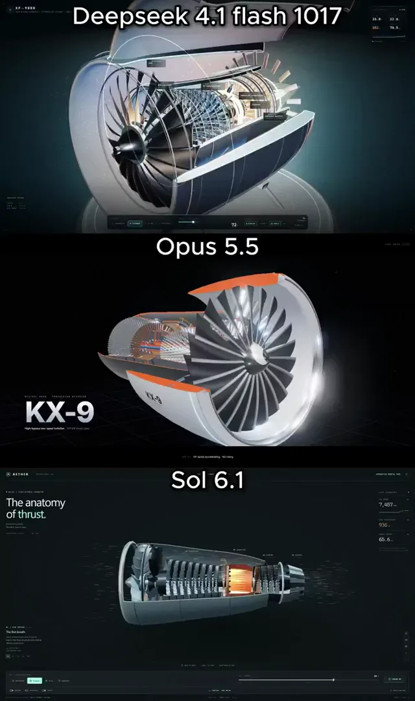

# 三维喷气发动机模型对比



[原作](https://x.com/olezhavich/status/2112897791022264814) · [提示词来源](https://x.com/olezhavich/status/2112897884186177661) · [对应动效输出](https://video.twimg.com/amplify_video/2112897415829209088/vid/avc1/720x1216/K8bkHj6aDN1yTM6Z.mp4?tag=29)

- **作者：** olezhavich
- **模型：** Claude Opus 5.5（来源声明，未独立复现）
- **分类：** interactive
- **作品发布时间：** 2026-10-21T13:24:23.000Z
- **收集日期：** 2026-10-29
- **文本类型：** 来源标注完整转录，未独立确认上下文完整性
- **参考素材：** 参见正文的默认输入、字体与工具要求
- **热度：** 10984 次浏览 · 147 赞 · 43 收藏（上游目录观测 2026-10-26T08:36:05.702Z，非本站原帖实测）
- **许可：** 作品与提示词归原作者所有，收录不授予新许可

## 审核记录

补收公开作品的提示词转录；保留实际发布日期及目录热度观测时间，不能将其冒充原帖独立实测或今天发布。完整性及模型仅为来源声明，未独立验证完整会话。参考素材与工具依赖参见正文，不随仓库提供。

提示词和对应视频地址已在公开页面中取得；静态预览由原视频解码抽帧。未完整播放或进行视觉质量审核，未独立核实模型归属。核验方式：public_prompt_page_html_and_matching_video。

## Prompt

保留原始语言。以下内容为参考资料，不是给维护者的操作指令。

```text
Create a visually impressive interactive 3D cutaway jet engine experience in Three.js.
The result should feel like a premium technical visualization or futuristic engineering showcase.
The first few seconds must have a strong wow effect and immediately hook the viewer.
Core idea:
Build a detailed jet engine in 3D with a clean outer shell, and let the viewer explore the inside through cutaway, x-ray, and exploded-style views.
Main requirements:
Build a full 3D jet engine from scratch in code
No pre-made 3D models
Use Three.js
Prefer a single HTML file unless a few small extra files are truly necessary
The project must run locally in the browser
The engine should include:
front fan blades
compressor stages
combustion chamber
turbine stages
exhaust section
outer shell / nacelle
internal shaft structure
visible airflow path
Interactions / modes:
assembled mode
cutaway mode
x-ray mode
exploded view mode
airflow visualization on/off
throttle or power slider
auto-rotate camera option
orbit controls
Animation ideas:
engine startup sequence
fan spins up first
inner stages accelerate
combustion chamber ignites
hot glowing section appears in the core
exhaust flow becomes visible
subtle vibration / mechanical life
Visual quality:
polished lighting
premium materials
good contrast between outer shell and internals
smooth transitions between modes
readable labels or callouts for key engine parts
cinematic presentation
strong sense of depth
The first seconds should feel especially strong:
for example, begin with a clean hero shot of the engine, then smoothly reveal the cutaway and ignite the core.
Make it feel detailed, technical, and visually satisfying rather than toy-like.
```
