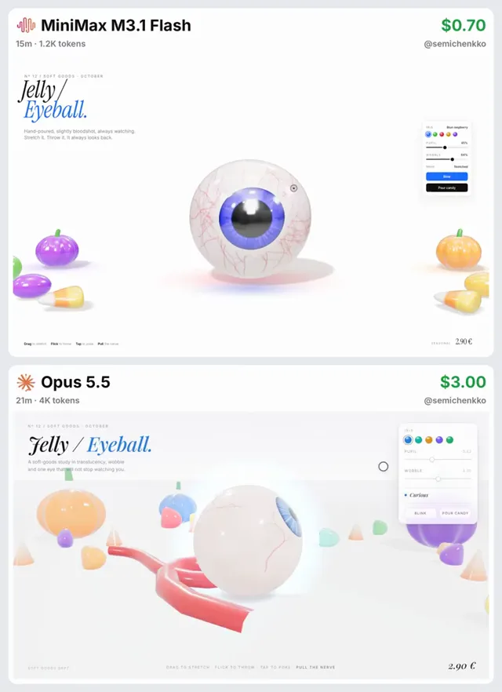

# 果冻眼球模型对比



[原作](https://x.com/semichenkko/status/2112923979002368406) · [提示词来源](https://x.com/semichenkko/status/2112941229641965730) · [对应动效输出](https://video.twimg.com/amplify_video/2112923941119447040/vid/avc1/720x992/TUrVM-FaxvV2LGG5.mp4?tag=29)

- **作者：** semichenkko
- **模型：** Claude Opus 5.5（来源声明，未独立复现）
- **分类：** interactive
- **作品发布时间：** 2026-10-21T15:08:27.000Z
- **收集日期：** 2026-10-29
- **文本类型：** 来源标注完整转录，未独立确认上下文完整性
- **参考素材：** 参见正文的默认输入、字体与工具要求
- **热度：** 7196 次浏览 · 102 赞 · 31 收藏（上游目录观测 2026-10-26T08:36:05.702Z，非本站原帖实测）
- **许可：** 作品与提示词归原作者所有，收录不授予新许可

## 审核记录

补收公开作品的提示词转录；保留实际发布日期及目录热度观测时间，不能将其冒充原帖独立实测或今天发布。完整性及模型仅为来源声明，未独立验证完整会话。参考素材与工具依赖参见正文，不随仓库提供。

提示词和对应视频地址已在公开页面中取得；静态预览由原视频解码抽帧。未完整播放或进行视觉质量审核，未独立核实模型归属。核验方式：public_prompt_page_html_and_matching_video。

## Prompt

保留原始语言。以下内容为参考资料，不是给维护者的操作指令。

```text
Build a single-file HTML + Three.js interactive scene called "Jelly / Eyeball."

Look: premium product render on a clean white background. One large gummy eyeball sits on the floor in the center - milky translucent jelly sclera with fine red veins, a glowing blue iris with radial fibers, a glossy black pupil and a clear wet cornea bulge on top. A red gummy optic nerve trails behind it on the floor. Soft colored glow and a soft shadow underneath. Around the edges: small jelly pumpkins (purple, green, orange), jelly beans and candy corn, all glossy and translucent. Physically based materials (transmission, clearcoat), environment reflections, ACES tone mapping, soft shadows.

The eye is a real soft body - deformation happens in the vertex shader so the sclera, iris, pupil and cornea all bend together:
1. It always watches the cursor, and keeps finding you even after it rolls.
2. Tap it - a gooey dent with a ripple, jelly eyelids blink, the pupil contracts, and it does a small hop.
3. Grab and drag it - the grabbed spot stretches toward the cursor like taffy into a teardrop. Lift it up and it dangles and sways with gravity.
4. Flick and release - it gets thrown with the hand's velocity plus a slingshot recoil from the stretch. It squashes and stretches along its velocity in flight, splats on the floor and walls with a big squash, bounces, rolls (the iris rolls with it), then wobbles and rights itself to look back at you.
5. Pull it sideways and let go - it snaps back like a slingshot.
6. Grab the nerve - it is a verlet rope, so you can lift the eye by it and swing it around.
7. Double-tap - hypnotized: the pupil dilates and the gaze spins in circles.
8. Hard landings make it dizzy - its eyes wander for a moment.

Jelly secondary motion everywhere: volume-preserving squash on impacts, shear wobble when it accelerates, ripples from pokes.

UI: elegant serif italic title "Jelly /" with "Eyeball." in the iris color top-left, small kicker "Nº 12 / Soft goods · October", short grey subtitle. Small white control panel top-right: iris color swatches (changes the iris and title color), sliders for Pupil and Wobble, a live "Mood" status (Curious / Startled / Stretched / Airborne / Dizzy / Dangling / Hypnotized), a "Blink" button and a "Pour candy" button that rains gummies that bounce off the eye and dent it. Bottom hints: "Drag to stretch · Flick to throw · Tap to poke · Pull the nerve". Price "2.90 €" bottom-right.

Smooth 60fps.
```
