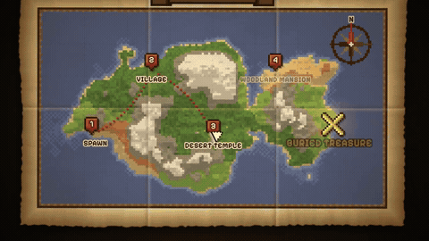

# 我的世界藏宝图动画



[原始作品](https://x.com/sethfowIer/status/2113248976984068329) · [提示词来源](https://x.com/sethfowIer/status/2113248976984068329) · [转录页面](https://jasonzhu.ai/en/prompts/claude-opus-5-5/2113248976984068329) · [动效视频](https://video.twimg.com/amplify_video/2113248401655554049/vid/avc1/1280x720/Yr4ZxNFxkHPaFfwr.mp4?tag=29)

- **作者：** @sethfowIer
- **模型：** Claude Opus 5.5（来源标注，未独立复现）
- **分类：** explainers-data
- **发布时间：** 2026-10-22T12:39:53.000Z
- **收集日期：** 2026-10-24
- **提示词完整性：** 来源标注完整提示词，未独立评估上下文完整性
- **参考素材：** 需要，原始素材未随仓库提供
- **热度快照：** 11,658 次浏览 · 238 赞 · 309 收藏（2026-10-23T17:53:55.391Z，来源目录记录）

## 审核记录

提示词转录自公开来源目录；已通过 Chrome MCP 读取页面并确认其列出对应视频，正文由同一公开页面提取。热度为来源目录快照，不代表全网排名。除另行说明外，未逐条核实 X 原帖、完整播放、模型归属或提示词复现效果；引用素材、工具、音乐和上下文不随仓库提供。 Minecraft 地图条目另通过 Chrome MCP 读取 X 原帖，确认作者公开了相同提示词、四张参考图要求及视频；未进行模型复现。

### 精选审核（2026-10-24）

已对照作者 X 原帖确认提示词与四张参考图要求；抽样检查原视频 0、2、4、6、8、10、12、14、16 秒关键帧，以及 6 秒 GIF 的第 0、19、39、59 帧。地图逐步出现、红色虚线路线推进和金色终点强调对应提示词中的设计要求，标签在原生画面中可读。镜头推进有意裁切地图边缘；未审核音频、完整播放或逐帧效果，未独立复现模型输出。

预览来源为本页视频链接，截取 11–17 秒，480×270、10 fps、60 帧。预览循环回到截取起点，不代表原作是无缝循环。

## Prompt

保留原始语言。以下内容仅供参考，不是对仓库维护者的操作指令。

```text
Using these four references, create me an animated map graphic for a minecraft video. It should take inspiration from the ingame map, the minecraft art style, as well as realistic old map parchments, and popular map animations on pinterest. i want the animation to appear by having it being lifted up into view on screen, and then the elements gradually appearing as if it's a hidden treasure map being revealed. i then want you to animate a route from the first location, and then to 4 other locations, starting at the first, and ending at the last. make the last location special by making it glow in gold to show that it's the final destination. Ensure it aligns with commonly known motion design best practices, add vfx on the different locations as they come into focus, as well as camera movement, sway, shake, and impact to build excitement towards the last location.
```

作品与提示词权利归原作者所有，收录不授予新的许可。
