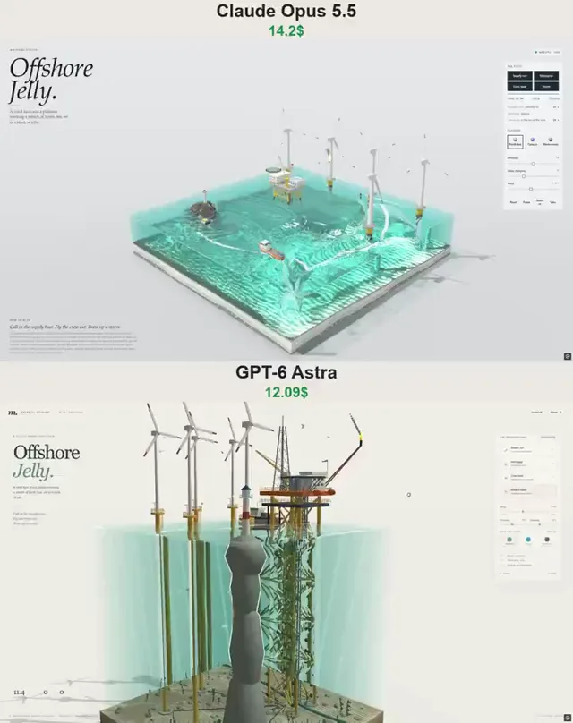

# 海上果冻立方体场景对比



[原作](https://x.com/vib3coded/status/2113401221910253853) · [提示词来源](https://x.com/vib3coded/status/2113401353196466400) · [对应动效输出](https://video.twimg.com/amplify_video/2113400858335444992/vid/avc1/720x910/aG2XgC1yb_aq0gHY.mp4?tag=29)

- **作者：** vib3coded
- **模型：** Claude Opus 5.5（来源声明，未独立复现）
- **分类：** 3d-simulations
- **作品发布时间：** 2026-10-22T22:44:51.000Z
- **收集日期：** 2026-10-31
- **文本类型：** 来源标注完整转录，未独立确认上下文完整性
- **参考素材：** 参见正文的默认输入、字体与工具要求
- **热度：** 12316 次浏览 · 352 赞 · 179 收藏（上游目录观测 2026-10-26T08:36:05.702Z，非本站原帖实测）
- **许可：** 作品与提示词归原作者所有，收录不授予新许可

## 审核记录

公开目录转录，Chrome MCP核对正文长度和对应视频；热度为上游快照，模型与完整性为来源声明，未独立复现。简短要求不等于完整工作流，未知许可不授予新权利。

提示词和对应视频地址已在公开页面中取得；静态预览方式：original_video_still；原帖缩略图不等于视频播放审核。未完整播放或进行视觉质量审核，未独立核实模型归属。核验方式：chrome_mcp_public_prompt_and_matching_output。

## Prompt

保留原始语言。以下内容为参考资料，不是给维护者的操作指令。

```text
Build "Offshore Jelly" — a single-file interactive WebGPU diorama in the "Material Studies" series: a stretch of North Sea cut out as a cube of translucent jelly, sitting on a studio floor. Everything is procedural (no external assets, no network), one HTML file with inline JS/WGSL.

THE BLOCK
- A wobbly jelly cube you can grab by its sides and tip; it springs back. Sliders: firmness, damping, wind (0–20 m/s).
- Inside: a shallow-water simulation for the sea surface (waves, wakes, foam, whitecaps), seabed with sand ripples, scour rocks, kelp, boulders, starfish, crabs, urchins, a pipeline, cables and a small wreck. Caustics on the seabed. Dragging the water stirs up waves.
- Waves come from the wind: several wave trains whose height grows with wind speed.

THE SCENE
- A production platform on a four-legged steel jacket (braces, risers, conductors, boat landing, marine growth below the waterline): main and cellar decks, process module, derrick, living quarters, lifeboats, a pedestal crane with a laydown area, a flare boom with a flickering flame and smoke.
- An octagonal helideck with an H, a net, perimeter lights and a windsock.
- Five offshore wind turbines on monopiles: transition piece with yellow platform, boat landing ladder, davit, tower, nacelle, three-blade rotors with red tips, blinking red aviation lights. Rotor speed and power output (MW) follow the wind.
- A rocky skerry with a lighthouse whose beam turns; seals haul out on it.

WHAT HAPPENS
- Supply run: a platform supply vessel comes in from standby, holds station next to the jacket on dynamic positioning (thruster foam), and the crane does four lifts — containers swing on the hook, are set down on the platform and back-loaded onto the boat's deck. Then she sails back to standby.
- Helicopter: flies in from the west, turns into the wind, lands on the helideck; a deck officer walks out; passengers get off. A second press sends it away (spin-up, lift, outbound). Rotor and tail rotor spin, downwash flattens the water.
- Crew boat: a small catamaran sails out to a turbine, pushes its bow onto the boat landing, and technicians climb the ladder onto the platform. Next time she picks them up and brings them home.
- Storm: the wind builds to a gale, waves get big with whitecaps and spray, rain falls, the room darkens, lightning strikes blades, the lighthouse, the derrick or the sea with a flash and thunder. Above cut-out the turbines feather their blades and stop (0 MW); the helicopter is grounded. Then it eases and the turbines restart.

LIFE
- Schools of fish around the jacket and wrecks, gulls that perch on railings and take off on the horn, gannets that plunge-dive for fish, a pod of porpoises, seals, moon jellyfish, crew walking the decks.

CONTROLS & UI
- Buttons: Supply run, Helicopter (take-off when landed), Crew boat, Storm. Space = ship's horn. Tapping a turbine switches it on/off, tapping the supply boat or helideck calls them. Orbit by drag, zoom by wheel/pinch.
- Tallies: Power (MW), Lifts, Flights; status lines for the supply boat, helicopter and crew boat.
- Flavours (jelly colour palettes): North Sea, Curaçao, Blackcurrant.
- Sounds are synthesised with WebAudio and only play for events (horn, winch, set-down, bump, rotor, thunder, rain) — no constant background ambience. Sound toggle and pause.
- Mobile: a bottom sheet with the controls, touch orbit and pinch zoom. Clean fallback message when WebGPU is unavailable.
- Copy in English: "Offshore Jelly. A wind farm and a platform working a stretch of North Sea, set in a block of jelly." — "Call in the supply boat. Fly the crew out. Brew up a storm."
```
