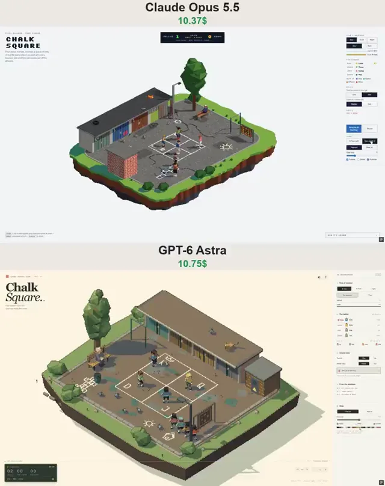

# Claude与GPT后院游戏对比



[原作](https://x.com/vib3coded/status/2113602050172785117) · [提示词来源](https://x.com/vib3coded/status/2113602161607069911) · [对应动效输出](https://video.twimg.com/amplify_video/2113601799215108097/vid/avc1/720x910/fda-6YWuzAe5YSXr.mp4?tag=29)

- **作者：** vib3coded
- **模型：** Claude Opus 5.5（来源声明，未独立复现）
- **分类：** interactive
- **作品发布时间：** 2026-10-23T12:02:52.000Z
- **收集日期：** 2026-10-29
- **文本类型：** 来源标注完整转录，未独立确认上下文完整性
- **参考素材：** 参见正文的默认输入、字体与工具要求
- **热度：** 7076 次浏览 · 223 赞 · 116 收藏（上游目录观测 2026-10-26T08:36:05.702Z，非本站原帖实测）
- **许可：** 作品与提示词归原作者所有，收录不授予新许可

## 审核记录

补收公开作品的提示词转录；保留实际发布日期及目录热度观测时间，不能将其冒充原帖独立实测或今天发布。完整性及模型仅为来源声明，未独立验证完整会话。参考素材与工具依赖参见正文，不随仓库提供。

提示词和对应视频地址已在公开页面中取得；静态预览由原视频解码抽帧。未完整播放或进行视觉质量审核，未独立核实模型归属。核验方式：public_prompt_page_html_and_matching_video。

## Prompt

保留原始语言。以下内容为参考资料，不是给维护者的操作指令。

```text
Build a single-file HTML + three.js (r160) scene called "Chalk Square": four square played with a football in a back yard on a floating island. It is a real 3D scene rendered as crisp pixel art.

Rendering: an orthographic isometric camera (drag to turn in 90° steps, scroll or pinch to zoom). Render into a small low-res target with a depth texture, then upscale with texelFetch to whole screen pixels. Add depth-based outlines and quantize every pixel to a fixed ~60-colour palette in OKLab, with an optional Bayer dither. Toggle "Pixel art / Raw 3D", with a pixel-size slider and Palette / Dither / Outlines checkboxes.

Yard: patched, cracked asphalt with a kerb, grass and dirt around the island edge. Around the asphalt:
- a row of lock-up garages with painted, numbered doors and a flat roof that overhangs them;
- a brick transformer booth with a warning sign;
- a poplar with a bench and a grandmother on it;
- a chin-up bar, a carpet rack with a rug, bushes;
- a lamp on a pole and a lamp over a garage door.
Pigeons walk and peck, and flap up onto the roofs when the ball or a kid comes near. A cat on the garage roof follows the ball with its head.

Chalk: a data texture over the asphalt. It holds the 4.8 m square split into four zones (King, Queen, Jack, Dunce) with letters and a crown, plus hopscotch and doodles. Each texel stores its order along its stroke, so the lines can be redrawn progressively.

Game (8 kids, each with a skill, power and style: power / trick / safe / lob):
- Four kids play, four wait in a queue. The King serves by dropping the ball and kicking it after the bounce.
- The ball must bounce once in your zone, then you kick it into another zone. With the two-touch rule you may first cushion it up.
- You are out for: a ball that lands out, lands in your own zone, bounces a second time, or (if set) lands on a middle line. Otherwise a ball on the line is replayed.
- The kid who is out goes to the back of the queue. Everyone below moves up a zone, and the next kid in line enters at Dunce. A kid fetches the ball and throws it to the King.

Ball and AI: real ball physics (gravity, bounces, rolling, softer bounces in puddles, the walls). Each receiver simulates the ball forward, picks the moment it is at foot height, runs to stand behind it and kicks. Shots are a drive, a lob, or a dink just over the line, aimed away from the target kid; everyone picks on the King. Aim and power errors grow with a fast ball, a stretched contact and lower skill, and occasionally a kick is shanked.

Kids: box-rigged with two-bone IK. Poses: run, ready crouch, a kick that strikes at the ball's height, cushion, hold, throw, clap, argue a call, and a crouched walk while drawing chalk.

Time and weather: Day / Dusk / Night (the lamps light the court), Dry / Rain.
- Rain: streaks, splashes, darker asphalt, puddles that mirror the yard via a mirrored render pass, and the chalk washing out.
- The kids shelter under the garage roof. When the asphalt dries, two of them redraw the square and play resumes.

UI (English, light and dark themes, mobile layout):
- A lit scoreboard with rallies, clock + status, the King's current reign, and the best reign.
- A side rail with: Time & weather (with asphalt and chalk bars); the ladder (King / Queen / Jack / Dunce plus "Next up"); Rules (One/Two touches; Liners: Replay/Out); a feed of calls with "Gang up on the King" and Pause; View.
- Click a kid in the square and everyone aims at them. Original design, no real brands.
```
