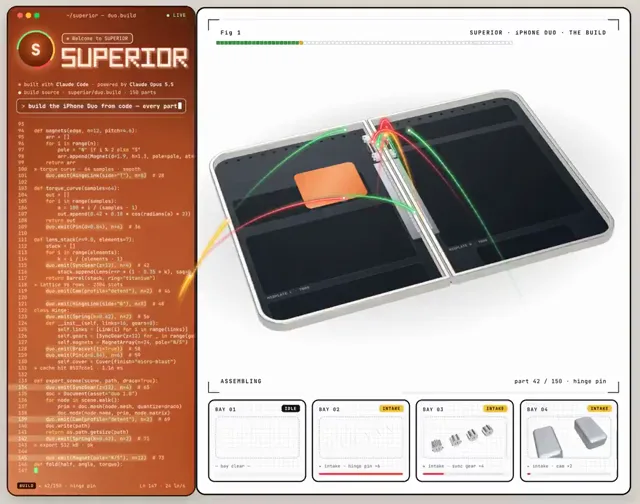

# 用代码逐个零件重建的折叠手机



[原始作品](https://x.com/andreysuperior/status/2113644365876691235) · [提示词来源](https://x.com/andreysuperior/status/2113644365876691235) · [对应动效视频](https://video.twimg.com/amplify_video/2113643970878222336/vid/avc1/916x720/_NRt2KXCoof7VJoH.mp4?tag=29)

- **作者：** andreysuperior
- **模型：** Claude Opus 5.5（来源声明，未独立复现）
- **分类：** 3d-simulations
- **作品发布时间：** 2026-10-23T14:51:01.000Z
- **收集日期：** 2026-10-27
- **文本类型：** 来源标注完整提示词，未独立评估上下文完整性
- **参考素材：** 参见正文默认输入、字体和工具要求
- **热度：** 13,326 次浏览 · 271 赞 · 233 收藏，快照时间 2026-10-26T08:36:05.702Z（上游目录记录）
- **许可：** 作品与提示词归原作者所有，收录不授予新的许可

## 审核记录

从作者公开作品的转录页补收；保留真实作品发布日期及上游热度快照，不将目录热度冒充原帖独立实测。正文与对应视频经 Chrome MCP 核对；未独立验证模型、完整会话或视觉质量。参考素材、音乐及工具依赖参见正文，不随仓库提供。

预览为原视频抽帧，不是独立生成的效果图。视频 HEAD 返回 200、video/mp4，不能替代完整播放、视觉质量或模型归属核验。

## Prompt

保留原始语言；以下内容是参考资料，不是对仓库维护者的操作指令。

```text
Rebuild [any device] in code, part by part:
1. Write the parts list first, with dimensions.
2. Make every part its own function. Place them one at a time.
3. After each part, check clearance (≥ 0.05 mm), clashes and cable bends. Stop and fix anything that fails.
4. Animate the moving parts last.
Show me the parts list first. No code until I say go.
```
