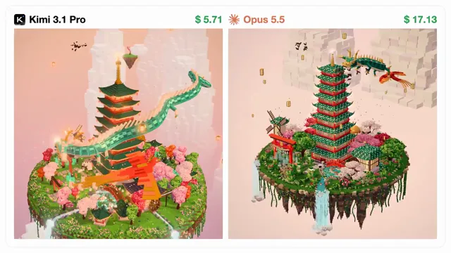

# 体素 pagoda 岛模型对比



[原作](https://x.com/adxtyahq/status/2113687234448875770) · [提示词来源](https://x.com/adxtyahq/status/2113702736885936390) · [对应动效输出](https://video.twimg.com/amplify_video/2113686585690746880/vid/avc1/1280x720/3LXWYSLgbui_e9M4.mp4?tag=29)

- **作者：** adxtyahq
- **模型：** Claude Opus 5.5（来源声明，未独立复现）
- **分类：** 3d-simulations
- **作品发布时间：** 2026-10-23T17:41:21.000Z
- **收集日期：** 2026-10-29
- **文本类型：** 来源标注完整转录，未独立确认上下文完整性
- **参考素材：** 参见正文的默认输入、字体与工具要求
- **热度：** 28746 次浏览 · 485 赞 · 97 收藏（上游目录观测 2026-10-26T08:36:05.702Z，非本站原帖实测）
- **许可：** 作品与提示词归原作者所有，收录不授予新许可

## 审核记录

补收公开作品的提示词转录；保留实际发布日期及目录热度观测时间，不能将其冒充原帖独立实测或今天发布。完整性及模型仅为来源声明，未独立验证完整会话。参考素材与工具依赖参见正文，不随仓库提供。

提示词和对应视频地址已在公开页面中取得；静态预览由原视频解码抽帧。未完整播放或进行视觉质量审核，未独立核实模型归属。核验方式：public_prompt_page_html_and_matching_video。

## Prompt

保留原始语言。以下内容为参考资料，不是给维护者的操作指令。

```text
Build a beautiful, fully animated 3D voxel-style pagoda island using Three.js and React.

Create a floating island with layered grass, soil, and rocky voxel terrain.
Place a detailed Japanese pagoda with multiple curved roofs, wooden pillars, and glowing lanterns at the center.
Add voxel-style cherry blossom trees, pine trees, shrubs, and tiny flowers across the island.
Build small wooden bridges, stone pathways, stairs, and waterfalls around the terrain.
Surround the island with floating rocks, tiny clouds, and distant miniature islands.
Use a warm sunset palette with pink blossoms, lush greens, golden lighting, and soft atmospheric fog.
Add realistic ambient occlusion, soft shadows, depth, and subtle bloom for a polished diorama effect.
Animate drifting cherry blossom petals, floating clouds, gently swaying trees, and flowing waterfalls.
Slowly rotate the entire island while allowing users to orbit, zoom, and explore the scene.
Use a clean perspective camera, high-quality materials, and carefully balanced composition.
Make the entire scene feel like a premium miniature voxel world, with intricate details visible at every zoom level.
```
