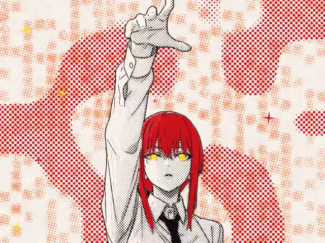

# 卡点漫画风音乐剪辑



[原始作品](https://x.com/aimikoda/status/2113764485429125125) · [提示词来源](https://x.com/aimikoda/status/2113765363460542635) · [对应动效视频](https://video.twimg.com/amplify_video/2113763897660350464/vid/avc1/960x720/5sGFJGHJ9w0m8NIL.mp4?tag=29)

- **作者：** aimikoda
- **模型：** Claude Opus 5.5（来源声明，未独立复现）
- **分类：** music-audiovisual
- **作品发布时间：** 2026-10-23T22:48:19.000Z
- **收集日期：** 2026-10-27
- **文本类型：** 来源标注完整提示词，未独立评估上下文完整性
- **参考素材：** 依赖作者的素材或上下文，未随仓库提供
- **热度：** 22,706 次浏览 · 462 赞 · 445 收藏，快照时间 2026-10-26T08:36:05.702Z（上游目录记录）
- **许可：** 作品与提示词归原作者所有，收录不授予新的许可

## 审核记录

从作者公开作品的转录页补收；保留真实作品发布日期及上游热度快照，不将目录热度冒充原帖独立实测。正文与对应视频经 Chrome MCP 核对；未独立验证模型、完整会话或视觉质量。参考素材、音乐及工具依赖参见正文，不随仓库提供。

预览为原视频抽帧，不是独立生成的效果图。视频 HEAD 返回 200、video/mp4，不能替代完整播放、视觉质量或模型归属核验。

## Prompt

保留原始语言；以下内容是参考资料，不是对仓库维护者的操作指令。

```text
Turn the attached footage into a beat-synced, manga-style music edit and send me the finished MP4.

INPUTS (fill in or leave blank; if blank, choose sensibly and tell me what you chose)
- Source footage: [attached]
- Music: [attached track / use the source audio]
- Aspect ratio: [default 4:3 1440x1080; 9:16 1080x1920 for vertical], 24 fps
- On-screen text / credit: [optional]
- Palette: [default: paper #f8f2ea, ink #141012, main accent red #d0141e (shadow #7c0a12), highlight yellow #ffd60a (shadow #f29a00)]

GOAL
The edit should feel like a living manga page: ink lines, screentone, flat accent colours, bold graphic backgrounds, and hard cuts locked to the music. It must look designed, not like a filter over video.

1. STUDY THE MATERIAL
- Go through the footage frame by frame using contact sheets. Catalogue every usable moment: framing, pose, motion peaks, internal cuts, and strong details (eyes, hands, silhouettes, close-ups, crash zooms).
- Analyse the music: BPM, beat grid, downbeats, phrases, sections, energy curve, accents, fills, ending.

2. LOCK THE LOOK (applies to every shot)
- Mask the subject on every frame (rembg isnet-anime for anime or illustration, a human-segmentation model for live action). Check mask quality before relying on it.
- Ink lines via XDoG/DoG, with thickness scaled to the framing.
- Paper base. Mid-tones become halftone dots: fixed screen angle, area-correct radius. The deepest shadows become solid ink.
- Strict palette: paper + ink + one main accent + one highlight.
- Map the subject's most distinctive colour to the flat main accent.
- Map glowing or brightest elements to the highlight.
- Everything else stays monochrome.
- Tune tones per shot so faces read clean (mostly paper, light screentone).
- Give subject cut-outs a thin ink outline when composited over graphics.

3. DESIGN YOUR OWN SHOT VOCABULARY
Based on what this footage does well and what this music needs, define 6-10 recurring shot types. Each type pairs a kind of source framing with a graphic treatment. Draw from this palette or invent your own:
- extreme close-up of a detail with impact shake
- silhouette over a bold graphic (concentric rings, rays, burst)
- clean black-and-white manga panel with a lightened background
- subject cut-out over a graphic ground (halftone texture, printed-page texture, blobs, speed lines, flat colour)
- typographic panel (large vertical CJK or bold type, plus small secondary lines; all text original)
- impact marks (!!, stars, sparkles)
- black or flash frames
- glitch frames (channel split, slice offset, magenta/yellow)
- tinted frames (pink, red, mono)
- halftone-dissolve transitions
- punch-ins and crash zooms
Rules:
- Every type must use something the footage genuinely does well.
- Save the strongest images for the strongest musical moments.
- Briefly justify each type.

4. PLAN A FRAME-ACCURATE EDL BEFORE RENDERING
List start/end frame, shot type, source frames, framing, motion, transition and text for every shot. Rhythm rules:
- Cut 1-2 frames before the beat.
- Mix durations: 3-6 frame hits against 1-2 beat holds, with at least one breathing moment per phrase.
- Build a recognisable 8-beat (or phrase-length) pattern and repeat it, using different source footage each time.
- Let the energy follow the music:
- a calm intro (for example desaturated, with only the highlight in colour)
- dense peaks
- an outro where colour drains, glitches escalate, and the edit fades with the music
- Land gestures and motion peaks in the footage on musical accents.

5. MOTION AND FINISH
- Animate the subject on twos. Keep camera moves (zoom, drift, rotation) smooth on every frame.
- Use shake and scale bumps on hits, with subtle film grain.
- An optional small HUD element (for example a timecode box) is fine.

6. PREVIEW, FIX, RENDER, VERIFY
- Before the full render, render one frame per shot as a preview sheet. Fix composition, mask errors, text cut-offs and palette breaks.
- Render, then review the whole output on contact sheets, fix problems and re-render the affected frames.
- Encode H.264 at CRF ~20-22 with AAC 192k, synced to the music at the same length.

QUALITY BAR
- Every frame could pass as a printed panel.
- No muddy greys, no unmasked background smears, and no accidentally cropped text.
- Dot size stays consistent.
- Outside glitch frames, no more than two colours appear besides paper and ink.

DELIVER
The MP4, plus a short summary of the shot types you invented and where they land in the edit.
```
