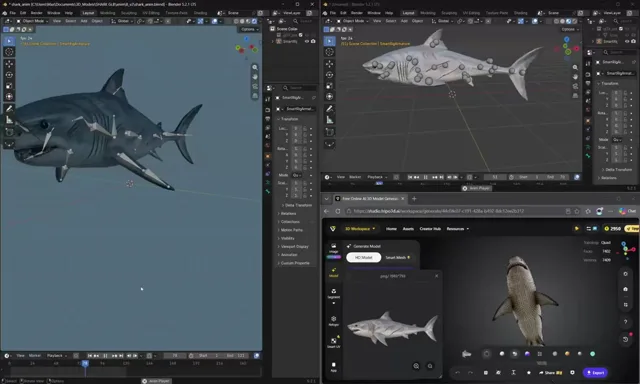

# 带骨骼绑定的3D鲨鱼游动与撕咬动画



[原始作品](https://x.com/maxt3chno/status/2113934291818221665) · [提示词来源](https://x.com/maxt3chno/status/2113934808187338978) · [对应动效视频](https://video.twimg.com/amplify_video/2113934210998185984/vid/avc1/1200x720/6__XcW73o4_kA1jZ.mp4?tag=29)

- **作者：** maxt3chno
- **模型：** Claude Opus 5.5（来源声明，未独立复现）
- **分类：** 3d-simulations
- **作品发布时间：** 2026-10-24T10:03:04.000Z
- **收集日期：** 2026-10-27
- **文本类型：** 来源标注完整提示词，未独立评估上下文完整性
- **参考素材：** 依赖作者的素材或上下文，未随仓库提供
- **热度：** 5,994 次浏览 · 113 赞 · 101 收藏，快照时间 2026-10-26T08:36:05.702Z（上游目录记录）
- **许可：** 作品与提示词归原作者所有，收录不授予新的许可

## 审核记录

从作者公开作品的转录页补收；保留真实作品发布日期及上游热度快照，不将目录热度冒充原帖独立实测。正文与对应视频经 Chrome MCP 核对；未独立验证模型、完整会话或视觉质量。参考素材、音乐及工具依赖参见正文，不随仓库提供。

预览为原视频抽帧，不是独立生成的效果图。视频 HEAD 返回 200、video/mp4，不能替代完整播放、视觉质量或模型归属核验。

## Prompt

保留原始语言；以下内容是参考资料，不是对仓库维护者的操作指令。

```text
You’ll animate a rigged shark from Meshy/Tripo in Blender. Generate and export headlessly with Python scripts so every run is reproducible; use Blender MCP only for inspecting the scene. Never overwrite the original GLB: work on copies, and put each new version in its own folder.
Stage 1: Fix the rig before animating
Auto-rigs usually bake a bent tail into the rest pose. Build a straight neutral pose by straightening the mesh, not the bones: rotate the tail joints until the fin lines up with the tail stalk. If you straighten by bones, the mesh stays bent and the tail beats asymmetrically.
Clean the weights in local zones only, and measure deformation before and after. Check that:
the nose and upper teeth have no lower-jaw weight;
the dorsal and pelvic fins are weighted to a single body bone;
noisy weights at the fin roots are smoothed.
Reweight the lower jaw to about 1.0 along the mouth line. Otherwise it bends instead of rotating when the mouth opens.
Map the bone chain and check the hierarchy. The pectoral fins are often children of the head bone, so any head rotation moves them too.
Stage 2: Procedural swim and idle (no video)
Make a travelling wave down the spine: yaw = A(x) · sin(2πt/T − 2πx/λ), with λ ≈ body length.
Use a tuna-like envelope: the front stays nearly rigid (<1–3°) and the motion grows toward the tail (~30° at the fin). Turn the head slightly in counter-phase.
Swim: 24 frames. Idle: about 60 frames at ~0.45× amplitude. The last key must equal the first, so the loop has a zero seam.
Check the result with real numbers: tail sweep about 0.15–0.2 of body length, sweep centered around 0, and no mesh edges overstretched.
Stage 3: Reference frame for the video model
Render a 1920×1080 split screen: side view on the left, top view on the right, both orthographic at the same scale, on a flat green background.
Color-code the parts on the mesh:
left fin blue, right fin yellow;
tail lobe magenta;
lower jaw orange;
body desaturated gray.
Save the cameras, the world-to-pixel formulas and the start pose (frame 1 of swim) to JSON.
Write a Seedance/Omni prompt: static camera, shark held in place, both panels in sync. Timing: calm swim, then lunge and jaw open, bite, recover, back to swimming. Forbid water, bubbles, blood and prey.
Stage 4: Check the generated video
Compare frame 0 with the start frame. The model usually zooms and shifts the image slightly, so fit one global 2D zoom + offset and apply it before fitting. Don’t move the cameras.
Check that:
the colors stay stable on every frame;
nothing leaves the frame;
the two panels stay consistent with each other.
Expect artifacts: the far fin rendered gray, a “forked” tail seen from above, and a red mouth interior.
Stage 5: Fit the bite
Fit the rig frame by frame in world-space parameters, so that:
the model’s points fall inside the silhouette;
the model covers the silhouette;
the colored zones match in both views.
Fit in stages per frame: body, then head + jaw, then fins.
Express fin rotation relative to the torso, not the head. Keep the tail lobe stiff, because its yaw is barely visible from above.
Apply a de-jerk smoothing pass, but keep the peak amplitudes.
Stage 6: Retarget to an anatomical spine model (important)
A free per-joint 2D fit turns the body into a snake: segments bend in opposite directions and it explains out-of-plane motion as sideways bends. Wider joint limits make it worse.
Keep the head strike from the video, because that’s what makes the bite feel alive. After that, drive the body with:
whole-body heading;
one scheduled C-bend spread over fixed weights toward the tail;
head motion capped at about 12°;
roll scaled down;
the procedural swim wave on top.
Pass criteria:
adjacent segments ≤15° apart;
no sign flips in the bend along the front of the body;
tail stalk ≤25°;
total bend ≤60–70°.
```
