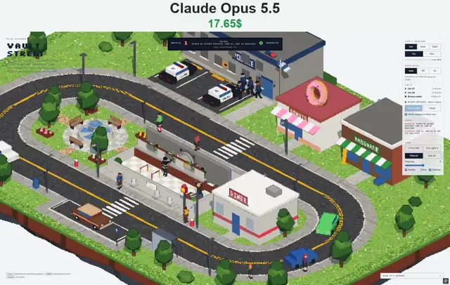

# Vault Street 像素风银行劫案微缩场景



[原始作品](https://x.com/vib3coded/status/2114054716959215724) · [提示词来源](https://x.com/vib3coded/status/2114054890011902110) · [对应动效视频](https://video.twimg.com/amplify_video/2114054456681668608/vid/avc1/1136x720/92kNv9on0PylRKYL.mp4?tag=29)

- **作者：** vib3coded
- **模型：** Claude Opus 5.5（来源声明，未独立复现）
- **分类：** interactive
- **作品发布时间：** 2026-10-24T18:01:36.000Z
- **收集日期：** 2026-10-27
- **文本类型：** 来源标注完整提示词，未独立评估上下文完整性
- **参考素材：** 参见正文默认输入、字体和工具要求
- **热度：** 5,050 次浏览 · 151 赞 · 61 收藏，快照时间 2026-10-26T08:36:05.702Z（上游目录记录）
- **许可：** 作品与提示词归原作者所有，收录不授予新的许可

## 审核记录

从作者公开作品的转录页补收；保留真实作品发布日期及上游热度快照，不将目录热度冒充原帖独立实测。正文与对应视频经 Chrome MCP 核对；未独立验证模型、完整会话或视觉质量。参考素材、音乐及工具依赖参见正文，不随仓库提供。

预览为原视频抽帧，不是独立生成的效果图。视频 HEAD 返回 200、video/mp4，不能替代完整播放、视觉质量或模型归属核验。

## Prompt

保留原始语言；以下内容是参考资料，不是对仓库维护者的操作指令。

```text
Build a single-file, original pixel-art diorama called "Vault Street": a toy-like bank job on a floating isometric town block, rendered with three.js (r160) at low resolution and upscaled with a post shader (depth outlines, OKLab quantisation to a fixed 64-colour palette, optional Bayer dither, a "Raw 3D" toggle). Orthographic camera, drag to rotate, scroll to zoom, whole-pixel snapping. No weapons anywhere: cartoon robbers in striped shirts, beanies and eye masks.

World: a two-lane loop road (Main St / South St) with curbs, sidewalks, zebra crossings and a parking bay cut into the far side of South St. Inside the block: a columned bank ("ACORN SAVINGS") with a dome, a counter with three teller windows behind glass, a rope line, a manager's desk and a round vault door that rolls aside on a track; everything above knee height is one lid that lifts off while the gang are inside (Auto / Off / On). Also a diner and a park with a fountain. North of Main St: a police station with a beacon, a radio mast, a flag and a three-bay lot (two black-and-white cruisers with red/blue light bars, one impound bay), plus a donut shop with a giant donut on the roof and a hardware store. Street lamps with real lights at night, an alarm bell on a post by the bank, trees, a bus shelter. Day / dusk / night; rain with puddle reflections.

Story loop: a brown sedan waits in the bay → two robbers cross and go in → staff and customers put their hands up → one goes behind the counter and opens the vault → a teller trips the alarm (bell rings, station beacon turns) → four officers run to the cruisers; Car 21 heads for the bank, Car 22 goes the other way and turns across both lanes of Main St → robbers run out with "$" sacks, the sedan pulls out and flees round the block with banknotes fluttering from the boot, Car 21 in pursuit → the sedan stops at the roadblock; hands up, or one runs for the park and gets a flying tackle → cuffs, escorted to the station, the loot carried back through the bank's back door → the cruisers back into the lot, the sedan towed into the impound bay → later the gang make bail and drive back to the bay.

Traffic and people: civilian cars keep their distance (people crossing included), pull over for sirens and give up after a while if nothing passes; cruisers go out over the line to pass. Cars wait at a line while anyone reverses out of or pulls into the lot, and lot moves wait for an empty street. Passers-by walk the sidewalks, step round lamps, wait for cars crossing and sometimes use the bank. No deadlocks, no overlapping vehicles.

UI (English): a lit scoreboard (HEISTS · clock + status · ARRESTS, "LOOT RECOVERED $"), a rail with Time & weather, Bank roof, Units (Car 21, Car 22, Brown sedan, the bank with live status; "Start a heist", Pause, "Heists happen on their own"), a Radio log, View controls; click the bank to start a heist; a "How it's drawn" note. Responsive, light and dark themes.
```
