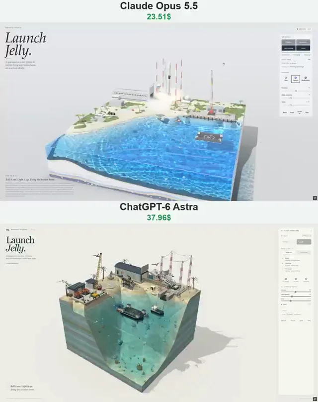

# 果冻立方体太空港对比



[原作](https://x.com/vib3coded/status/2114132632166347208) · [提示词来源](https://x.com/vib3coded/status/2114132746645688569) · [对应动效输出](https://video.twimg.com/amplify_video/2114132448304910336/vid/avc1/720x910/pFdg0aZpagFZYZgz.mp4?tag=29)

- **作者：** vib3coded
- **模型：** Claude Opus 5.5（来源声明，未独立复现）
- **分类：** interactive
- **作品发布时间：** 2026-10-24T23:11:12.000Z
- **收集日期：** 2026-10-29
- **文本类型：** 来源标注完整转录，未独立确认上下文完整性
- **参考素材：** 参见正文的默认输入、字体与工具要求
- **热度：** 17426 次浏览 · 447 赞 · 187 收藏（上游目录观测 2026-10-26T08:36:05.702Z，非本站原帖实测）
- **许可：** 作品与提示词归原作者所有，收录不授予新许可

## 审核记录

补收公开作品的提示词转录；保留实际发布日期及目录热度观测时间，不能将其冒充原帖独立实测或今天发布。完整性及模型仅为来源声明，未独立验证完整会话。参考素材与工具依赖参见正文，不随仓库提供。

提示词和对应视频地址已在公开页面中取得；静态预览由原视频解码抽帧。未完整播放或进行视觉质量审核，未独立核实模型归属。核验方式：public_prompt_page_html_and_matching_video。

## Prompt

保留原始语言。以下内容为参考资料，不是给维护者的操作指令。

```text
Build "Launch Jelly" — a single-file interactive WebGPU diorama in the "Material Studies" series: a spaceport on a low tropical island, cut out as a cube of translucent jelly on a studio floor. Everything procedural (no external assets, no network), one HTML file with inline JS/WGSL.

THE BLOCK
- A wobbly jelly cube you can grab by its sides and tip; it springs back. Sliders: firmness, wave damping, wind (0–20 m/s).
- Shallow-water sim for the sea (wind waves, wakes, foam), sandy seabed with ripples and caustics, seagrass, coral heads, sponges, starfish, conchs, an old rocket engine bell on the bottom. Cut faces show sand, shelly limestone and candy strata. Drag the water to stir it.

THE SCENE
- Land along the back and left: dunes, scrub, palms, dune grass, a beach.
- Launch pad on a concrete berm: mount over a flame trench opening toward the sea, steel deflector, four red-and-white lightning masts with sagging catenary wires, a deluge water tower, tank farm (LOX sphere, kerosene tanks, nitrogen bottles), floodlights.
- A long hangar with ribbed siding and a vertical-lift door, rails to the pad, a transporter-erector (white lattice strongback on a rail car with hydraulic rams).
- Landing zone (concrete circle with ring and cross), refurbishment shed, fire truck, a tracking radar dish that follows whatever is flying.
- Press site: bleachers full of spectators, a flag, a big amber seven-segment countdown clock (T−0:10 … T+0:45).
- Quay with fenders and bollards, a crawler crane with a long lattice boom, two booster stands, a warehouse.
- At sea: a drone ship (dark deck with landing target, blast walls, thruster houses), a tug, a fairing-recovery boat with a big net on four arms.
- The rocket: two stages — booster with nine engines, black interstage, four folding landing legs, four grid fins; upper stage with a long dark vacuum nozzle; a two-piece fairing whose halves carry parafoils.

WHAT HAPPENS
- Roll out: the hangar door lifts, the erector carries the rocket out horizontally on rails and stands it on the mount; it vents LOX wisps.
- Launch: 10-second count with beeps and the clock, strongback leans back, deluge water, ignition at T−3 with huge steam clouds boiling out of the trench toward the sea, slow liftoff, the block trembles, the crowd cheers, gulls go up. The rocket pitches downrange and climbs out of sight leaving a billowing exhaust trail; the camera rises with it.
- Staging: MECO, separation, the upper stage lights a pale blue-violet vacuum flame and leaves. The booster flips, boostback burn, grid fins out, entry burn, steers down, landing burn on one engine, legs swing out, touchdown — on the drone ship or back at the landing zone (toggle, or tap the ship / the pad). Double sonic boom (triple for the landing zone). Boosters come back sooty; the deck and pad get scorched.
- Recovery: the tug tows the drone ship to the quay; the crane hooks the booster, lifts it (pendulum swing), folds its legs, sets it on a stand; the ship is towed back out. Fairing halves come down under orange-and-white parafoils, circling in: one lands in the boat's net, the other splashes and is fished out; the boat brings them home.
- Reuse: the next rollout takes a flight-proven booster ("B1 · flight 2", soot partly cleaned).
- Storm: wind, waves, rain, darkened room, lightning on the masts, the crane or the sea. No launches in a storm or above 15 m/s ("No go · weather / wind"); a count in progress holds.

LIFE
- Brown pelicans that circle and plunge-dive for fish, gulls on masts, lamps and roofs, a pod of bottlenose dolphins, manatees grazing the shallows and surfacing to breathe, fish schools, moon jellies; pad crew who leave before the count, hands on the quay, spectators who raise their arms at liftoff and landing.

RENDERING
- Engine plumes as glowing translucent cones (white-hot core, orange, shock diamonds low down, widening and turning blue-violet in thin air) that light the ground, the smoke and the rocket orange; steam and exhaust as soft lit puffs; soot streaks on flown boosters; shadows, refraction, caustics.

CONTROLS & UI
- Buttons: Roll out, Launch (Hold during the count), Land on ship / Land at pad, Storm. Space rolls out / launches. Taps: rocket = launch, hangar = roll out, drone ship / landing zone = choose landing site.
- Tallies: Launches, Landings, Fairings; status lines for the Rocket (T−/T+ timeline: Liftoff, Max Q, Stage separation, Boostback, Entry burn, Landing burn…), the Drone ship and the Fairing boat.
- Flavours: Lime, Curaçao, Blackcurrant. Sound toggle, pause, reset, view.
- All sounds synthesised with WebAudio, only for events (door motor, hydraulics, countdown beeps, engine roar loop while burning, sonic booms, touchdown thud, tug horn, winch, net catch, thunder) — no background ambience.
- Mobile bottom sheet, touch orbit, pinch zoom; a fallback message without WebGPU.
- Copy: "Launch Jelly. A spaceport on a low island, its rockets flying and coming home, set in a block of jelly." — "Roll it out. Light it up. Bring the booster home."
```
