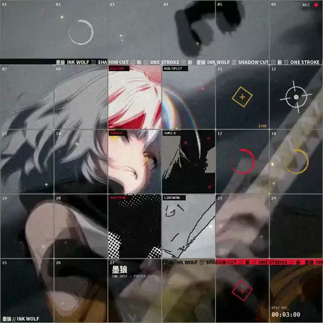

# 三种海报网格音乐视频效果



[原始作品](https://x.com/aimikoda/status/2114167098284839305) · [提示词来源](https://x.com/aimikoda/status/2114167098284839305) · [对应动效视频](https://video.twimg.com/amplify_video/2114165538637086720/vid/avc1/720x720/Sx3_3kMkQPJ5zhbK.mp4?tag=29)

- **作者：** aimikoda
- **模型：** Claude Opus 5.5（来源声明，未独立复现）
- **分类：** music-audiovisual
- **作品发布时间：** 2026-10-25T01:28:10.000Z
- **收集日期：** 2026-10-27
- **文本类型：** 来源标注完整提示词，未独立评估上下文完整性
- **参考素材：** 依赖作者的素材或上下文，未随仓库提供
- **热度：** 22,295 次浏览 · 659 赞 · 649 收藏，快照时间 2026-10-26T08:36:05.702Z（上游目录记录）
- **许可：** 作品与提示词归原作者所有，收录不授予新的许可

## 审核记录

从作者公开作品的转录页补收；保留真实作品发布日期及上游热度快照，不将目录热度冒充原帖独立实测。正文与对应视频经 Chrome MCP 核对；未独立验证模型、完整会话或视觉质量。参考素材、音乐及工具依赖参见正文，不随仓库提供。

预览为原视频抽帧，不是独立生成的效果图。视频 HEAD 返回 200、video/mp4，不能替代完整播放、视觉质量或模型归属核验。

## Prompt

保留原始语言；以下内容是参考资料，不是对仓库维护者的操作指令。

```text
Create a 1:1 high-energy poster-grid music video, exactly matching the supplied music's duration. Divide the frame into near-square cells with thin grey lines, keeping the original footage as one continuous, clearly recognizable image across the grid. The center ~6 cells play in sync with distinct visual treatments, while outer cells create independent variations. Fill the composition with dense, rapidly evolving effects, layered motion graphics, typography, icons, flashes and rhythmic transitions. Let the footage and music inspire every creative choice. Push visual intensity with frequent beat-driven bursts, but keep the original characters, action and scene consistently recognizable. Effects enhance the footage rather than replace it.

2. Create a 1:1 high-energy poster-grid music video, exactly matching the supplied music's duration. Divide the frame into near-square cells with thin grey lines, preserving one continuous, recognizable image across the grid. The center ~6 cells remain synchronized with distinct visual treatments. Aggressive waves of stylistic transformations spread between neighboring cells, triggering rapid chain reactions, layered effects, graphic explosions and rhythmic resets. Fill the grid with constant visual activity, inventive typography, icons and motion graphics inspired by the footage and soundtrack. Make transformations bold, frequent and visually spectacular, but temporary, always revealing the original characters and action beneath.

3. Create a 1:1 high-energy temporal poster-grid music video, exactly matching the supplied music's duration. Divide the frame into near-square cells with thin grey lines, preserving one continuous, recognizable image across the grid. The center ~6 cells follow the original action in sync while surrounding cells create intense temporal variations. Build dense rhythmic cascades of motion echoes, rapid frame repetitions, time offsets, reversals, impact freezes and layered graphic effects. Sync aggressive temporal bursts, typography, icons and transitions precisely to the music. Let the footage and soundtrack guide every creative decision. Keep the original action clearly identifiable amid the controlled visual chaos.
```
