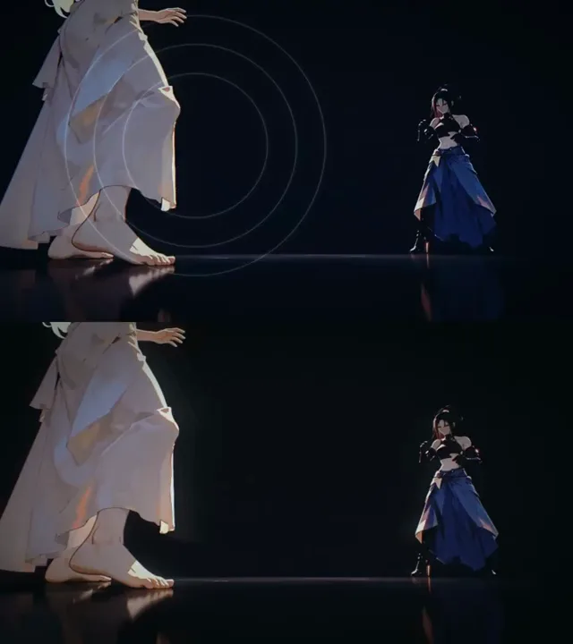

# 节拍同步视频剪辑



[原作](https://x.com/aimikoda/status/2114356633849516157) · [提示词来源](https://x.com/aimikoda/status/2114357254472278126) · [对应动效输出](https://video.twimg.com/amplify_video/2114356040913358848/vid/avc1/720x810/HKWDEFqH0nBTtgLa.mp4?tag=29)

- **作者：** aimikoda
- **模型：** Claude Opus 5.5（来源声明，未独立复现）
- **分类：** music-audiovisual
- **作品发布时间：** 2026-10-25T14:01:19.000Z
- **收集日期：** 2026-10-28
- **文本类型：** 来源标注完整转录，未独立确认上下文完整性
- **参考素材：** 依赖原作者素材或上下文，未随仓库提供
- **热度：** 8119 次浏览 · 149 赞 · 120 收藏（上游目录观测 2026-10-26T19:22:00.898Z，非本站原帖实测）
- **许可：** 作品与提示词归原作者所有，收录不授予新许可

## 审核记录

补收公开作品的提示词转录；保留实际发布日期及目录热度观测时间，不能将其冒充原帖独立实测或今天发布。完整性及模型仅为来源声明，未独立验证完整会话。参考素材与工具依赖参见正文，不随仓库提供。

提示词和对应视频地址已在公开页面中取得；静态预览由原视频解码抽帧。未完整播放或进行视觉质量审核，未独立核实模型归属。核验方式：public_prompt_page_html_and_matching_video。

## Prompt

保留原始语言。以下内容为参考资料，不是给维护者的操作指令。

```text
Create a high-energy 16:9 music video using the supplied footage. Keep the original timing and playback speed, with no slow motion, speed ramps or trimming. Use the full frame with no grid or split panels, preserving the original footage as one continuous, clearly recognizable image at all times. Apply a constantly shifting base visual treatment driven by the music's sections, and unleash aggressive style infections that erupt from points of action such as clashes, impacts and fast movement, spreading violently across the frame through expanding circles, shockwave rings, slashing wipes and mutating color fields. Blend these with rhythmic cascades of motion echoes, time-offset ghost layers, frame repetitions and hard impact freezes. Trigger dense, layered visual effects, flashes, camera punches, shakes, chromatic splits, inversions, graphic symbols and chain reactions precisely to the music. Let the original footage and soundtrack guide all creative decisions, keeping the editing constantly evolving, unpredictable and visually spectacular. Preserve the original characters, action and scene continuity throughout. Effects enhance the footage rather than replace it. Preserve the original video's audio, including dialogue, sound effects and ambient sounds, mixing it naturally with the supplied music. Do not mute, replace or remove the original audio. No typography, text, letters or numbers.

Bottom:
Create a high-energy 16:9 music video using the supplied footage. Keep the original timing and playback speed throughout, with no slow motion, speed ramps or trimming, so the picture stays in natural sync with its own audio. Use the full frame with no grid or split panels, keeping the original footage as one continuous, clearly recognizable image at all times. Apply a shifting base visual treatment that evolves with the music's sections, and let secondary styles spread smoothly across the frame through soft-edged organic shapes — expanding circles, flowing wipes and blooming color fields — that grow from points of action such as clashes, impacts and fast movement, then gently fade. Blend these with rhythmic motion echoes and subtle time-offset ghost layers. Use frame repetitions and impact freezes sparingly, only as brief accents of a few frames on the strongest hits, never sustained, so playback always feels fluid and never stuttery. Trigger flashes, light camera punches, soft chromatic shifts, graphic symbols and gentle chain reactions in sync with the music, favoring smooth easing and glow over harsh strobing. Let the original footage and soundtrack guide all creative decisions, keeping the editing evolving and visually rich but fluid and comfortable to watch. Preserve the original characters, action and scene continuity throughout. Effects enhance the footage rather than replace it. Preserve the original video's audio, including dialogue, sound effects and ambient sounds, mixing it naturally with the supplied music. Do not mute, replace or remove the original audio. No typography, text, letters or numbers.
```
