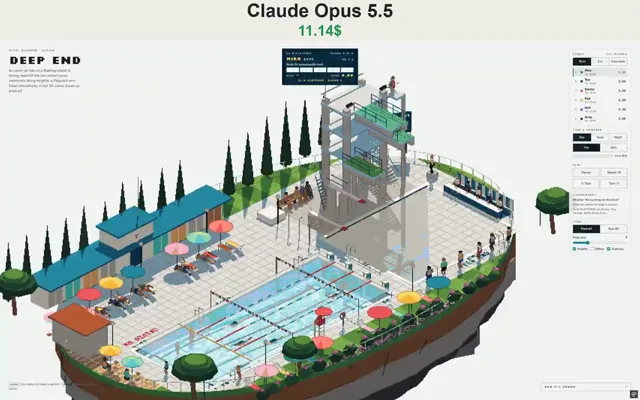

# 互动像素风游泳俱乐部



[原作](https://x.com/N1njaCodex/status/2114467181912322353) · [提示词来源](https://x.com/N1njaCodex/status/2114467376926175288) · [对应动效输出](https://video.twimg.com/amplify_video/2114467119723114497/vid/avc1/1152x720/iQNURuxUreOBuHOe.mp4?tag=29)

- **作者：** N1njaCodex
- **模型：** Claude Opus 5.5（来源声明，未独立复现）
- **分类：** 3d-simulations
- **作品发布时间：** 2026-10-25T21:20:35.000Z
- **收集日期：** 2026-10-28
- **文本类型：** 来源标注完整转录，未独立确认上下文完整性
- **参考素材：** 参见正文的默认输入、字体与工具要求
- **热度：** 6455 次浏览 · 201 赞 · 133 收藏（上游目录观测 2026-10-27T06:16:03.823Z，非本站原帖实测）
- **许可：** 作品与提示词归原作者所有，收录不授予新许可

## 审核记录

补收公开作品的提示词转录；保留实际发布日期及目录热度观测时间，不能将其冒充原帖独立实测或今天发布。完整性及模型仅为来源声明，未独立验证完整会话。参考素材与工具依赖参见正文，不随仓库提供。

提示词和对应视频地址已在公开页面中取得；静态预览由原视频解码抽帧。未完整播放或进行视觉质量审核，未独立核实模型归属。核验方式：public_prompt_page_html_and_matching_video。

## Prompt

保留原始语言。以下内容为参考资料，不是给维护者的操作指令。

```text
Make a pixel-art 3D diorama of an open-air lido on a floating island, the same series and engine as my other pixel dioramas (three.js, orthographic isometric camera turned in quarter steps, small render target with no anti-aliasing snapped to whole pixels, depth-based outlines, a fixed 64-colour palette matched in OKLab, hard sun shadows, day/dusk/night, rain with puddles). Call it "Deep End".

The lido: a 25 m four-lane lap pool (shallow end roped off for children, lane ropes whose floats ride the waves, backstroke flags, starting blocks) and a 5 m deep diving pool, with 1 m and 3 m springboards that bend and a 1930s concrete tower with platforms at 5, 7.5 and 10 m and an open stair. Around them: striped changing cabins with a clock, a kiosk, the judges' table, the lifeguard's high chair, loungers, parasols and umbrella pines.

Real water: each pool is a height field run with the wave equation, so dives, strokes, raindrops and clicks make rings that reflect off the walls. The surface shades from its normals, with sun glints and a mirrored render of the scene; the tiled floor gets caustics.

Dives are flown, not animated. The diver takes off with an upward speed and an angular momentum chosen to land the somersaults, the momentum is conserved through tuck, pike and straight shapes, and the body rotates about its real centre of mass, with twists about the spine. Kick-out timing errors tip the entry angle, which sets the splash and five judges' cards; drop the highest and lowest and multiply by DD. Run a six-diver, five-round meet on the 10 m platform or the 3 m springboard (with the approach and hurdle), with standings, then a medal moment, then free swim with pencil jumps, cannonballs and belly flops.

Also: lap swimmers doing freestyle, breaststroke and backstroke with flip turns; divers who swim to a ladder, shower, sit in the hot tub and climb again; children who get whistled at for running; wet footprints on the deck that dry; pool lights glowing at night. Click the water to make a splash. English UI; must work on phones.
```
