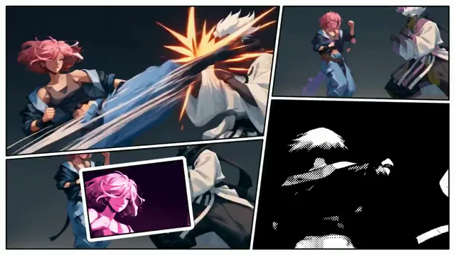

# 漫画分格风音乐视频剪辑



[原作](https://x.com/aimikoda/status/2114477295574425988) · [提示词来源](https://x.com/aimikoda/status/2114477612525408276) · [对应动效输出](https://video.twimg.com/amplify_video/2114476718438162432/vid/avc1/1280x720/5OyYrNOBCvtt9CVv.mp4?tag=29)

- **作者：** aimikoda
- **模型：** Claude Opus 5.5（来源声明，未独立复现）
- **分类：** music-audiovisual
- **作品发布时间：** 2026-10-25T22:00:47.000Z
- **收集日期：** 2026-10-28
- **文本类型：** 来源标注完整转录，未独立确认上下文完整性
- **参考素材：** 依赖原作者素材或上下文，未随仓库提供
- **热度：** 18712 次浏览 · 494 赞 · 431 收藏（上游目录观测 2026-10-27T06:16:03.823Z，非本站原帖实测）
- **许可：** 作品与提示词归原作者所有，收录不授予新许可

## 审核记录

补收公开作品的提示词转录；保留实际发布日期及目录热度观测时间，不能将其冒充原帖独立实测或今天发布。完整性及模型仅为来源声明，未独立验证完整会话。参考素材与工具依赖参见正文，不随仓库提供。

提示词和对应视频地址已在公开页面中取得；静态预览由原视频解码抽帧。未完整播放或进行视觉质量审核，未独立核实模型归属。核验方式：public_prompt_page_html_and_matching_video。

## Prompt

保留原始语言。以下内容为参考资料，不是给维护者的操作指令。

```text
Create a high-energy 16:9 music video using both supplied video clips, edited to exactly match the full duration of the supplied music.

EDITING:
Analyze both clips and the soundtrack. Select the strongest moments, creatively cut, interleave, rearrange and combine footage from both sources. Build a cohesive, fast-paced edit driven by the music's rhythm, energy, transitions and emotional progression. Freely alternate between clips, create visual connections and synchronize key actions with musical accents. Avoid simply playing the clips sequentially.

GRID STRUCTURE:
Use a dynamic, asymmetrical manga-inspired panel layout with large dominant panels, narrow strips, tilted rectangles and smaller supporting panels separated by clean white gutters. Use the reference image strictly for panel geometry, not its artwork or visual style. Mix moments from both clips across different panels, creating coordinated compositions. On major beats, dynamically rearrange panel sizes, positions and boundaries.

VISUAL EFFECTS:
Blend aggressive style infections spreading between neighboring panels with temporal variations, motion echoes, frame repetitions, time offsets and impact freezes. Create dense, layered visual effects, rhythmic flashes, graphic symbols and cross-panel chain reactions. Synchronize everything precisely to the soundtrack.

CREATIVE DIRECTION:
Let the footage and music guide all editing decisions, visual treatments, effects and transitions. Be bold, experimental and visually inventive. Keep the original characters, actions and environments clearly recognizable. Use large panels to maintain visual clarity while smaller panels explore creative variations. Effects should enhance the footage rather than replace it.

AUDIO:
Preserve the original audio from both clips, including dialogue, sound effects and ambience. Retain relevant sounds from the selected moments and mix them naturally with the supplied music. The soundtrack drives the edit and plays uninterrupted from beginning to end.
No typography, text, letters or numbers.
```
