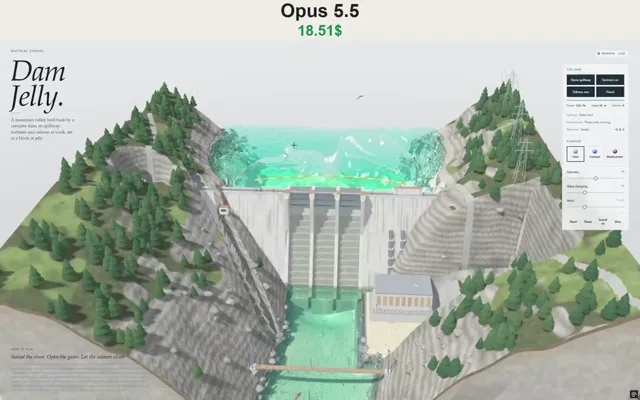

# 互动果冻大坝模拟器



[原作](https://x.com/vib3coded/status/2114512807500615723) · [提示词来源](https://x.com/vib3coded/status/2114512949897547782) · [对应动效输出](https://video.twimg.com/amplify_video/2114512714047369217/vid/avc1/1152x720/Ujqgiurn5ckncdSi.mp4?tag=29)

- **作者：** vib3coded
- **模型：** Claude Opus 5.5（来源声明，未独立复现）
- **分类：** 3d-simulations
- **作品发布时间：** 2026-10-26T00:21:53.000Z
- **收集日期：** 2026-10-28
- **文本类型：** 来源标注完整转录，未独立确认上下文完整性
- **参考素材：** 参见正文的默认输入、字体与工具要求
- **热度：** 9850 次浏览 · 272 赞 · 130 收藏（上游目录观测 2026-10-27T06:16:03.823Z，非本站原帖实测）
- **许可：** 作品与提示词归原作者所有，收录不授予新许可

## 审核记录

补收公开作品的提示词转录；保留实际发布日期及目录热度观测时间，不能将其冒充原帖独立实测或今天发布。完整性及模型仅为来源声明，未独立验证完整会话。参考素材与工具依赖参见正文，不随仓库提供。

提示词和对应视频地址已在公开页面中取得；静态预览由原视频解码抽帧。未完整播放或进行视觉质量审核，未独立核实模型归属。核验方式：public_prompt_page_html_and_matching_video。

## Prompt

保留原始语言。以下内容为参考资料，不是给维护者的操作指令。

```text
Build "Dam Jelly", a new piece in my "Material Studies" series: a single-file, self-contained interactive WebGPU diorama (one HTML file, all JS/CSS/WGSL inline, no network requests, no libraries). A mountain valley with a concrete gravity dam is cut out as a wobbly block of jelly sitting on a pale studio table, seen from above at three-quarters.

SCENE (block-local coords, origin at base centre, y up, block ~5.2 × 5.2 units):
- A river valley running back to front: steep rocky slopes with crags, scree and boulders, conifer and broadleaf woods, grassy shoulders. Where the block is cut, the side faces show layered grey bedrock in tilted beds with joints, a weathered brown band and dark topsoil at the top, and gravel and silt under the water. At the very bottom are thin coloured "jelly" strata in the current flavour.
- A long reservoir behind the dam, with a bare drawdown ring of rock round its shore, a floating log boom of orange and yellow floats in front of the spillway, and a small patrol boat lapping the lake.
- A concrete gravity dam across the valley, its ends let into rock abutments: a battered downstream face with lift lines, a crest road with railings and lamps, an intake tower with trash racks and three penstocks down the face.
- A central stepped spillway with three bays between piers. Each bay has a radial (Tainter) gate: a curved skin plate on arms that swing about trunnions on the piers, with hoist houses on top. Below is an ogee crest, a stepped chute, training walls and a plunge pool scoured into the riverbed.
- A powerhouse at the right toe: a concrete base in the river, a hall of siding and tall windows, tailrace mouths. Above it, a switchyard on a terrace with transformers and gantries, and lattice pylons climbing the right slope with sagging lines.
- A fish ladder up the left bank: 14 stepped concrete pools with weirs between them from the river up to the lake, an exit gate and a counting hut at the top.
- A visitor centre on the left abutment, roads with hairpins, a suspension footbridge over the river downstream, rocks, weed and gravel bars in the river.

SIMULATION:
- Shallow-water heightfield (about 168×168), split into two bodies by the dam (reservoir and river), each with its own still level, separated by flood-fill classification. Sources, sinks and current jets make visible flow: inflow at the back of the lake, a draw toward open gates and the intake, boiling outflow in the plunge pool and tailrace, and drainage at the front edge. Foam advects on the currents.
- Reservoir level ODE: dL/dt = (Qin − Qspill − Qturbines − Qover) / AREA, where Qspill ∝ gateOpening · (L − sill)^1.5 and Qover ∝ (L − crest)^1.5. The river level rises with total outflow.
- Head-based power: 3 units × 120 MW, scaled by head.
- An automatic dam keeper opens the gates (siren first) when the lake nears the crest or a flood is coming, and shuts them again once the water is back down.
- The jelly block itself wobbles, can be tipped by dragging its side, and settles back.

INTERACTIONS (right-hand glass panel, "The dam"):
- Open spillway: a 3.5 s siren, then the gates swing up over ~9 s, and white water streams down the steps with spray and mist. Press again to shut them.
- Turbines on/off: the units spin up or down, power rises or falls, the tailrace boils or goes still, and the powerhouse windows glow while running.
- Salmon run: salmon gather below the dam, try leaping at the falls, then climb the ladder pool by pool (a leap per pool, waiting their turn) and swim out into the lake. A counter tallies fish through. Runs also arrive on their own every few minutes.
- Flood: a storm builds, blows and eases (rain, darkening, lightning hitting pylons, ridges or the lake). A big inflow surge comes down the valley: the keeper pre-releases, the lake still rises over the crest, and a white overflow sheet pours across the whole dam face. The water turns muddy brown and clears slowly afterwards.
- Tap a gate, the powerhouse or the ladder to trigger the same actions. Tap the patrol boat for its horn. Space sounds the siren.
- Tallies: Power (MW), Head (m), Salmon. Status lines: Spillway, Powerhouse, Reservoir (Rising/Falling/Steady/Flood coming in/Over the crest, with level relative to the crest in metres).
- Drag on water makes waves, drag the block's side tips it, drag empty space or right-drag orbits, wheel or pinch zooms.
- Flavour swatches (Lime, Curaçao, Blackcurrant) tint the jelly and water. Sliders for Firmness, Wave damping and Wind. Reset, Pause, Sound on/off and View buttons.

LIFE: rainbow trout in the river and lake, salmon, mallards (drakes and hens) paddling and taking off, herons wading and stalking, ospreys circling and plunge-diving for fish, people walking the crest (who pause at the siren), the powerhouse yard, the visitor centre and the footbridge, and a fisherman on the bank. Animals startle at the siren, lightning and splashes.

SOUND (synthesised with WebAudio, events only, no constant ambience): motor siren, gate-hoist clunk and drone, the spillway's rush as the gates lift, turbine spin-up and spin-down whine, a rumble of overtopping, salmon leaps, a chime for each fish counted, osprey splashes, the boat horn, thunder, and wind and rain only while a storm blows.

RENDERING: WebGPU with MSAA, a sun shadow map, caustics on the riverbed, refraction and absorption through the water and the jelly, Fresnel reflections, translucent premultiplied passes for spray and mist puffs, white-water sheets, ladder pools and rain, and a muddy-water tint during floods.

UI and layout: editorial look with an italic serif masthead ("Material Studies" eyebrow, "Dam Jelly." title, a one-line description) and a "How to play" footer at bottom left. On mobile the controls panel becomes a bottom sheet. If WebGPU is unavailable, show a clear fallback card. Respect prefers-reduced-motion. No page scroll.

QUALITY: keep the sim around 2 ms/frame, no NaNs over long soaks, everything stays inside the block, the boat always afloat. Verify with headless Playwright screenshots (SwiftShader WebGPU) and an end-to-end test that drives every button, tap target, slider and the mobile sheet, and checks for zero console errors.
```
