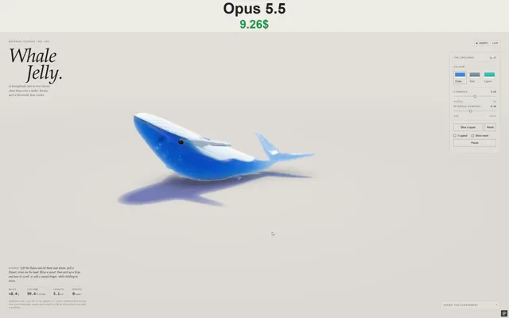

# 可交互的果冻鲸鱼



[原作](https://x.com/vib3coded/status/2114674922802782355) · [提示词来源](https://x.com/vib3coded/status/2114675119364653309) · [对应动效输出](https://video.twimg.com/amplify_video/2114674840137306112/vid/avc1/1152x720/PsEvPqOOrjpeFPpL.mp4?tag=29)

- **作者：** vib3coded
- **模型：** Claude Opus 5.5（来源声明，未独立复现）
- **分类：** 3d-simulations
- **作品发布时间：** 2026-10-26T11:06:05.000Z
- **收集日期：** 2026-10-29
- **文本类型：** 来源标注完整转录，未独立确认上下文完整性
- **参考素材：** 参见正文的默认输入、字体与工具要求
- **热度：** 51683 次浏览 · 988 赞 · 433 收藏（上游目录观测 2026-10-28T06:51:45.678Z，非本站原帖实测）
- **许可：** 作品与提示词归原作者所有，收录不授予新许可

## 审核记录

补收公开作品的提示词转录；保留实际发布日期及目录热度观测时间，不能将其冒充原帖独立实测或今天发布。完整性及模型仅为来源声明，未独立验证完整会话。参考素材与工具依赖参见正文，不随仓库提供。

提示词和对应视频地址已在公开页面中取得；静态预览由原视频解码抽帧。未完整播放或进行视觉质量审核，未独立核实模型归属。核验方式：public_prompt_page_html_and_matching_video。

## Prompt

保留原始语言。以下内容为参考资料，不是给维护者的操作指令。

```text
Build a single-file interactive WebGPU soft-body study called "Whale Jelly" (Material Studies / No. 043), matching the quality of an earlier watermelon-slice jelly study. Subject: a humpback whale cast in two layers of gummy jelly, lying on its belly on a studio table.

Geometry: a signed-distance whale — an elliptical section swept along a curved spine (broad head with a flat crown, deep chest, narrow keeled tail stock), the belly pressed flat on the floor, smoothly joined to notched flukes with a scalloped trailing edge, long flippers with knobs along the leading edge, a small dorsal fin and twin blowhole dimples. Mesh it with surface nets and Newton projection; simulate it with a snapped hex lattice (5 tets per cell, a node layer on the floor) and XPBD (60 Hz, 10 substeps, co-rotational shape matching, volume constraints, edge damping, floor friction). Make the fins firmest and the clear body jelly softest.

Look: clear tinted jelly over a milky layer. The milky layer is its own embedded surface, cut by a wavy line along the flank that rises at the head into the mouth. Light it with key light absorbed through the jelly above it, measured from shadow-map depth. Draw throat pleats, a dark mouth groove, head tubercles and tail-stock knuckles in the shader from rest-space coordinates as bump-mapped relief. Add glossy dark bead eyes and a few trapped air bubbles. Render with refraction plus Beer–Lambert thickness from back-face depth, back-lit glow on the thin fins, a jelly-tinted floor shadow, PCSS soft shadows, contact AO, studio softbox reflections and GGX highlights, then PBR Neutral tone mapping.

Interaction: grab and stretch anywhere, with twist on scroll or a second finger. A "Blow a spout" button fires a column of rigid jelly drops from the blowhole along its deformed axis; the drops bounce, roll, land on the whale through its tets, and can be picked up and thrown.

UI (English, editorial style): masthead, live status pill, specimen panel (three colourways — Ocean, Slate, Lagoon; Firmness and Internal damping sliders; Blow / Reset; ¼ speed; Show mesh; Pause), live readouts (mass, volume %, length in cm snout-to-notch, loose drops), "Inside the experiment" notes, a WebGPU fallback and a stacked mobile layout.
```
