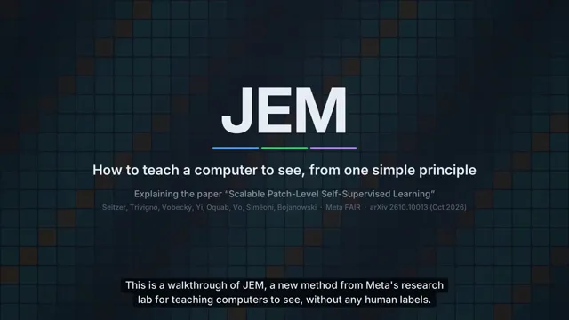

# JEM自监督学习论文讲解视频



[原作](https://x.com/iScienceLuvr/status/2114676265093664978) · [提示词来源](https://x.com/iScienceLuvr/status/2114677310653898974) · [对应动效输出](https://video.twimg.com/amplify_video/2114675884305350657/vid/avc1/1280x720/_a3na2ieAVArHq8Q.mp4?tag=29)

- **作者：** iScienceLuvr
- **模型：** Claude Opus 5.5（来源声明，未独立复现）
- **分类：** explainers-data
- **作品发布时间：** 2026-10-26T11:11:25.000Z
- **收集日期：** 2026-10-29
- **文本类型：** 来源标注完整转录，未独立确认上下文完整性
- **参考素材：** 依赖原作者素材或上下文，未随仓库提供
- **热度：** 32313 次浏览 · 613 赞 · 701 收藏（上游目录观测 2026-10-28T06:51:45.678Z，非本站原帖实测）
- **许可：** 作品与提示词归原作者所有，收录不授予新许可

## 审核记录

补收公开作品的提示词转录；保留实际发布日期及目录热度观测时间，不能将其冒充原帖独立实测或今天发布。完整性及模型仅为来源声明，未独立验证完整会话。参考素材与工具依赖参见正文，不随仓库提供。

提示词和对应视频地址已在公开页面中取得；静态预览由原视频解码抽帧。未完整播放或进行视觉质量审核，未独立核实模型归属。核验方式：public_prompt_page_html_and_matching_video。

## Prompt

保留原始语言。以下内容为参考资料，不是给维护者的操作指令。

```text
Make a video explaining how JEM works (https://arxiv.org/abs/2610.10013)
>
> Make sure it's in depth but also explains it from scratch and first principles without it being too complicated (I don't understand any of the information theoretic math for example, it confuses me)

[it generated a 16 min video but did not cover any of the equations directly]

> This is incredible! The only thing missing is it doesn't walk through the actual math/equations for the losses. You just need to explain how your intuitive description of the losses connect with the math. Please let me know what parts of the video you change to make this clear.
```
