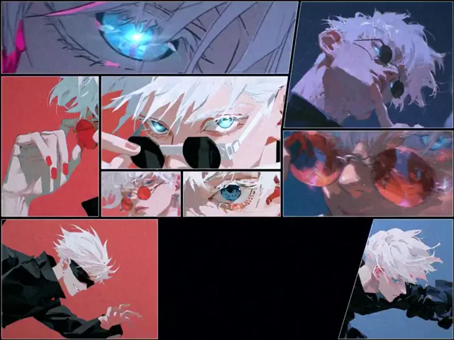

# 用静态图和音乐制作的五条悟动漫混剪



[原作](https://x.com/aimikoda/status/2114745463736082828) · [提示词来源](https://x.com/aimikoda/status/2114745768234144127) · [对应动效输出](https://video.twimg.com/amplify_video/2114745209930084352/vid/avc1/960x720/eoBcRF3-Mac3QXNb.mp4?tag=29)

- **作者：** aimikoda
- **模型：** Claude Opus 5.5（来源声明，未独立复现）
- **分类：** music-audiovisual
- **作品发布时间：** 2026-10-26T15:46:23.000Z
- **收集日期：** 2026-10-29
- **文本类型：** 来源标注完整转录，未独立确认上下文完整性
- **参考素材：** 依赖原作者素材或上下文，未随仓库提供
- **热度：** 8918 次浏览 · 210 赞 · 162 收藏（上游目录观测 2026-10-28T06:51:45.678Z，非本站原帖实测）
- **许可：** 作品与提示词归原作者所有，收录不授予新许可

## 审核记录

补收公开作品的提示词转录；保留实际发布日期及目录热度观测时间，不能将其冒充原帖独立实测或今天发布。完整性及模型仅为来源声明，未独立验证完整会话。参考素材与工具依赖参见正文，不随仓库提供。

提示词和对应视频地址已在公开页面中取得；静态预览由原视频解码抽帧。未完整播放或进行视觉质量审核，未独立核实模型归属。核验方式：public_prompt_page_html_and_matching_video。

## Prompt

保留原始语言。以下内容为参考资料，不是给维护者的操作指令。

```text
Create a spectacular 4:3 Jujutsu Kaisen AMV centered on Satoru Gojo, using the supplied images and music. Match the final video's duration exactly to the full soundtrack.

EDITING & ANIMATION:
Analyze the music's rhythm, structure, energy and emotional progression. Animate the supplied images into dynamic cinematic sequences with expressive character motion, dramatic camera movements, parallax and seamless transitions. Creatively select, crop, reframe, combine and revisit images throughout the edit. Build an intense anime opening with powerful visual storytelling, synchronized precisely to the music.

DYNAMIC GRID:
Use a constantly evolving manga-inspired grid with variable cell sizes, shapes and arrangements. Mix large hero panels, small square cells, narrow strips, irregular rectangles and occasional diagonal divisions. Freely expand, shrink, split, merge and rearrange cells according to the music. Alternate between dense multi-cell compositions, striking asymmetrical layouts and occasional full-frame hero moments. Allow different images, perspectives and moments to coexist across cells. Keep panel boundaries crisp and compositions visually coherent.

VISUAL EFFECTS:
Create intense, layered effects inspired by Gojo Satoru's powers and the visual identity of Jujutsu Kaisen. Explore spatial distortion, Infinity, Six Eyes, cursed energy, Blue, Red and Hollow Purple through inventive motion graphics, impact frames, dimensional fractures and cinematic transitions. Blend style infections spreading across neighboring cells with temporal echoes, frame repetitions, speed ramps, freezes and rhythmic chain reactions. Let effects interact creatively with the grid and occasionally break beyond panel boundaries.

CREATIVE DIRECTION:
Make this feel like a premium, visually groundbreaking Jujutsu Kaisen anime opening. Capture Gojo's overwhelming power, confidence, elegance and mysterious presence. Let the supplied images and soundtrack guide every creative decision, including pacing, visual treatments, transitions, color grading and effect intensity. Avoid repetitive editing patterns or generic templates. Balance explosive action with striking moments of visual clarity. Preserve Gojo's recognizable identity, facial features, costume and the artistic style of the supplied images.

AUDIO:
Use the supplied music as the primary soundtrack, uninterrupted from beginning to end. Synchronize animation, grid transformations, camera movements and visual effects to its beats, melodies, transitions and emotional peaks.
No typography, text, letters, numbers or watermarks.
```
