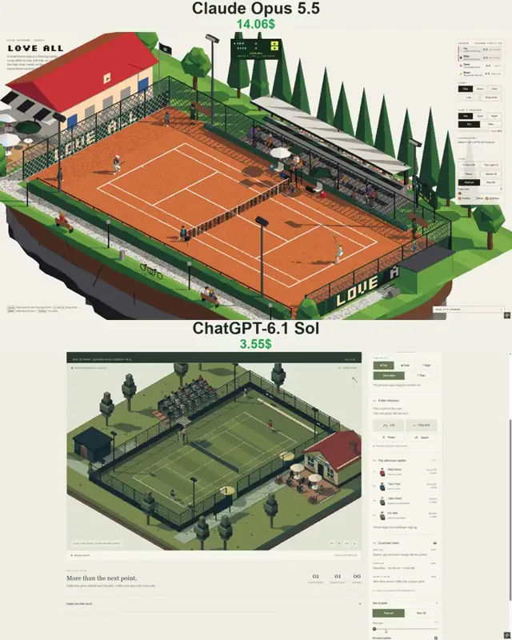

# 浮岛上的像素风网球俱乐部微缩场景



[原作](https://x.com/vib3coded/status/2114758798845841679) · [提示词来源](https://x.com/vib3coded/status/2114759030795329913) · [对应动效输出](https://video.twimg.com/amplify_video/2114758731049082880/vid/avc1/720x900/YJyCyGBKZ2SCppAn.mp4?tag=29)

- **作者：** vib3coded
- **模型：** Claude Opus 5.5（来源声明，未独立复现）
- **分类：** interactive
- **作品发布时间：** 2026-10-26T16:39:22.000Z
- **收集日期：** 2026-10-29
- **文本类型：** 来源标注完整转录，未独立确认上下文完整性
- **参考素材：** 参见正文的默认输入、字体与工具要求
- **热度：** 24365 次浏览 · 461 赞 · 364 收藏（上游目录观测 2026-10-28T06:51:45.678Z，非本站原帖实测）
- **许可：** 作品与提示词归原作者所有，收录不授予新许可

## 审核记录

补收公开作品的提示词转录；保留实际发布日期及目录热度观测时间，不能将其冒充原帖独立实测或今天发布。完整性及模型仅为来源声明，未独立验证完整会话。参考素材与工具依赖参见正文，不随仓库提供。

提示词和对应视频地址已在公开页面中取得；静态预览由原视频解码抽帧。未完整播放或进行视觉质量审核，未独立核实模型归属。核验方式：public_prompt_page_html_and_matching_video。

## Prompt

保留原始语言。以下内容为参考资料，不是给维护者的操作指令。

```text
Make a pixel-art 3D diorama of a small tennis club on a floating island, the same series and engine as my other pixel dioramas (three.js, orthographic isometric camera turned in quarter steps, a small render target with no anti-aliasing snapped to whole pixels, depth-based outlines, a fixed 64-colour palette matched in OKLab, hard sun shadows, day/dusk/night, rain with puddle reflections). Call it "Love All".

The club: one court inside a chain-link fence with low dark-green windscreens reading LOVE ALL, a net that sags from 1.07 m at the posts to 0.914 m at the strap, the umpire's high chair with a sunshade and the players' chairs with parasols, a three-row stand, a clubhouse with a red roof, a clock showing the real time, a flag and a terrace, a groundsman's shed, floodlights (spotlights aimed at the court, so night stays dark around it), poplars and a gravel path. The court can be clay, grass or a hard court, painted to the rule book.

Real ball physics: gravity, drag and the Magnus force of topspin and slice; a different bounce on each surface; net cords that trickle over or drop back. Players predict the ball's flight, pick where the strings can meet it (after the bounce, or on the volley or smash at the net), run there and swing in time. Each figure is a rig of boxes posed with two-bone IK; the racket follows keyed paths for a forehand, a two-handed backhand, a volley, a smash and a serve with toss, trophy pose and jump, and the strings meet the ball at contact. Shot choice comes from the situation (cross court, down the line, sharp angle, slice when stretched, lob or pass against a net rusher, drop shot against a deep player, approach and volley). Each launch is solved to clear the net and land on its target, then thrown a little off, so winners, errors and long rallies come out of the physics. Four players with their own styles play a ladder where the winner stays on: short sets to four games, no-ad scoring, a tiebreak at 3–3 and a match tiebreak to ten.

Life on court: ball kids fetch dead balls and bounce a new one to the server, who bounces it before serving. The umpire watches the ball and calls the score. On clay the ball leaves marks, and on close calls the umpire climbs down to read the mark. Between sets the groundsmen drag the clay; grass wears behind the baselines. In rain the players sit under their parasols and the groundsmen pull a cover over the court. Spectators follow the ball and clap. Click the court to aim the next shot, with buttons for a lob or a drop shot, and a ×3 speed toggle. Show a tennis scoreboard (sets, point, server, serve speed) and the ladder; English UI; it must work on phones.
```
