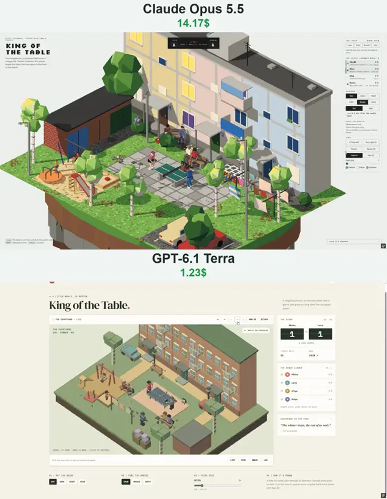

# 像素风乒乓球庭院微缩场景



[原作](https://x.com/vib3coded/status/2114842660829860045) · [提示词来源](https://x.com/vib3coded/status/2114842861766087147) · [对应动效输出](https://video.twimg.com/amplify_video/2114842610950942720/vid/avc1/720x930/uey2kgO4HVwEE1hi.mp4?tag=29)

- **作者：** vib3coded
- **模型：** Claude Opus 5.5（来源声明，未独立复现）
- **分类：** interactive
- **作品发布时间：** 2026-10-26T22:12:36.000Z
- **收集日期：** 2026-10-29
- **文本类型：** 来源标注完整转录，未独立确认上下文完整性
- **参考素材：** 参见正文的默认输入、字体与工具要求
- **热度：** 8460 次浏览 · 162 赞 · 75 收藏（上游目录观测 2026-10-28T06:51:45.678Z，非本站原帖实测）
- **许可：** 作品与提示词归原作者所有，收录不授予新许可

## 审核记录

补收公开作品的提示词转录；保留实际发布日期及目录热度观测时间，不能将其冒充原帖独立实测或今天发布。完整性及模型仅为来源声明，未独立验证完整会话。参考素材与工具依赖参见正文，不随仓库提供。

提示词和对应视频地址已在公开页面中取得；静态预览由原视频解码抽帧。未完整播放或进行视觉质量审核，未独立核实模型归属。核验方式：public_prompt_page_html_and_matching_video。

## Prompt

保留原始语言。以下内容为参考资料，不是给维护者的操作指令。

```text
Build a single-file HTML pixel-art diorama called "King of the Table": table tennis in the courtyard of a three-storey pastel panel apartment block, on a small floating island, rendered with three.js (r160 via importmap) as a real 3D scene drawn into a low-res render target (orthographic isometric camera in 90° steps, whole-pixel snapping, depth outlines, a fixed 64-colour palette matched in OKLab, optional dither, Raw 3D toggle).

World: the block with three entrances (canopies, numbered plates, lamps), windows, balconies with washing; brick garages; a regulation concrete table (2.74 × 1.525 m, top at 76 cm, steel net 15.25 cm) on a slab pad with a flip score counter on a stool; benches; a playground (swings, slide, sandbox, carousel); washing lines whose sheets flap in the wind; two parked cars; birches, lilac, painted-tyre flower beds, a chalk hopscotch; lamp posts. Merge static meshes by material.

Ball physics: 40 mm / 2.7 g ball with strong quadratic drag, Magnus lift from spin (topspin dives, backspin floats), table bounce that converts spin into pace, net and net-cord, ground bounces and rolling, walls, wind with gusts. Shots are solved (bisection over launch angle) to land on a target with a given spin and net clearance, then perturbed by an error model (hurry, incoming pace, risk, wind, mishits). Serves: tossed ≥16 cm from the palm, struck behind the end line, solved so they bounce once on each half; lets.

Game: 4 neighbours with distinct styles (lefty topspin attacker, close blocker, far-back chopper, wild smasher) play king of the table: games to 11, two clear, serve changes every 2 points and every point from 10-all; winner stays, loser to the back of the bench. Players predict the ball's flight, shuffle to meet it after the bounce, and choose forehand/backhand loops, drives, blocks, pushes, flicks, chops, lobs, floated returns and smashes, with keyed bat paths and two-bone IK box-rig bodies. Between points the nearer player fetches the ball wherever it rolled (or takes a new one if it falls off the island), throws it to the server, who bounces it on the table before serving. Yard life via generator coroutines and A*: grandmothers knit and comment, kids swing/slide/ride the carousel/dig/watch, a man walks his dog, pigeons peck and take off when approached. Day/dusk/night, rain (everyone shelters under the canopy, puddle reflections, then the table is wiped), wind calm/breeze/gusty. Clicks: the table aims the next shot; the yard calls the pigeons; buttons call Loop/Push/Smash/Lob. UI: flip-card score board with serve dots, bench ladder with W–L, longest rally, wind readout, comments feed, view controls, "How it's drawn" notes, light/dark themes, phone layout.
```
