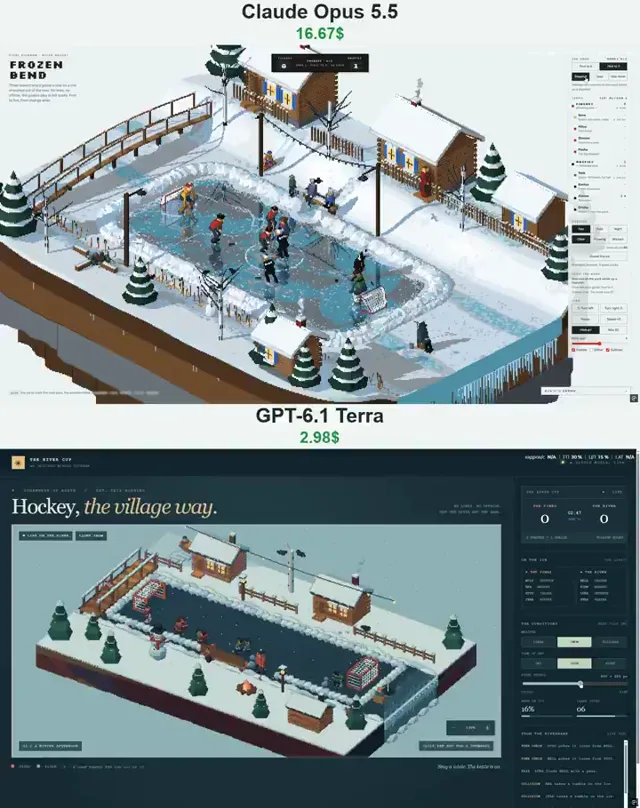

# 像素风冬日冰球场景对比



[原作](https://x.com/N1njaCodex/status/2114894485389791613) · [提示词来源](https://x.com/N1njaCodex/status/2114894686343049263) · [对应动效输出](https://video.twimg.com/amplify_video/2114894428850487296/vid/avc1/720x910/i3kOkaYxL1n1n7UM.mp4?tag=29)

- **作者：** N1njaCodex
- **模型：** Claude Opus 5.5（来源声明，未独立复现）
- **分类：** interactive
- **作品发布时间：** 2026-10-27T01:38:32.000Z
- **收集日期：** 2026-10-29
- **文本类型：** 来源标注完整转录，未独立确认上下文完整性
- **参考素材：** 参见正文的默认输入、字体与工具要求
- **热度：** 6796 次浏览 · 175 赞 · 102 收藏（上游目录观测 2026-10-28T06:51:45.678Z，非本站原帖实测）
- **许可：** 作品与提示词归原作者所有，收录不授予新许可

## 审核记录

补收公开作品的提示词转录；保留实际发布日期及目录热度观测时间，不能将其冒充原帖独立实测或今天发布。完整性及模型仅为来源声明，未独立验证完整会话。参考素材与工具依赖参见正文，不随仓库提供。

提示词和对应视频地址已在公开页面中取得；静态预览由原视频解码抽帧。未完整播放或进行视觉质量审核，未独立核实模型归属。核验方式：public_prompt_page_html_and_matching_video。

## Prompt

保留原始语言。以下内容为参考资料，不是给维护者的操作指令。

```text
Build a real-time pixel-art isometric diorama of hockey on a frozen river, as a single HTML page using three.js (WebGL). A floating winter island: a frozen river crosses it from edge to edge and spills off both ends as icicle falls. On the black ice, a rink has been shovelled out and walled with a ring of snow lumps, with a gap for the bench and a small red-framed net with white mesh at each end. The nets are set in from the walls so players can go behind them. The north bank climbs to a terrace with snow-roofed log houses (smoking chimneys, icicles on the eaves, lit windows), a fence, birches with crows and a sledging slope. The south shore is low: firs, a snowman, a fire and a small bath-house. Add a footbridge upstream and an ice fisherman on a box over his hole downstream. Render at low resolution with an orthographic camera, snap colours to a fixed 64-colour OKLab palette, draw depth outlines, and reflect the scene in the ice.
Play three skaters and a goalie a side, village rules: no lines, no offside. The goalies wear felt boots and pads. Skaters have momentum: pushes to accelerate, long glides, limited turning, and hockey stops with a spray of snow. They skate backwards when defending and fall and slide on their backs after collisions. Simulate the puck physically: low friction on ice and high on snow, solved passes (v0² = v² + 2ad), saucer passes over sticks, lifted shots aimed through a spot in the net, soft snow walls that can bury a hard puck, posts and crossbar.
AI: a chaser chosen by intercept time, attack and defence shapes, a presser and markers, poke checks, dekes, wristers, snapshots, slapshots, backhands, wraparounds and one-timers, plus blocked shots. Goalies read the shot from a forecast, drop into the butterfly, stretch, glove or kick out rebounds, and cover the puck.
An old man drops the puck at faceoffs, catches the puck the beaten goalie slides up to him, and tosses spares when a puck is lost in the snow. A dog digs the lost pucks out and brings them back.
The rink is a live canvas: skate blades scratch it white, falling snow settles on it and slows the puck, kids clear lanes with snow scoops, and between games the old man floods it from buckets into a mirror.
Village life: sledders, the fisherman catching perch, a woman crossing the bridge with a yoke of buckets, fans on a bench who comment, a boy on the snow wall who throws snowballs on click, crows, chimney smoke, breath in the frost. Day/dusk/night lighting with lamps, a string of bulbs and the fire; clear/snow/blizzard weather.
UI: a scoreboard, a side rail with team ladders, called moves, weather, snow on the ice and spare pucks, and a live feed. Original characters only, English UI, responsive down to phone width.
```
