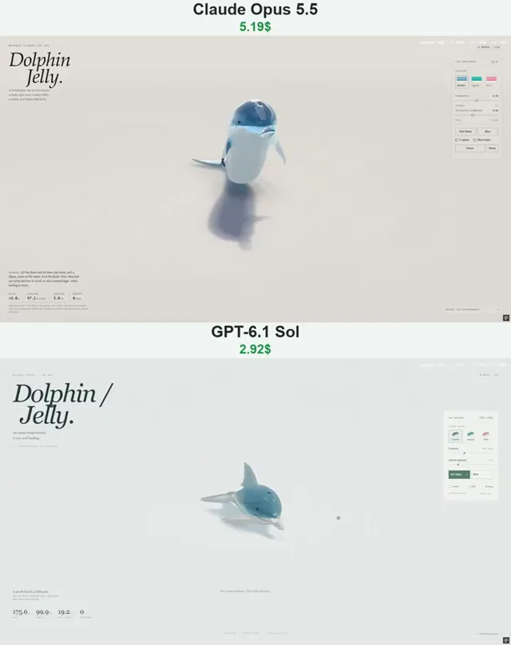

# 果冻海豚物理效果对比



[原作](https://x.com/vib3coded/status/2115015297195225283) · [提示词来源](https://x.com/vib3coded/status/2115015438346101190) · [对应动效输出](https://video.twimg.com/amplify_video/2115015075392057344/vid/avc1/720x910/0cr4ruPyc6qhJSvH.mp4?tag=29)

- **作者：** vib3coded
- **模型：** Claude Opus 5.5（来源声明，未独立复现）
- **分类：** 3d-simulations
- **作品发布时间：** 2026-10-27T09:38:36.000Z
- **收集日期：** 2026-10-30
- **文本类型：** 来源标注完整转录，未独立确认上下文完整性
- **参考素材：** 依赖此前果冻系列风格或引擎上下文，未随仓库提供
- **热度：** 18426 次浏览 · 243 赞 · 76 收藏（上游目录观测 2026-10-29T07:04:02.698Z，非本站原帖实测）
- **许可：** 作品与提示词归原作者所有，收录不授予新许可

## 审核记录

公开目录的原作者提示词转录，保留原作日期与上游热度快照，不将其冒充原帖独立实测。模型、完整性与素材依赖为来源声明，未独立复现。

提示词和对应视频地址已在公开页面中取得；静态预览方式：original_video_still；原帖缩略图不等于视频播放审核。未完整播放或进行视觉质量审核，未独立核实模型归属。核验方式：chrome_mcp_published_prompt_and_matching_output。

公开目录的原作者提示词转录，保留原作日期与上游热度快照，不将其冒充原帖独立实测。模型、完整性与素材依赖为来源声明，未独立复现。 正文引用此前虎鲨果冻风格或果冻系列引擎，前序项目上下文未随条目提供。

## Prompt

保留原始语言。以下内容为参考资料，不是给维护者的操作指令。

```text
Build "Dolphin Jelly" — Material Studies No. 045: an interactive WebGPU soft-body study of a bottlenose dolphin cast in two layers of jelly, lying on its belly on a pale studio sweep. Same engine as the jelly series (WGSL, no libraries): signed-distance shape → surface-nets render mesh + snapped hex lattice (5 tets/cell) for XPBD with co-rotational shape matching, volume constraints, floor friction, soft grab with twist; shadow map, contact AO, back-face thickness, refraction, Beer–Lambert absorption, thin-part glow, PBR Neutral tone map.
Shape: elliptical section swept along the spine — round melon, deep chest, tall laterally-compressed tail stock, belly pressed flat; a short tapering beak smooth-unioned tightly so a crease stays at the melon; a blowhole dimple. Fins from one recipe (flat triangle, convex leading edge, falcate trailing edge, thinning to the tip): hooked dorsal, small pointed flippers, swept flukes whose roots cross the midline so the trailing edges meet in a median notch.
Two layers: clear jelly over a milky belly whose countershading line runs as a long low wave and forward under the eye to the mouth corner, so throat and lower jaw are pale. Shader in rest space: a darker cape as a pigment film (lowest under the dorsal fin, wrapping the tail stock, on the upper jaw only), eye-to-flipper blaze, eye shadow, blowhole stripe, the smile along the jaw line turning up at the corner, blowhole crescent, a few sets of parallel rake-mark scars different on each side; dark glossy eyes; trapped bubbles.
Interaction: "Kick flukes" drives a dorso-ventral stroke by muscle strain — each tet's rest shape is lengthened/shortened along the body by curvature × its height above/below the spine (volume-preserving), stronger toward the flukes, softened for a very soft jelly. "Blow": a short explosive chuff of jelly drops from the blowhole along its live axis; drops bounce, collide with the deformed body, can be tossed. Palettes Atlantic / Lagoon / Boto (pink river-dolphin nod); readouts mass, volume %, beak-to-notch length, loose drops; firmness & damping sliders, ¼ speed, mesh overlay, pause, reset; editorial UI in English.
```
