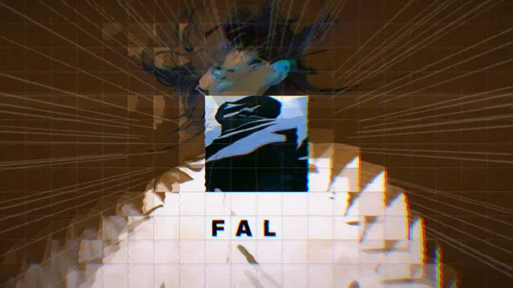

# 五条悟时间网格剪辑



[原作](https://x.com/aimikoda/status/2115118260060656126) · [提示词来源](https://x.com/aimikoda/status/2115118419741721086) · [对应动效输出](https://video.twimg.com/amplify_video/2115117961656619008/vid/avc1/480x270/XQxXKWdBkthpq7pt.mp4)

- **作者：** aimikoda
- **模型：** Claude Opus 5.5（来源声明，未独立复现）
- **分类：** music-audiovisual
- **作品发布时间：** 2026-10-27T16:27:44.000Z
- **收集日期：** 2026-10-30
- **文本类型：** 来源标注完整转录，未独立确认上下文完整性
- **参考素材：** 依赖原作者素材或上下文，未随仓库提供
- **热度：** 8165 次浏览 · 139 赞 · 97 收藏（上游目录观测 2026-10-29T07:04:02.698Z，非本站原帖实测）
- **许可：** 作品与提示词归原作者所有，收录不授予新许可

## 审核记录

公开目录的原作者提示词转录，保留原作日期与上游热度快照，不将其冒充原帖独立实测。模型、完整性与素材依赖为来源声明，未独立复现。

提示词和对应视频地址已在公开页面中取得；静态预览方式：original_post_video_thumbnail；原帖缩略图不等于视频播放审核。未完整播放或进行视觉质量审核，未独立核实模型归属。核验方式：chrome_mcp_published_prompt_and_matching_output。

## Prompt

保留原始语言。以下内容为参考资料，不是给维护者的操作指令。

```text
Create a high-energy 16:9 temporal poster-grid music video, exactly matching the full duration of the supplied music.

GRID STRUCTURE:
Divide the entire frame into a dense 20×12 matrix of near-square cells separated by ultra-thin grey lines. Preserve one continuous, recognizable image across the grid rather than displaying unrelated images. The grid acts as a unified visual canvas with independently animated temporal fragments.

TEMPORAL CHOREOGRAPHY:
Keep the central 4×4 region anchored to the primary action, maintaining recognizable movement and visual continuity. Surrounding cells explore different moments of the same footage through staggered time offsets, rapid repetitions, reversed motion, delayed echoes, speed ramps, micro-loops and impact freezes.

Create complex rhythmic patterns: diagonal temporal cascades, radial time ripples, expanding freeze-frame waves, checkerboard reversals, alternating motion phases and synchronized frame resets. Allow temporal distortions to propagate across neighboring cells like chain reactions.

VISUAL EFFECTS:
Layer sophisticated graphic treatments driven by the music:
- Chromatic aberration and RGB channel displacement
- Directional motion smears and multi-frame ghost trails
- Glitch propagation and digital frame tearing
- High-contrast monochrome flashes and selective color isolation
- Halftone textures, manga speed lines and graphic silhouettes
- Pixel sorting, scanline interference and datamosh-like distortions
- Grid warping, cell displacement and elastic boundary deformation
- Stroboscopic impact frames and negative-image flashes
- Temporal feedback loops and recursive motion echoes
- Brief typography fragments, abstract symbols and kinetic graphic overlays

RHYTHMIC EDITING:
Analyze the soundtrack's beats, accents, transitions and energy progression. Synchronize cell activity, temporal shifts, visual effects and grid transformations precisely to the music.

Use restrained motion during quieter passages, escalating into dense synchronized chaos during climaxes. On major impacts, trigger cascading temporal explosions across the grid, followed by sudden unified resets.

VISUAL COHERENCE:
Maintain the source footage's original characters, compositions and visual identity. The grid must remain structurally recognizable even during aggressive effects. Prioritize creative temporal manipulation over random glitch noise.

Make the result feel like an experimental motion-design masterpiece: dense, rhythmic, kinetic, visually intricate and deliberately choreographed.
```
