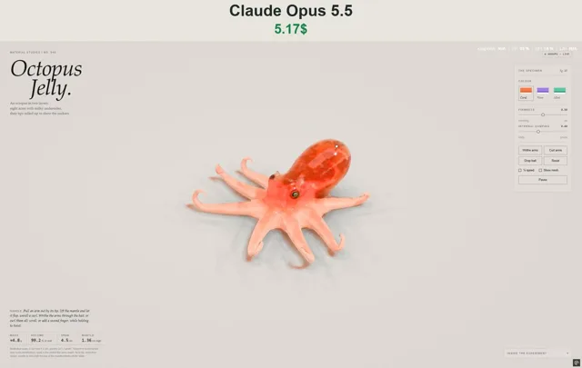

# 可交互的果冻章鱼软体模拟



[原作](https://x.com/vib3coded/status/2115173334031737112) · [提示词来源](https://x.com/vib3coded/status/2115173563669864948) · [对应动效输出](https://video.twimg.com/amplify_video/2115173259561848833/vid/avc1/426x270/kzQvCMzwqJbTVQvs.mp4)

- **作者：** vib3coded
- **模型：** Claude Opus 5.5 / fable-5.5（来源声明，未独立复现）
- **分类：** 3d-simulations
- **作品发布时间：** 2026-10-27T20:06:35.000Z
- **收集日期：** 2026-10-30
- **文本类型：** 来源标注完整转录，未独立确认上下文完整性
- **参考素材：** 依赖此前果冻系列风格或引擎上下文，未随仓库提供
- **热度：** 9566 次浏览 · 184 赞 · 64 收藏（上游目录观测 2026-10-29T07:04:02.698Z，非本站原帖实测）
- **许可：** 作品与提示词归原作者所有，收录不授予新许可

## 审核记录

公开目录的原作者提示词转录，保留原作日期与上游热度快照，不将其冒充原帖独立实测。模型、完整性与素材依赖为来源声明，未独立复现。

提示词和对应视频地址已在公开页面中取得；静态预览方式：original_post_video_thumbnail；原帖缩略图不等于视频播放审核。未完整播放或进行视觉质量审核，未独立核实模型归属。核验方式：chrome_mcp_published_prompt_and_matching_output。

公开目录的原作者提示词转录，保留原作日期与上游热度快照，不将其冒充原帖独立实测。模型、完整性与素材依赖为来源声明，未独立复现。 正文引用此前虎鲨果冻风格或果冻系列引擎，前序项目上下文未随条目提供。

## Prompt

保留原始语言。以下内容为参考资料，不是给维护者的操作指令。

```text
Make an interactive WebGPU soft-body study of an octopus cast in two layers of jelly, in the same studio style as the tiger shark jelly: a domed head with eyes in raised sockets (golden iris, horizontal bar pupil) and a small horn over each, a big soft mantle leaning back, a funnel on the flank, and a web joining eight arms. Each arm is a chain of tapering capsules laid out by integrating curvature: a gentle sweep across the table, then the outer third rolls up off the table into a curl so the two staggered rows of pale suckers face out. The underside of every arm is a milky layer, the back has a chromatophore mottle and small papillae. XPBD tetrahedral sim with firmer arm tips; muscle strain makes the arms writhe (sideways bending waves out along each arm, phased arm to arm) and curl up and let go. Drag to stretch and lift, drop bait beads, three colourways (coral, plum, mint), live mass, volume, arm span and mantle height readouts.
```
