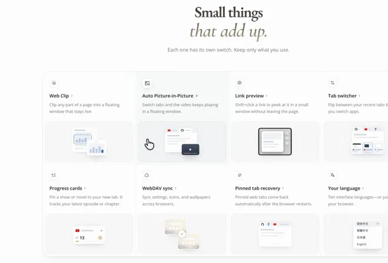

# 产品官网动态便当格功能展示



[原作](https://x.com/Kubai087/status/2115393082472681875) · [提示词来源](https://x.com/Kubai087/status/2115393082472681875) · [对应动效输出](https://video.twimg.com/amplify_video/2115391937515790336/vid/avc1/1060x720/WLKC37q71HeXzadR.mp4?tag=29)

- **作者：** Kubai087
- **模型：** Claude Opus 5.5（来源声明，未独立复现）
- **分类：** product-brand
- **作品发布时间：** 2026-10-28T10:39:47.000Z
- **收集日期：** 2026-10-31
- **文本类型：** 来源标注完整转录，未独立确认上下文完整性
- **参考素材：** 依赖原作者素材或上下文，未随仓库提供
- **热度：** 8771 次浏览 · 170 赞 · 199 收藏（上游目录观测 2026-10-30T07:06:01.011Z，非本站原帖实测）
- **许可：** 作品与提示词归原作者所有，收录不授予新许可

## 审核记录

公开目录转录，Chrome MCP核对正文长度和对应视频；热度为上游快照，模型与完整性为来源声明，未独立复现。简短要求不等于完整工作流，未知许可不授予新权利。

提示词和对应视频地址已在公开页面中取得；静态预览方式：original_video_still；原帖缩略图不等于视频播放审核。未完整播放或进行视觉质量审核，未独立核实模型归属。核验方式：chrome_mcp_public_prompt_and_matching_output。

## Prompt

保留原始语言。以下内容为参考资料，不是给维护者的操作指令。

```text
# Small animations for a product site's feature tiles

Give every tile in my site's feature grid a small animation: a tiny scene that shows what the feature does.

## 0. Before you build
- Read the project: find out the tech stack (plain HTML/CSS, React, Vue, Svelte, Astro, Tailwind, Framer Motion…) and build it the way the project already does. Don't add an animation library unless the project already uses one.
- Ask me which look to use:
A. The Lumno material below, as written.
B. My product's own style: take the colors, radii, borders and shadows from my existing design tokens and components, and keep only the structure and motion rules from this prompt.
C. A mix: the Lumno material in my brand's accent color and radii.
- Picking features: if I named features, animate those. If not, read the product's site, docs or code, list 3–5 features that a short scene can explain, and let me pick.

## 1. Lumno material (option A)
Overall: quiet, neutral, precise. Hairlines instead of borders, soft shadows tinted warm, no gradients or color washes, one accent color.

- Grid: one card with an outer radius of 28px. Cells are separated by 1px hairlines (a 1px grid gap over a hairline color). Cells are white. The card has a faint hairline ring and a soft shadow.
- Art panel: inset 8px from the cell edge, with a radius of the card radius minus the inset (20px), so corners stay concentric.
- Fill #fafafa, plus an inner 1px ring: box-shadow: inset 0 0 0 1px rgba(32,38,46,.07).
- Texture: background: repeating-linear-gradient(-45deg, rgba(32,38,46,.06) 0 1px, transparent 1px 7px).
- The scene sits centred on the panel, about 126×118px.
- Text bars: body bars 4px tall with a 2px radius in #e5e9ef; heading bars 5px tall in #cdd4de. Vary the widths (34–92px).
- Mini windows and cards: white with a 9px radius.
- Shadow: 0 0 0 1px rgba(47,42,34,.06), 0 8px 20px -10px rgba(47,42,34,.25).
- Tab strip: 20px tall, #eef1f5. Tabs: 16px tall with 6px top corners; the active tab is white.
- Favicons: 10px.
- Inner surfaces such as charts or fields: #f4f6fa. Secondary data: #b9c9e0. Accent: #3462ad, used only on the result.
- Icon chip (top-left of each tile): 32px, 10px radius, 1px border rgba(32,38,46,.1), white, shadow 0 1px 2px rgba(32,38,46,.05), a line-style glyph in #4b5563.
- Text color: a warm near-black, #2f2a22.
- Hover: the cell darkens to about 2.5% grey; the panel goes to #f4f5f6 with its ring at .09; the icon chip grows 32→36px from its top-left corner, its glyph turns to the text color, and its shadow deepens slightly.
- Dark mode (suggested values; keep the same relationships):
- Cells #17181a, panel #1d1f22, inner ring rgba(255,255,255,.06), texture rgba(255,255,255,.04).
- Body bars #2c2f34, heading bars #3a3e45.
- Windows #24272b with a 1px rgba(255,255,255,.06) outline and a shadow of 0 8px 20px -10px rgba(0,0,0,.6).
- Tab strip #1a1c1f, accent #6f9bea, text #ecebe8.

## 2. Scene
- One idea per tile: 2–4 moves that show "action → result", such as "click → a small window opens" or "change here → the other side syncs".
- Abstract wireframes only: no screenshots and no real text. Use at most one small icon where something needs to be recognisable.
- Motion: ease-out for movement, cubic-bezier(.22,1,.36,1); a slight spring for appearing, cubic-bezier(.34,1.4,.64,1). Each move takes 250–600ms; the whole scene is done in about 3s.
- Icon chip: when the tile plays, its glyph redraws stroke by stroke (draw, pop or slide per part), then hands back to the solid icon.

## 3. Playback
- Resting styles are the final frame. Animations only describe where things come from (fill-mode: both or equivalent), so reduced motion shows the result and an interrupted play never jumps.
- The art panel fades in (opacity, plus translateY 6px and scale .97 to none) as its tile first plays.
- Play once in view: when about 70% of the tile is visible, wait ~200ms, then play. Tiles that enter together go ~250ms apart, in reading order. Stop on the final frame.
- One "played" state (a class or data attribute) drives every animation in the tile. To replay: remove it, force a reflow, add it back (or re-key in a framework).
- On mouse hover (mouse only) or keyboard focus, replay: blur the final frame out over ~160ms (blur 6px, opacity 0), restart under the blur, then clear it. Don't restart a play that hasn't finished.
- Optional loop on hover: while the pointer stays on the tile, replay again ~600ms after each play ends. When the pointer leaves, finish the current play and rest on the final frame.
- Touch: a tap follows the tile's link; nothing depends on hover.
- prefers-reduced-motion: reduce: no animation; show the final frame.

## 4. Colors and dark mode
- Every color is a variable on the art panel (panel, ring, texture, bars, windows, tab strip, accent, shadow); no hard-coded colors in the rules.
- Follow prefers-color-scheme, and the project's manual theme switch too (a class or data-theme), if it has one.
- Check it in both light and dark.

## 5. Delivery
- Mark the art as decorative (aria-hidden) and keep translatable text out of it.
- Check it in a real browser: first play, hover replay, keyboard focus, reduced motion, dark mode and a phone-width layout.
```
